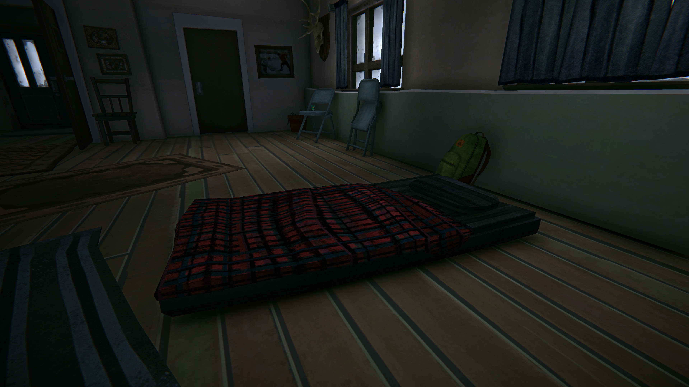

# Bed

**Categories:** Beds, Interactable Objects, Interactable objects, Story items · **Source:** [Fandom](https://thelongdark.fandom.com/wiki/Bed)

**Contents**

- [Overview](#overview)
- [Variants](#variants)
- [Health recovery](#health-recovery)
- [Trivia](#trivia)
- [Gallery](#gallery)

**Bed**

| \[\[File: /  / _Full_ /  / _Twin_ /  / _Cot_ /  / _Bunk bed_ /  / _Mattress_ /  / _Hay_ /  / _Tuffet_ /  / _Medical Cot_ /  / _Blanket_ | 250px\]\] |
| --- | --- |
| **General** |  |
| Item Type | Item |
