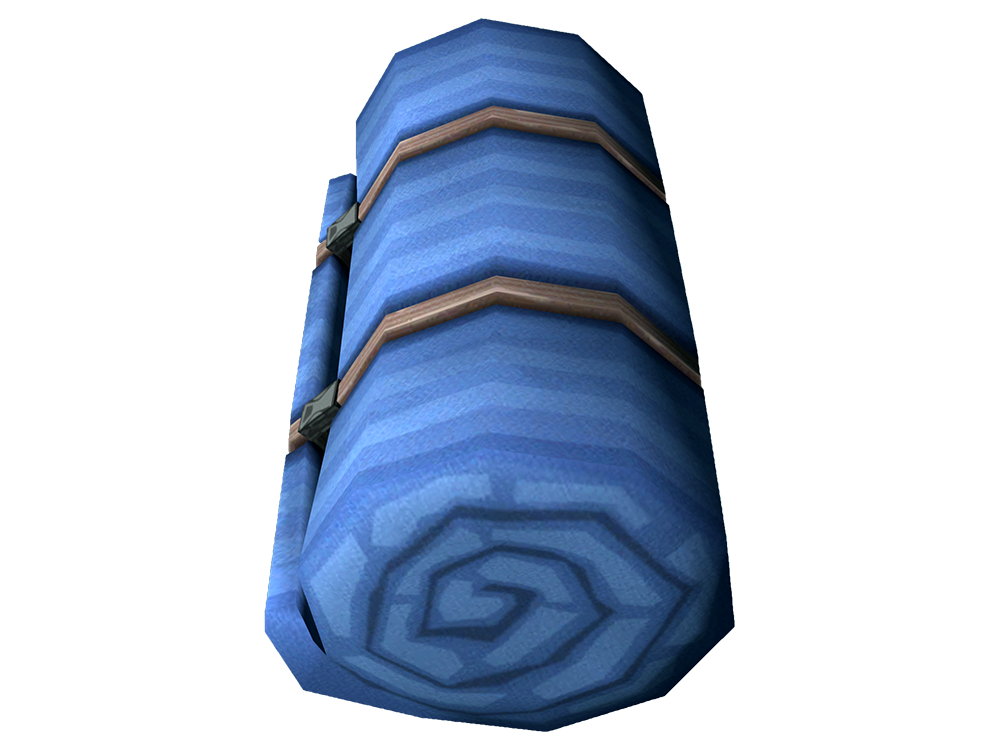

# Bedroll

**Contents**

- [Overview](#overview)
- [Features](#features)
- [Spawn Locations](#spawn-locations)
- [Products](#products)
- [Tips](#tips)
- [Gallery](#gallery)

**Bedroll**

| Property | Details |
| --- | --- |
|  |  / *bedroll\_icon.png* |
| **General** |  |
| Item Type | Tool\|- |
| **Statistics** |  |
| Weight | 1.00 kg(2.2 lbs) |
| Warmth bonus | 5.0 °C(9 °F) |
| Harvest | 90 Minutes 10 × [Cloth](./Cloth.md) |
| Repair | 45 Minutes 2 × [Cloth](./Cloth.md) / 30% Condition |

*This is about the normal cloth bedroll. For a list of other bedrolls see here.*

> “**A down-filled sleeping bag.**”
>
> — In-game description

The **Bedroll** is a tool for sleeping without a bed in *The Long Dark*.

## Overview

The Bedroll is a tool which allows [sleep](./Sleep.md) at almost any location indoors or outside. It cannot be crafted but can be found at multiple locations in most [regions](./Region.md). The Bedroll requires 2 [cloth](./Cloth.md) and a [Sewing Kit](./Sewing%20Kit.md) or [Fishing Tackle](./Fishing%20Tackle.md) to be repaired.

## Features

Bedrolls must be deployed to use ("use" in the inventory, or via the [Radial Menu](./Radial%20Menu.md)). When deployed they may be slept in indoors or outside, restoring fatigue and also condition if all 4 needs are met. The rate of Condition restored when using a Bedroll is slower than with a proper beds or a [Bear Skin Bedroll](./Bear%20Skin%20Bedroll.md) (see [Sleep](./Sleep.md)). When used Bedrolls provide warmth based on the bedroll's current condition (similar to [Clothes](./Clothing.md)).

The Bedroll is lighter than the [Bearskin Bedroll](./Bear%20Skin%20Bedroll.md) (1kg vs 3kg). Bedrolls decay slowly over time, and quickly while being used.

As of Part 3: Frontier Comforts update for those who purchase the [Tales from the Far Territory](./Tales%20from%20the%20Far%20Territory.md) expansion, the bedroll can be [improved](./Improvised%20Down%20Bedroll.md).

## Spawn Locations

- Inside the Train Car in [Mystery Lake](./Mystery%20Lake%20%28region%29.md).
- Inside a Pipe at the [Carter Hydro Dam](./Carter%20Hydro%20Dam.md) where the [Exit](./Carter%20Hydro%20Dam.md#Exit) to the Lower Dam leads.
- Inside a Cave in [Hushed River Valley](./Hushed%20River%20Valley.md).
- Next to the front door in [Quonset Garage](./Quonset%20Garage.md).
- Next to the front entrance of the [Stone Church](./Stone%20Church.md).

## Products

## Tips

- Bedrolls are useful or even life-saving in cold or remote regions ([Hushed River Valley](./Hushed%20River%20Valley.md), [Ash Canyon](./Ash%20Canyon.md), [Timberwolf Mountain](./Timberwolf%20Mountain.md), [Bleak Inlet](./Bleak%20Inlet.md), [Forlorn Muskeg](./Forlorn%20Muskeg.md), and [Pleasant Valley](./Pleasant%20Valley.md)), and on harder survival modes (with colder world temperatures and faster [Condition](./Condition.md) damage from [freezing](./Needs.md)).
- Care should be taken not to freeze to death (Stalker and Interloper) while sleeping with a bedroll, especially outside. This includes checking the current temperature, weather conditions, fire duration, and not sleeping for many hours at a time.
- Sleeping near [Wildlife](./Wildlife.md) can be dangerous, and lead to a [Struggle](./Struggle.md).
- Bedrolls are useful for overcoming [Cabin Fever](./Cabin%20Fever.md).
- Sleeping without a bedroll is possible inside [cars and trucks](./Car.md) by entering the vehicle and selecting "sleep" from the Radial Menu (campcraft).

## Gallery

| Column 1 |
| --- |
|  / *Old model.* |

**Lua execution error in Module:Navbox function navbox**

[ru:Спальный\_мешок](ru:%D0%A1%D0%BF%D0%B0%D0%BB%D1%8C%D0%BD%D1%8B%D0%B9_%D0%BC%D0%B5%D1%88%D0%BE%D0%BA)
