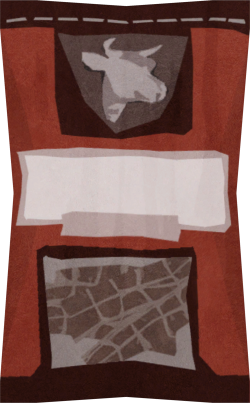

# Beef Jerky

<table class="infobox">
<caption>Beef Jerky</caption>
<colgroup>
<col style="width: 50%" />
<col style="width: 50%" />
</colgroup>
<tbody>
<tr>
<td colspan="2"><figure>

<figcaption>Beef_Jerky_icon.png</figcaption>
</figure></td>
</tr>
<tr>
<td>
Release
</td>
<td>
<a href="./The%20Long%20Dark%20%E2%80%94%20Changelog.md#0.117" class="wikilink" title="22 September 2014">22 September 2014</a>
</td>
</tr>
<tr>
<td>
Wintermute
</td>
<td>
No
</td>
</tr>
<tr>
<td>
Renewable
</td>
<td>
Yes (rare <a href="./Beachcombing.md" class="wikilink" title="Beachcombing">Beachcombing</a>)
</td>
</tr>
<tr>
<td colspan="2" class="section">
<strong>Properties</strong>
</td>
</tr>
<tr>
<td>
Item type
</td>
<td>
<a href="./Food%20And%20Drink.md" class="wikilink" title="Food And Drink">Food And Drink</a>|-
</td>
</tr>
<tr>
<td>
Stackable
</td>
<td>
No
</td>
</tr>
<tr>
<td>
Examine
</td>
<td>
Package of Beef Jerky. Tasty and pretty much lasts forever.
</td>
</tr>
<tr>
<td colspan="2" class="section">
<strong>Values</strong>
</td>
</tr>
<tr>
<td>
Calories
</td>
<td>
350 kcal
</td>
</tr>
<tr>
<td>
Hydration
</td>
<td>
-10%
</td>
</tr>
<tr>
<td>
Weight
</td>
<td>
0.10 kg (0.22 lbs)
</td>
</tr>
<tr>
<td colspan="2" class="section">
<strong>Advanced data</strong>
</td>
</tr>
<tr>
<td>
Item key
</td>
<td>
GAMEPLAY_BeefJerky
</td>
</tr>
</tbody>
</table>

**Beef Jerky** is a packaged <a href="./Food%20And%20Drink.md" class="wikilink" title="food">food</a> item in *<a href="./The%20Long%20Dark.md" class="wikilink" title="The Long Dark">The Long Dark</a>*.

Beef Jerky features a high energy density, making it a valuable food item. Additionally, Beef Jerky can never cause <a href="./Food%20Poisoning.md" class="wikilink" title="Food Poisoning">Food Poisoning</a>, and <a href="./Decay.md" class="wikilink" title="decay">decay</a> extremely slowly especially outdoors (100 days per 1% Condition).

## Trivia

- Beef Jerky's logo, coloration and font is likely based on the real-life "Jack Link's" brand, which is also rich in preservatives like description.
- The back of the bag lists "Ingredients: Beef, Sugar, Soy Sauce, Salt, Cayenne Pepper, Natural Flavours" and that it was "Made in Canada"

## Gallery

<table class="gallery">
<colgroup>
<col style="width: 100%" />
</colgroup>
<tbody>
<tr>
<td><figure>

<figcaption>Old model</figcaption>
</figure></td>
</tr>
</tbody>
</table>

## Update history

- UPDATE **22 September 2014 (<a href="./The%20Long%20Dark%20%E2%80%94%20Early%20Access%20Changelog.md#0.117" class="wikilink" title="Update">Update</a>):**
  - Added to game.

**Lua execution error in Module:Navbox function navbox** <a href="ru:%D0%92%D1%8F%D0%BB%D0%B5%D0%BD%D0%B0%D1%8F_%D0%B3%D0%BE%D0%B2%D1%8F%D0%B4%D0%B8%D0%BD%D0%B0" class="wikilink" title="ru:Вяленая_говядина">ru:Вяленая_говядина</a> <a href="fr:B%C5%93uf_s%C3%A9ch%C3%A9" class="wikilink" title="fr:Bœuf séché">fr:Bœuf séché</a> <a href="es:Cecina_de_ternera" class="wikilink" title="es:Cecina de ternera">es:Cecina de ternera</a>

