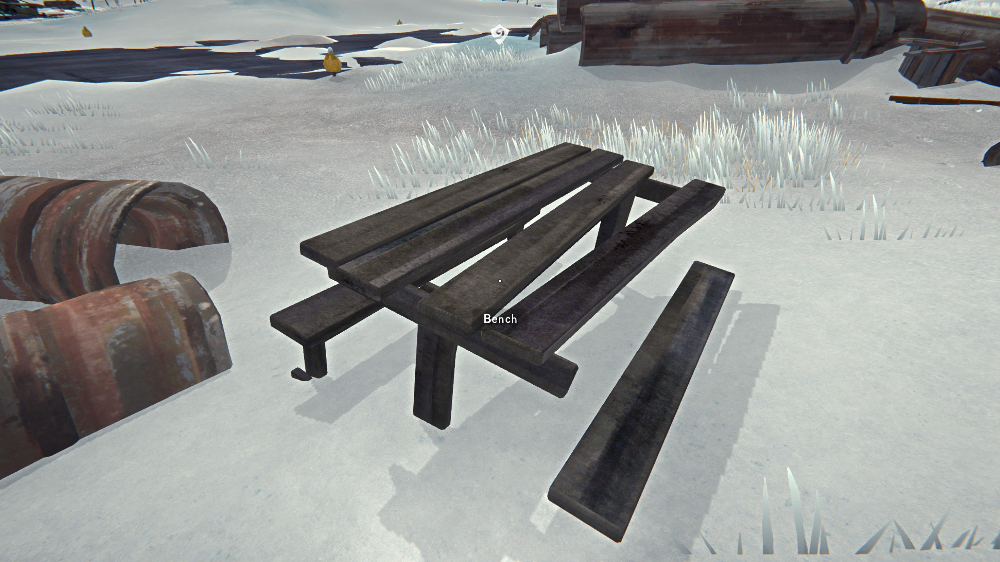
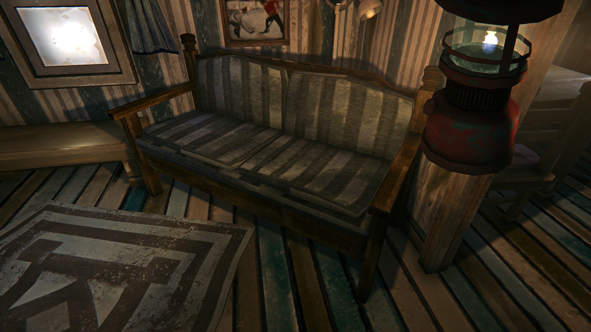

# Bench

**Contents**

- [Bench Table](#bench-table)
- [Bench Couch](#bench-couch)
- [Bench Chair](#bench-chair)
- [Small Bench Table](#small-bench-table)

**Bench**

| Property | Details |
| --- | --- |
| \[\[File: / \| Column 1 \| Column 2 \| Column 3 \| Column 4 \| / \| --- \| --- \| --- \| --- \| / \|  / *Bench Table* \|  / *Couch* \|  / *Chair Bench* \|  / *Small Table* \| | 250px\]\] |
|  / *Bench Table* |  / *Couch* /  / *Chair Bench* /  / *Small Table* |
| **General** |  |
| Item Type | Item |
| Wintermute | No |

**Benches** are wooden tables either used for chairs or tables, and can be harvested with a [Hatchet](./Hatchet.md) for [Reclaimed Wood](./Reclaimed%20Wood.md).

## Bench Table

A Park table with built in chairs yield 8 reclaimed wood, 1 [Tinder Plug](./Tinder%20Plug.md), require a Hatchet to harvest, and take 1.5 hours to harvest.

## Bench Couch

A couch found in many homes that can be harvested with a Hatchet and yields 3 [Cloth](./Cloth.md), 5 Reclaimed Wood, and 1 Tinder Plug and takes 2 hours and 30 minutes to harvest.

## Bench Chair

Park chair benches yield 6 reclaimed wood, require a hatchet to harvest, and take 1 hour to harvest.

## Small Bench Table

Park tables yield 4 reclaimed wood, require a hatchet to harvest, and take 30 minutes to harvest.

**Lua execution error in Module:Navbox function navbox** [ru:Мебель и другие предметы под разбор#Древесина](ru:%D0%9C%D0%B5%D0%B1%D0%B5%D0%BB%D1%8C_%D0%B8_%D0%B4%D1%80%D1%83%D0%B3%D0%B8%D0%B5_%D0%BF%D1%80%D0%B5%D0%B4%D0%BC%D0%B5%D1%82%D1%8B_%D0%BF%D0%BE%D0%B4_%D1%80%D0%B0%D0%B7%D0%B1%D0%BE%D1%80#%D0%94%D1%80%D0%B5%D0%B2%D0%B5%D1%81%D0%B8%D0%BD%D0%B0) [es:banco](es:banco)
