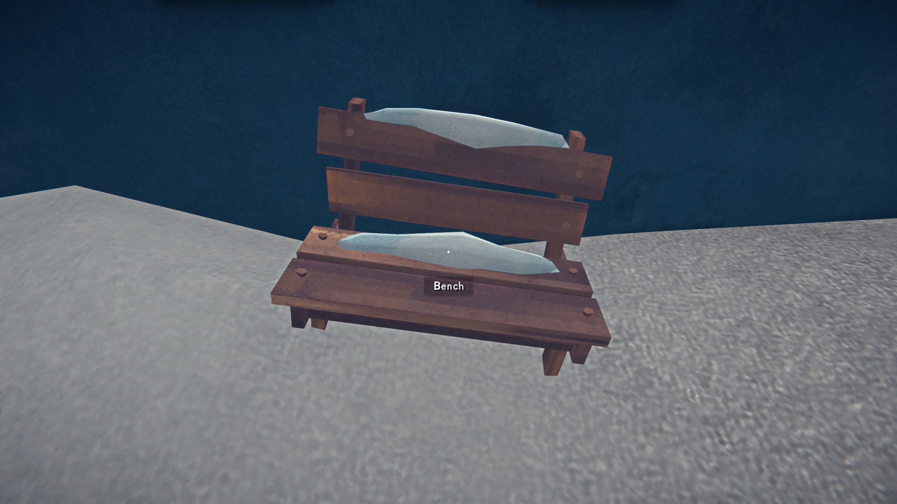
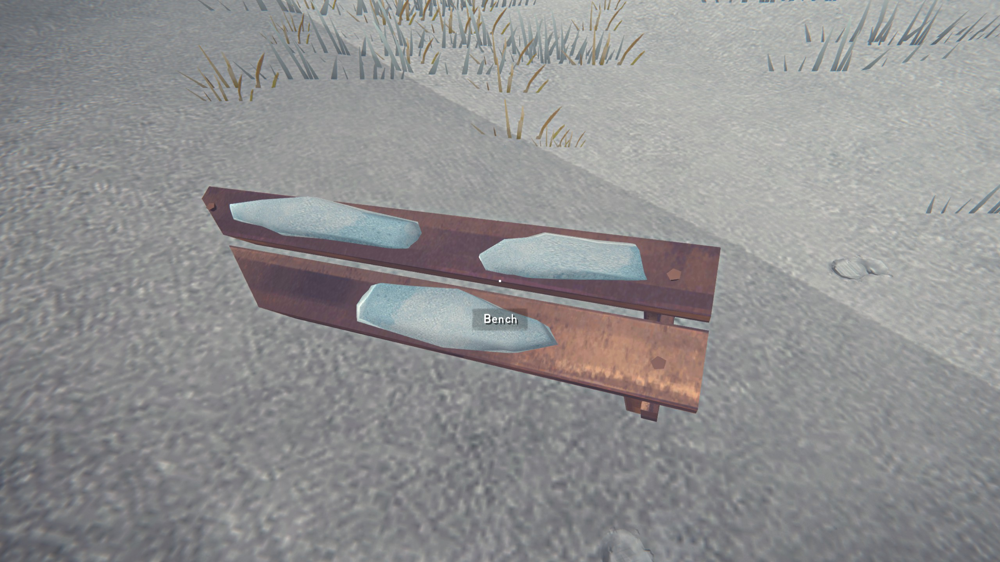

# Bench

**Categories:** Interactable Objects · **Source:** [Fandom](https://thelongdark.fandom.com/wiki/Bench)

**Contents**

- [Bench Table](#bench-table)
- [Bench Couch](#bench-couch)
- [Bench Chair](#bench-chair)
- [Small Bench Table](#small-bench-table)

**Bench**

\[\[File: /  / _Bench Table_ /  / _Couch_ /  / _Chair Bench_ /  / _Small Table_

250px\]\]

_Bench Table_

_Couch_

_Chair Bench_

_Small Table_

**General**

**Item Type:** Item

**Wintermute:** No

**Benches** are wooden tables either used for chairs or tables, and can be harvested with a [Hatchet](./Hatchet.md) for [Reclaimed Wood](./Reclaimed%20Wood.md).

## Bench Table

A Park table with built in chairs yield 8 reclaimed wood, 1 [Tinder Plug](./Tinder%20Plug.md), require a Hatchet to harvest, and take 1.5 hours to harvest.

## Bench Couch

A couch found in many homes that can be harvested with a Hatchet and yields 3 [Cloth](./Cloth.md), 5 Reclaimed Wood, and 1 Tinder Plug and takes 2 hours and 30 minutes to harvest.

## Bench Chair

Park chair benches yield 6 reclaimed wood, require a hatchet to harvest, and take 1 hour to harvest.

## Small Bench Table

Park tables yield 4 reclaimed wood, require a hatchet to harvest, and take 30 minutes to harvest.
