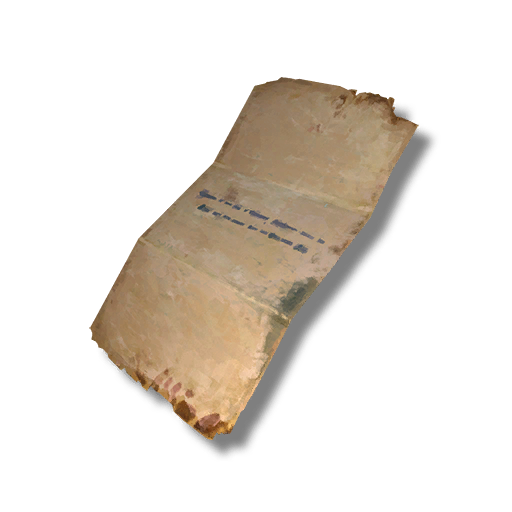

# Betrayal

<table class="infobox">
<caption>Betrayal</caption>
<colgroup>
<col style="width: 50%" />
<col style="width: 50%" />
</colgroup>
<tbody>
<tr>
<td colspan="2"><figure>

<figcaption>Betrayal_icon.png</figcaption>
</figure></td>
</tr>
<tr>
<td>
Release
</td>
<td>
<a href="./The%20Long%20Dark%20%E2%80%94%20Early%20Access%20Changelog.md#1.00" class="wikilink" title="1 August 2017">1 August 2017</a>
</td>
</tr>
<tr>
<td>
Wintermute
</td>
<td>
<a href="./Episode%201%20-%20Do%20Not%20Go%20Gentle.md" class="wikilink" title="Episode 1">Episode 1</a>
</td>
</tr>
<tr>
<td colspan="2" class="section">
<strong>Properties</strong>
</td>
</tr>
<tr>
<td>
Item type
</td>
<td>
<a href="./Collectibles.md" class="wikilink" title="Collectibles">Collectibles</a>|-
</td>
</tr>
<tr>
<td>
Stackable
</td>
<td>
No
</td>
</tr>
<tr>
<td>
Examine
</td>
<td>
Quick note scratched on the back of a scrap of paper.
</td>
</tr>
<tr>
<td colspan="2" class="section">
<strong>Values</strong>
</td>
</tr>
<tr>
<td>
Weight
</td>
<td>
0.00 kg (0 lbs)
</td>
</tr>
<tr>
<td colspan="2" class="section">
<strong>Actions</strong>
</td>
</tr>
<tr>
<td>
Backpack
</td>
<td>
Examine
</td>
</tr>
<tr>
<td>
On ground
</td>
<td>
Take It, Read Text, Leave It
</td>
</tr>
<tr>
<td colspan="2" class="section">
<strong>Advanced data</strong>
</td>
</tr>
<tr>
<td>
Item key
</td>
<td>
GAMEPLAY_MiltonLetter2
</td>
</tr>
</tbody>
</table>

**Betrayal** is a <a href="./Collectibles.md" class="wikilink" title="Collectible">Collectible</a> item found in <a href="./Episode%201%20-%20Do%20Not%20Go%20Gentle.md" class="wikilink" title="Episode 1">Episode 1</a> of the <a href="./Wintermute.md" class="wikilink" title="Wintermute">Wintermute</a> story mode. It is located on the dash of the green car across from <a href="./Milton%20House%20%28Grey%20Mother%27s%29.md" class="wikilink" title="Milton House (Grey Mother&#39;s)">Milton House (Grey Mother's)</a>, directly next to the <a href="./Milton%20Credit%20Union.md" class="wikilink" title="Milton Credit Union">Milton Credit Union</a>.

Currently, the collectible serves no additional purpose during <a href="./Episode%201%20-%20Do%20Not%20Go%20Gentle.md" class="wikilink" title="Episode 1">Episode 1</a>.

## Transcript

The following text is transcribed from **Betrayal**

I left him like I promised I would, and I waited here like you asked. Where are you? It's getting too cold to sit here. Pick me up at the old PO when you can and let's get out of here. If you don't pick me up by midnight, I'm out of here on my own.

## Update history

- UPDATE **1 August 2017 (<a href="./The%20Long%20Dark%20%E2%80%94%20Changelog.md#1.00" class="wikilink" title="Update">Update</a>):**
  - Added to game.

**Lua execution error in Module:Navbox function navbox**

