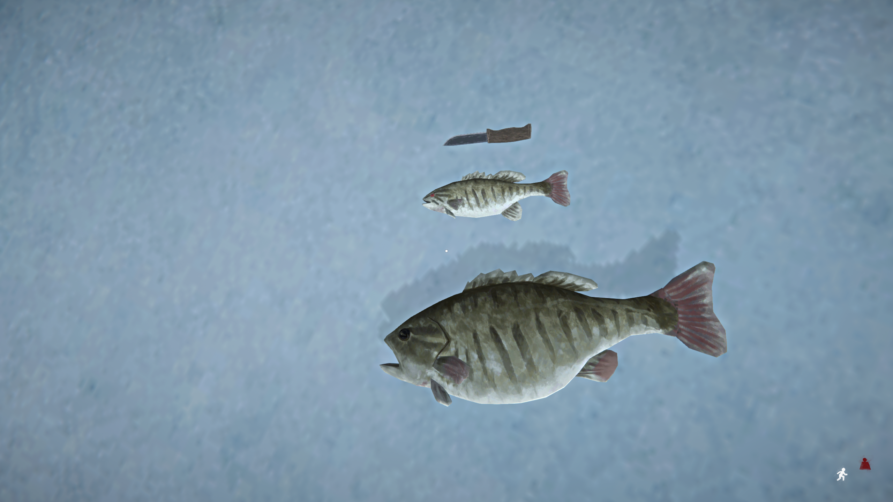

# Big Bass \(Raw\)

<table>
<colgroup>
<col style="width: 33%" />
<col style="width: 33%" />
<col style="width: 33%" />
</colgroup>
<tbody>
<tr>
<td width="40px"><figure>

<figcaption>2120907963_TLD-Wintermute-v2.png.de8a285930f6a8f5ad9cf5878754cf5b.png</figcaption>
</figure></td>
<td>
<strong>Wintermute-Exclusive content.</strong> 

This content only appears in <a href="./Wintermute.md" class="wikilink" title="Wintermute">Wintermute</a>.

</td>
<td>
|}

<table class="infobox">
<caption>Big Bass (Raw)</caption>
<colgroup>
<col style="width: 33%" />
<col style="width: 33%" />
<col style="width: 33%" />
</colgroup>
<tbody>
<tr>
<td colspan="2">
[[File:

<table class="gallery">
<colgroup>
<col style="width: 50%" />
<col style="width: 50%" />
</colgroup>
<tbody>
<tr>
<th><figure>

<figcaption>Raw</figcaption>
</figure></th>
<td><figure>

<figcaption>Opened</figcaption>
</figure></td>
</tr>
</tbody>
</table></td>
<td>
250px]]
</td>
</tr>
<tr>
<td>
Release
</td>
<td>
<a href="./The%20Long%20Dark%20%E2%80%94%20Changelog.md#1.60" class="wikilink" title="22 October 2019">22 October 2019</a>
</td>
<td></td>
</tr>
<tr>
<td colspan="2">
<strong>Properties</strong>
</td>
<td></td>
</tr>
<tr>
<td>
Item type
</td>
<td>
<a href="./Food%20And%20Drink.md" class="wikilink" title="Food And Drink">Food And Drink</a>|-
</td>
<td>
Examine
</td>
</tr>
<tr>
<td colspan="2">
<strong>Values</strong>
</td>
<td></td>
</tr>
<tr>
<td>
Calories
</td>
<td>
3750 kcal
</td>
<td></td>
</tr>
<tr>
<td>
Hydration
</td>
<td>
0%
</td>
<td></td>
</tr>
<tr>
<td>
Weight
</td>
<td>
15.00 kg (33 lbs)
</td>
<td></td>
</tr>
<tr>
<td colspan="2">
<strong>Advanced data</strong>
</td>
<td></td>
</tr>
<tr>
<td>
Item key
</td>
<td>
GAMEPLAY_RawBigMouthBass
</td>
<td></td>
</tr>
</tbody>
</table>
<dl>
<dt></dt>
<dd>
<em>For For the cooked version, see <a href="./Big%20Bass%20%28Cooked%29.md" class="wikilink" title="Big Bass (Cooked)">Big Bass (Cooked)</a>.</em>
</dd>
</dl>

The <strong>Big Bass</strong> is a legendary <a href="./Smallmouth%20Bass%20%28Raw%29.md" class="wikilink" title="Smallmouth Bass">Smallmouth Bass</a> rumored to be located in the <a href="./Pensive%20Pond.md" class="wikilink" title="Pensive Pond">Pensive Pond</a> in <a href="./Pleasant%20Valley.md" class="wikilink" title="Pleasant Valley">Pleasant Valley</a>, and is sought after in the <a href="./Tall%20Tales.md" class="wikilink" title="Tall Tales">Tall Tales</a> - The Big One side mission of <a href="./Episode%203%20-%20Crossroads%20Elegy.md" class="wikilink" title="Episode 3">Episode 3</a> of <a href="./Wintermute.md" class="wikilink" title="Wintermute">Wintermute</a>.

<h2 id="Story">Story</h2>

The Big Bass is first learned about by the player after reading the book <em>Local Legends - The Big One</em>. This book can be found in the second bunker of <a href="./Joplin%27s%20Bunker%20Raid.md" class="wikilink" title="Joplin&#39;s Bunker Raid">Joplin's Bunker Raid</a> within Pleasant Valley.

After reading this book, the player can fish at the Pensive Pond with <a href="./Fishing%20Tackle.md" class="wikilink" title="Fishing Tackle">Fishing Tackle</a> and catch the Big Bass. This completes the mission, rewarding the player with an incredibly large bass, which may be useful for the <a href="./Coming%20Storm.md" class="wikilink" title="Coming Storm">Coming Storm</a> mission.

<h2 id="Products">Products</h2>
<table class="gallery">
<colgroup>
<col style="width: 100%" />
</colgroup>
<tbody>
<tr>
<td><figure>

<figcaption>The size of the Big Bass compared to a regular <a href="./Smallmouth%20Bass%20%28Raw%29.md" class="wikilink" title="Smallmouth Bass (Raw)">Smallmouth Bass (Raw)</a> (with hunting knife for reference)</figcaption>
</figure></td>
</tr>
</tbody>
</table>
<h2 id="Update_history">Update history</h2>

<ul>
<li>UPDATE <strong>22 October 2019 (<a href="./The%20Long%20Dark%20%E2%80%94%20Changelog.md#1.60" class="wikilink" title="Update">Update</a>):</strong>
<ul>
<li>Added to game.</li>
</ul></li>
</ul>

<strong>Lua execution error in Module:Navbox function navbox</strong> <strong>Lua execution error in Module:Navbox function navbox</strong>
</td>
</tr>
</tbody>
</table>

