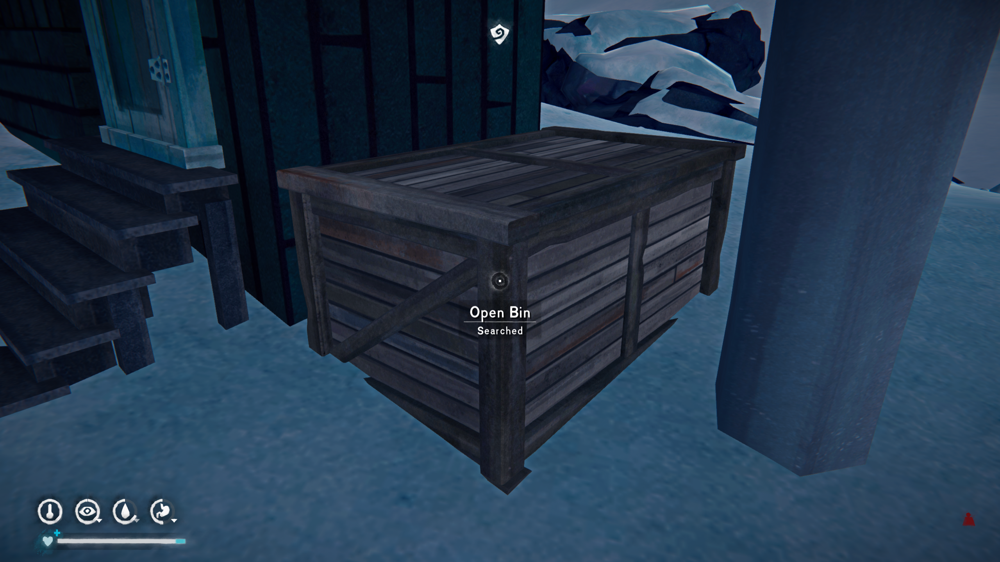

# Bin

<table class="infobox">
<caption>Bin</caption>
<colgroup>
<col style="width: 50%" />
<col style="width: 50%" />
</colgroup>
<tbody>
<tr>
<td colspan="2"><figure>

<figcaption>Bin_Wintermute.png</figcaption>
</figure></td>
</tr>
<tr>
<td>
Story item
</td>
<td>
Yes
</td>
</tr>
<tr>
<td colspan="2" class="section">
<strong>Container</strong>
</td>
</tr>
<tr>
<td>
Capacity
</td>
<td>
50.00 kg(110 lbs)
</td>
</tr>
</tbody>
</table>

**Bin** is a unique <a href="./Supply%20Bin.md" class="wikilink" title="Supply Bin">Supply Bin</a> that appears in <a href="./Wintermute.md" class="wikilink" title="Wintermute">Wintermute</a> during <a href="./Episode%202%20-%20Luminance%20Fugue.md" class="wikilink" title="Episode 2: Luminance Fugue">Episode 2: Luminance Fugue</a>. It is found next to <a href="./Jeremiah.md" class="wikilink" title="Jeremiah&#39;s">Jeremiah's</a> <a href="./Trapper%27s%20Homestead.md" class="wikilink" title="Trapper&#39;s Homestead">Trapper's Homestead</a>, and is a useful storage container for the player's items during the Episode.**Lua execution error in Module:Navbox function navbox**

