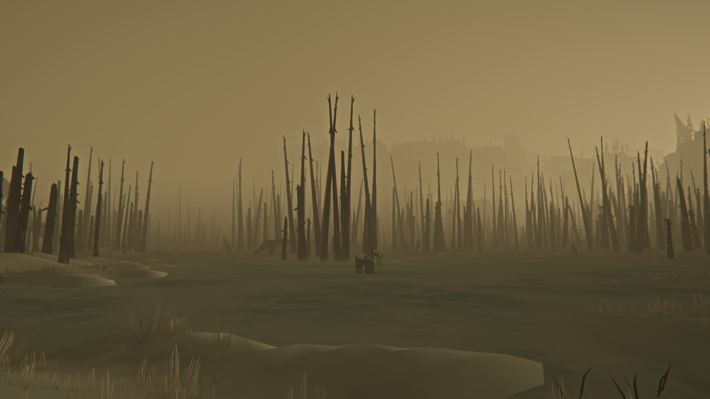
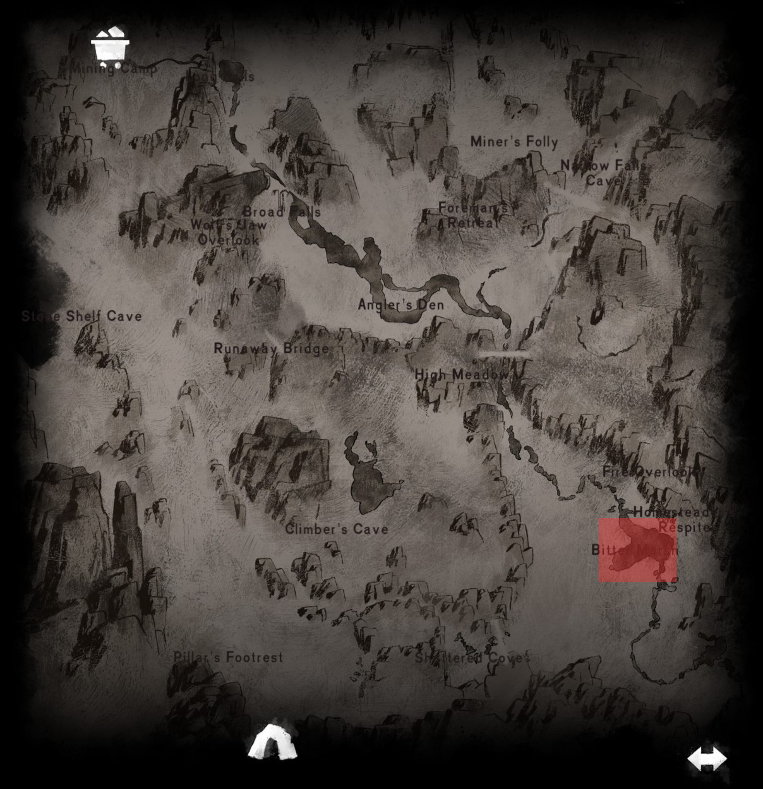

# Bitter Marsh

**Categories:** Lakes, Landmarks, Locations, Locations in Ash Canyon, Outdoor locations, Sheltered locations · **Source:** [Fandom](https://thelongdark.fandom.com/wiki/Bitter_Marsh)

**Bitter Marsh**

_20201210111120\_1.jpg_

**Location**

_Bitter\_Marsh\_Location.png_

**Region:** [Ash Canyon](./Ash%20Canyon.md)

**Description:** A small, shallow lake with a destroyed fishing hut.

**General**

**Type:** Landmark
