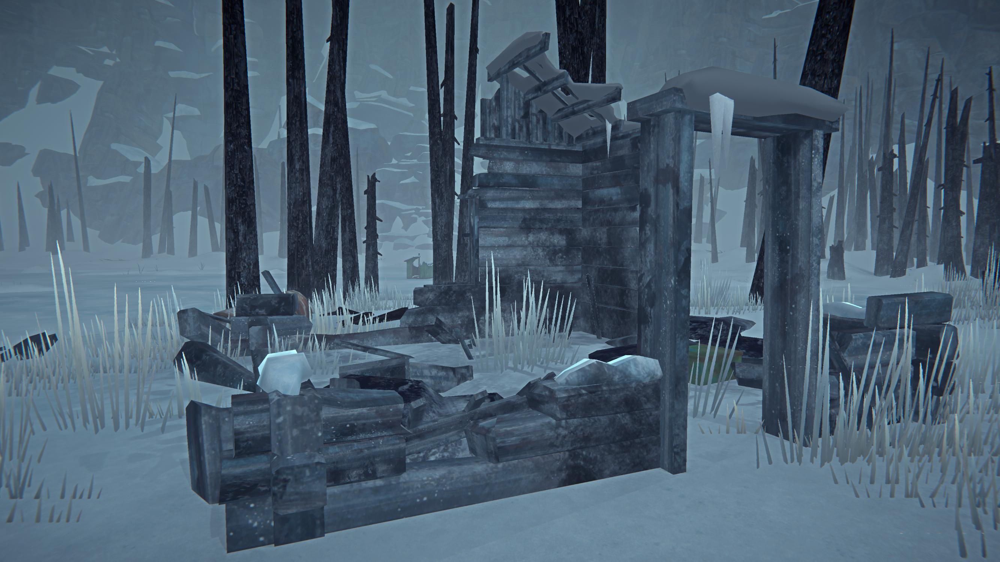

# Bitter Marsh

<table class="infobox">
<caption>Bitter Marsh</caption>
<colgroup>
<col style="width: 50%" />
<col style="width: 50%" />
</colgroup>
<tbody>
<tr>
<td colspan="2"><figure>
[Missing image: 20201210111120_1.jpg]
<figcaption>20201210111120_1.jpg</figcaption>
</figure></td>
</tr>
<tr>
<td colspan="2" class="section">
<strong>Location</strong>
</td>
</tr>
<tr>
<td colspan="2"><figure>
[Missing image: Bitter_Marsh_Location.png]
<figcaption>Bitter_Marsh_Location.png</figcaption>
</figure></td>
</tr>
<tr>
<td>
Region
</td>
<td>
<a href="./Ash%20Canyon.md" class="wikilink" title="Ash Canyon">Ash Canyon</a>|-
</td>
</tr>
<tr>
<td>
Description
</td>
<td>
A small, shallow lake with a destroyed fishing hut.
</td>
</tr>
<tr>
<td colspan="2" class="section">
<strong>General</strong>
</td>
</tr>
<tr>
<td>
Type
</td>
<td>
Landmark|-
</td>
</tr>
<tr>
<td></td>
<td>
Provides some shelter|}

<strong>Bitter Marsh</strong> is a small, shallow pond located towards the eastern end of <a href="./Ash%20Canyon.md" class="wikilink" title="Ash Canyon">Ash Canyon</a>, in the marshy, burned-out area. <a href="./Homesteader%27s%20Respite.md" class="wikilink" title="Homesteader&#39;s Respite">Homesteader's Respite</a> looms on a cliff overhead, and can be reached via a <a href="./Rope%20Climbing.md" class="wikilink" title="Rope Climb">Rope Climb</a>.

<h2 id="Overview">Overview</h2>

The most notable feature of this location is the small, partially destroyed <a href="./Fishing%20Hut.md" class="wikilink" title="Fishing Hut">Fishing Hut</a> found on the lake. Despite being destroyed and offering little shelter from wind, predators, and weather, it does have a <a href="./Pot%20Belly%20Stove.md" class="wikilink" title="Pot Belly Stove">Pot Belly Stove</a> inside it, which will stay lit no matter the weather, helping keep the player warm as they fish. A small burned down cabin can also be found nearby, with a metal container and a few pieces of low-tier loot inside. A lot of <a href="./Cat%20Tail.md" class="wikilink" title="Cat Tail">Cat Tail</a> plants surround the area. A <a href="./Moose.md" class="wikilink" title="Moose">Moose</a> can also be found nearby, along with a few wolves which may sniff out players who try to carry too much fish.

<h2 id="Gallery">Gallery</h2>
<table class="gallery">
<colgroup>
<col style="width: 25%" />
<col style="width: 25%" />
<col style="width: 25%" />
<col style="width: 25%" />
</colgroup>
<tbody>
<tr>
<td><figure>
[Missing image: 20201210111520_1.jpg]
<figcaption>Sunset at Bitter Marsh</figcaption>
</figure></td>
<td><figure>
[Missing image: 20201210111343_1.jpg]
<figcaption>The fishing hut at Bitter Marsh</figcaption>
</figure></td>
<td><figure>

<figcaption>Burned Cabin with Fishing Hut Visible in Background</figcaption>
</figure></td>
<td><figure>
[Missing image: Fishing_Hut_in_Bitter_Marsh_in_Ash_Canyon.jpg]
<figcaption>Fishing Hut in Bitter Marsh from Homesteader's Respite Viewpoint</figcaption>
</figure></td>
</tr>
</tbody>
</table>

<strong>Lua execution error in Module:Navbox function navbox</strong> <strong>Lua execution error in Module:Navbox function navbox</strong> <a href="ru:%D0%A2%D0%BE%D0%BF%D0%BA%D0%BE%D0%B5_%D0%B1%D0%BE%D0%BB%D0%BE%D1%82%D0%BE" class="wikilink" title="ru:Топкое болото">ru:Топкое болото</a>
</td>
</tr>
</tbody>
</table>

