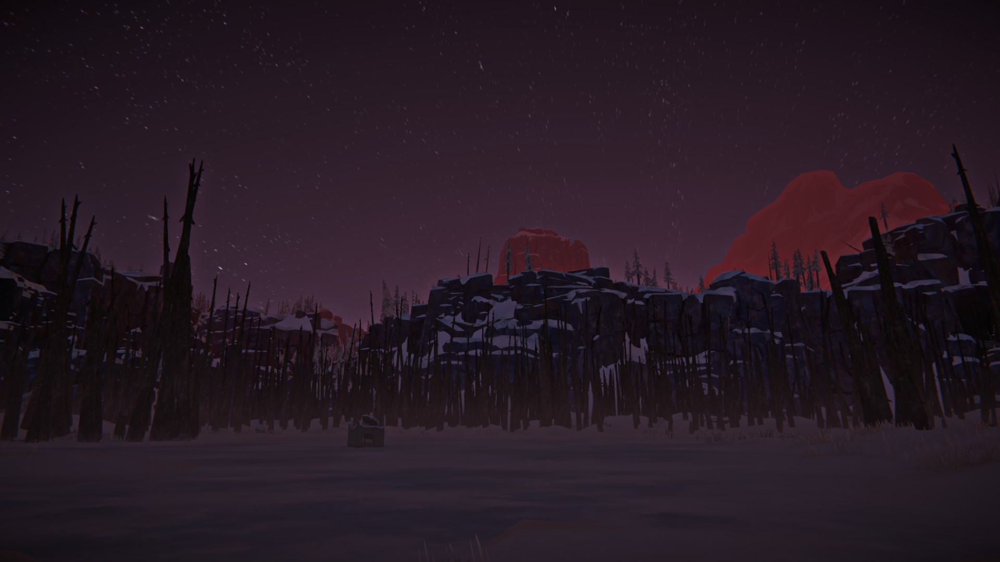
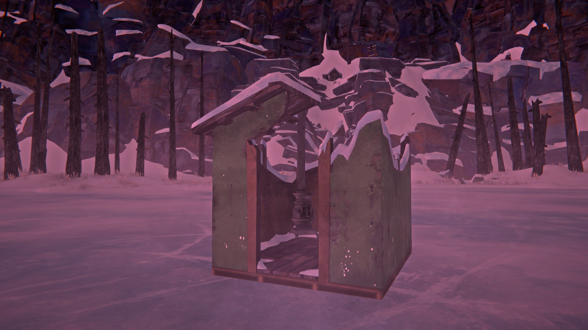
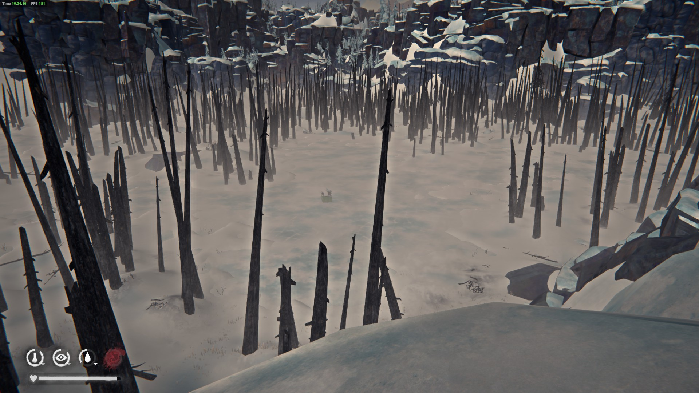

# Bitter Marsh

**Categories:** Lakes, Locations · **Source:** [Fandom](https://thelongdark.fandom.com/wiki/Bitter_Marsh)

**Bitter Marsh**

| Property | Details |
| --- | --- |
|  | [20201210111120 1](../assets/20201210111120_1.jpg) |
| **Location** |  |
|  | [Bitter Marsh Location](../assets/Bitter_Marsh_Location.png) |
| Region |  |
| Location | The southeastern part of the region |
| Description | A small, shallow lake with a destroyed fishing hut. |
| **General** |  |
| Type |  |
| Firebox |  |

**Bitter Marsh** is a small, shallow pond located towards the eastern end of [Ash Canyon](./Ash%20Canyon.md), in the marshy, burned-out area. [Homesteader's Respite](./Homesteader%27s%20Respite.md) looms on a cliff overhead, and can be reached via a [Rope Climb](./Rope%20Climbing.md).

## Overview

The most notable feature of this location is the small, partially destroyed [Fishing Hut](./Fishing%20Hut.md) found on the lake. Despite being destroyed and offering little shelter from wind, predators, and weather, it does have a [Pot Belly Stove](./Pot%20Belly%20Stove.md) inside it, which will stay lit no matter the weather, helping keep the player warm as they fish. A small burned down cabin can also be found nearby, with a metal container and a few pieces of low-tier loot inside. A lot of [Cat Tail](./Cat%20Tail.md) plants surround the area. A [Moose](./Moose.md) can also be found nearby, along with a few wolves which may sniff out players who try to carry too much fish.

## Gallery

