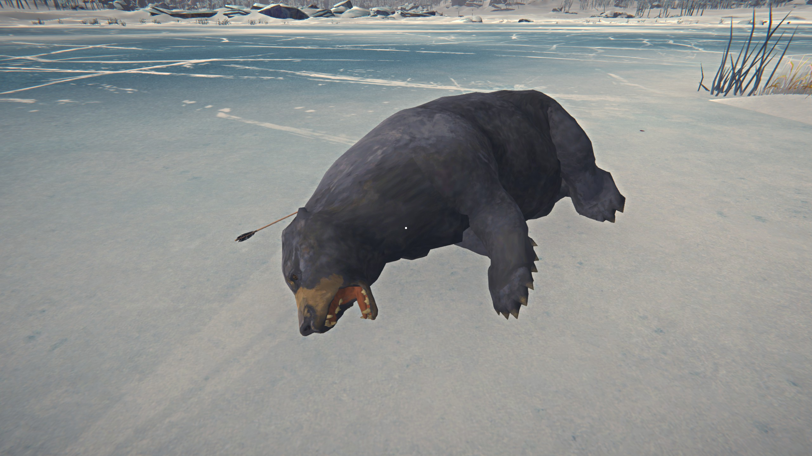
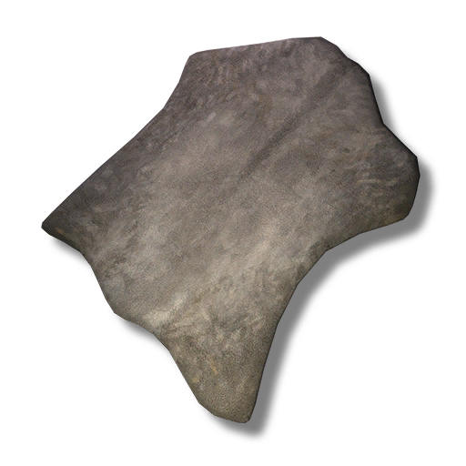
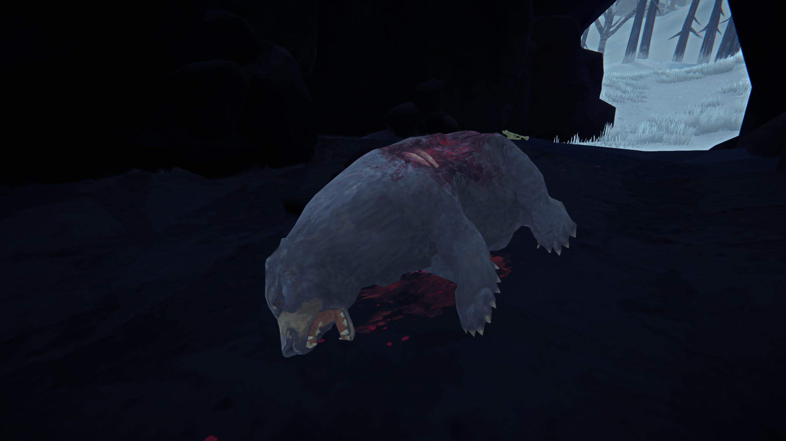

# Black Bear Carcass

**Categories:** Interactable Objects, Story items · **Source:** [Fandom](https://thelongdark.fandom.com/wiki/Black_Bear_Carcass)

**Black Bear Carcass**

| Property | Details |
| --- | --- |
|  |  / _Bear\_Carcass.jpg_ |
| **General** |  |
| Item Type | Item |

|  | Item / Quantity / Rarity |
|  / _Bear\_Meat\_(Raw)\_icon.png_ | [Bear Meat (Raw)](./Bear%20Meat%20%28Raw%29.md) / 25 - 40 / Always[¹](#fn1) |
|  / _Bear\_Quarter\_icon.png_ | [Bear Quarter](./Bear%20Quarter.md) / 5 - 8 / Always[²](#fn2) |
|  / _Fresh\_Black\_Bear\_Hide\_icon.png_ | [Fresh Black Bear Hide](./Fresh%20Black%20Bear%20Hide.md) / 1 / Always |
| \[Missing image: Gut\_icon.png\] / _Gut\_icon.png_ | [Fresh Gut](./Fresh%20Gut.md) / 10 / Always |
|  |  |
|  / _A dead Bear Carcass as seen in the Escape the Darkwalker Concept art_ |  / _Ravaged_ /  / _Frozen_ /  / _Aurora Carcass_ |

## Notes

---

1. If carcass is harvested[↩︎](#fnref1)
2. If carcass is quartered.[↩︎](#fnref2)
