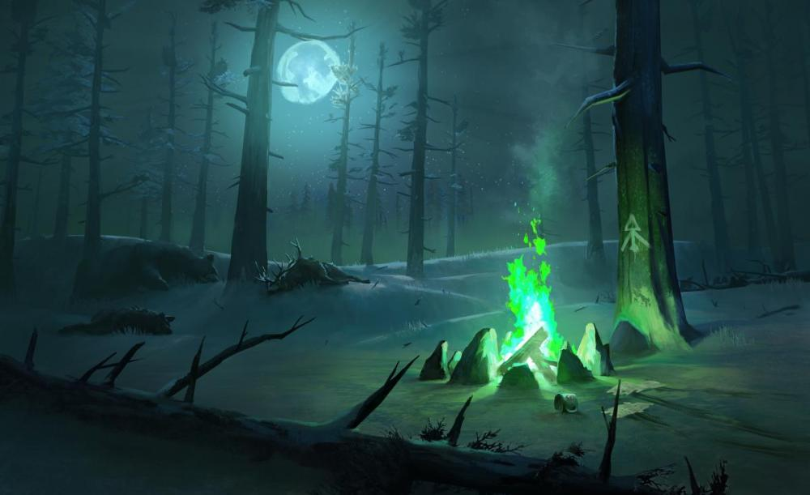
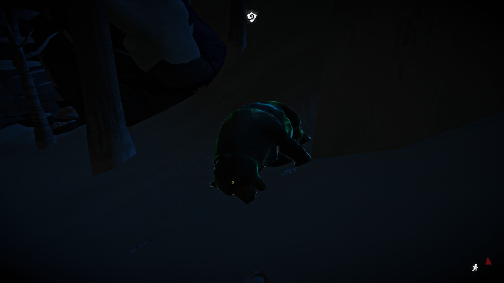

# Black Bear Carcass

**Black Bear Carcass**

| Property | Details |
| --- | --- |
|  |  / *Bear\_Carcass.jpg* |
| **General** |  |
| Item Type | Item |
| Wintermute | Yes\|} A **Black Bear Carcass** is a harvestable "object" found after [Hunting](./Hunting.md) a [Bear](./Bear.md). [Crows](./Crow.md) will fly around a Bear Carcass and always drop 5 [Crow Feathers](./Crow%20Feather.md) around the carcass at a time. / Bears are massive creatures, and their carcasses can be used as makeshift cover to provide a [Wind Shield](./Survival%20Overlay.md#Windshield_and_Scent) when harvesting them, a distinction also shared with a [Moose Carcass](./Moose%20Carcass.md). / ## Drops / A Bear Carcass may be harvested for 25.00-40.00 kg of [raw meat](./Bear%20Meat%20%28Raw%29.md), 1 [Fresh Black Bear Hide](./Fresh%20Black%20Bear%20Hide.md) and 10 guts. Bear hides can be cured to craft [Bearskin Coat](./Bearskin%20Coat.md) or [Bear Skin Bedroll](./Bear%20Skin%20Bedroll.md). On Stalker and Interloper modes, Bear meat carries the risk of [Intestinal Parasites](./Intestinal%20Parasites.md). / \|  \| Item \| Quantity \| Rarity \| / \| --- \| --- \| --- \| --- \| / \|  / *Bear\_Meat\_(Raw)\_icon.png* \| [Bear Meat (Raw)](./Bear%20Meat%20%28Raw%29.md) \| 25 - 40 \| Always[¹](#fn1) \| / \|  / *Bear\_Quarter\_icon.png* \| [Bear Quarter](./Bear%20Quarter.md) \| 5 - 8 \| Always[²](#fn2) \| / \|  / *Fresh\_Black\_Bear\_Hide\_icon.png* \| [Fresh Black Bear Hide](./Fresh%20Black%20Bear%20Hide.md) \| 1 \| Always \| / \| \[Missing image: Gut\_icon.png\] / *Gut\_icon.png* \| [Fresh Gut](./Fresh%20Gut.md) \| 10 \| Always \| / \|  \|  \|  \|  \| / ## Preplaced Locations / Bear Carcasses are never found preplaced in the game world, requiring the player to hunt a living Bear to produce a carcass. Concept art of a preplaced dead Bear Carcass can be seen in the [Escape the Darkwalker](./Escape%20the%20Darkwalker.md) art however, but this never appears in game. / ## Gallery / \| Column 1 \| Column 2 \| Column 3 \| Column 4 \| / \| --- \| --- \| --- \| --- \| / \|  / *A dead Bear Carcass as seen in the Escape the Darkwalker Concept art* \|  / *Ravaged* \|  / *Frozen* \|  / *Aurora Carcass* \| / **Lua execution error in Module:Navbox function navbox** [ru:Туша черного медведя](ru:%D0%A2%D1%83%D1%88%D0%B0_%D1%87%D0%B5%D1%80%D0%BD%D0%BE%D0%B3%D0%BE_%D0%BC%D0%B5%D0%B4%D0%B2%D0%B5%D0%B4%D1%8F) |
|  | Item / Quantity / Rarity |
|  / *Bear\_Meat\_(Raw)\_icon.png* | [Bear Meat (Raw)](./Bear%20Meat%20%28Raw%29.md) / 25 - 40 / Always[¹](#fn1) |
|  / *Bear\_Quarter\_icon.png* | [Bear Quarter](./Bear%20Quarter.md) / 5 - 8 / Always[²](#fn2) |
|  / *Fresh\_Black\_Bear\_Hide\_icon.png* | [Fresh Black Bear Hide](./Fresh%20Black%20Bear%20Hide.md) / 1 / Always |
| \[Missing image: Gut\_icon.png\] / *Gut\_icon.png* | [Fresh Gut](./Fresh%20Gut.md) / 10 / Always |
|  |  |
|  / *A dead Bear Carcass as seen in the Escape the Darkwalker Concept art* |  / *Ravaged* /  / *Frozen* /  / *Aurora Carcass* |

## Notes

---

1. If carcass is harvested[↩︎](#fnref1)
2. If carcass is quartered.[↩︎](#fnref2)
