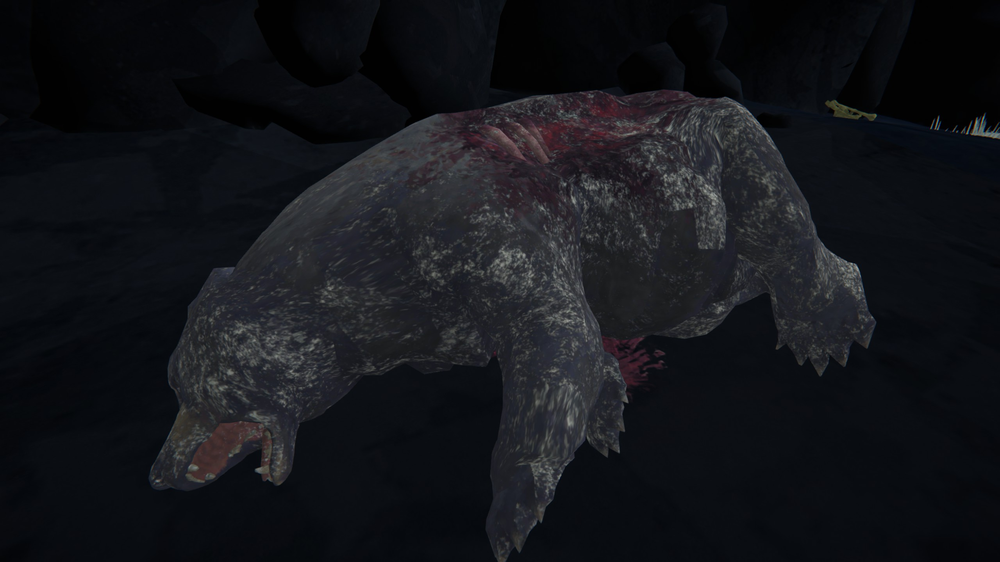

# Black Bear Carcass

**Categories:** Interactable Objects, Story items · **Source:** [Fandom](https://thelongdark.fandom.com/wiki/Black_Bear_Carcass)

**Black Bear Carcass**

_Bear\_Carcass.jpg_

**General**

**Item Type:** Item

**Wintermute:** Yes A **Black Bear Carcass** is a harvestable "object" found after [Hunting](./Hunting.md) a [Bear](./Bear.md). [Crows](./Crow.md) will fly around a Bear Carcass and always drop 5 [Crow Feathers](./Crow%20Feather.md) around the carcass at a time. / Bears are massive creatures, and their carcasses can be used as makeshift cover to provide a [Wind Shield](./Survival%20Overlay.md#Windshield_and_Scent) when harvesting them, a distinction also shared with a [Moose Carcass](./Moose%20Carcass.md).

## Drops

A Bear Carcass may be harvested for 25.00-40.00 kg of [raw meat](./Bear%20Meat%20%28Raw%29.md), 1 [Fresh Black Bear Hide](./Fresh%20Black%20Bear%20Hide.md) and 10 guts. Bear hides can be cured to craft [Bearskin Coat](./Bearskin%20Coat.md) or [Bear Skin Bedroll](./Bear%20Skin%20Bedroll.md). On Stalker and Interloper modes, Bear meat carries the risk of [Intestinal Parasites](./Intestinal%20Parasites.md).

Item

Quantity

Rarity

_Bear\_Meat\_(Raw)\_icon.png_

[Bear Meat (Raw)](./Bear%20Meat%20%28Raw%29.md)

25 - 40

Always[¹](#fn1)

_Bear\_Quarter\_icon.png_

[Bear Quarter](./Bear%20Quarter.md)

5 - 8

Always[²](#fn2)

_Fresh\_Black\_Bear\_Hide\_icon.png_

[Fresh Black Bear Hide](./Fresh%20Black%20Bear%20Hide.md)

1

Always

\[Missing image: Gut\_icon.png\] / _Gut\_icon.png_

[Fresh Gut](./Fresh%20Gut.md)

10

Always

## Preplaced Locations

Bear Carcasses are never found preplaced in the game world, requiring the player to hunt a living Bear to produce a carcass. Concept art of a preplaced dead Bear Carcass can be seen in the [Escape the Darkwalker](./Escape%20the%20Darkwalker.md) art however, but this never appears in game.

## Gallery

_A dead Bear Carcass as seen in the Escape the Darkwalker Concept art_

_Ravaged_

_Frozen_

_Aurora Carcass_

## Notes

---

1. If carcass is harvested[↩︎](#fnref1)
2. If carcass is quartered.[↩︎](#fnref2)
