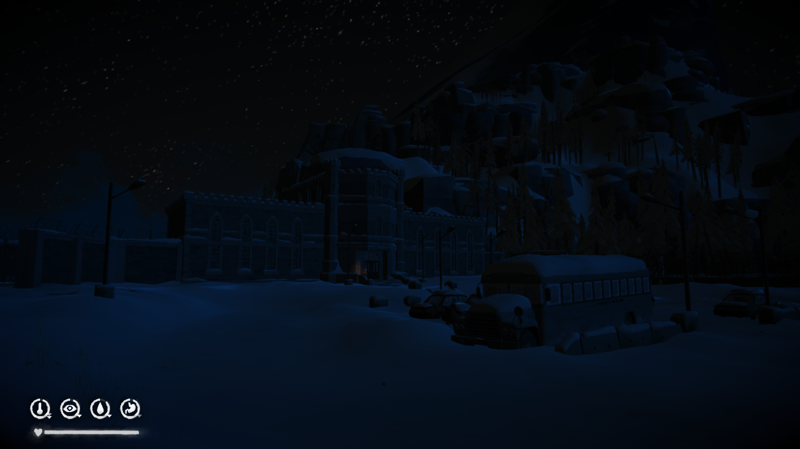

# Blackrock \(mission\)

**Contents**

- [Tasks](#tasks)
- [Walkthrough](#walkthrough)
- [Gallery](#gallery)
- [Update History](#update-history)

 Blackrock is a side mission in [Episode 3](./Episode%203%20-%20Crossroads%20Elegy.md) of the [story](./Wintermute.md). In this mission, [Astrid](./Astrid%20Greenwood.md) must search for clues about the presence of [Blackrock](./Blackrock%20Prison.md) prisoners in Pleasant Valley, as well as finding out that [Molly](./Molly.md) has been hunting them.

## Tasks

- Search the prison guard's body
- Search the surrounding area
- Search for more signs of the escaped convicts (x2)
- Search the abandoned camp
- Look for the hidden cache

## Walkthrough

The mission is initiated by finding the prison guard's body. The body is located on the right side of the road just after crossing [Heartbreak Bridge](./Heartbreak%20Bridge.md) on the way to [Community Hall](./Community%20Hall.md) from [Barn (Molly's)](./Barn%20%28Molly%27s%29.md). The prison guard's body will contain an improvised knife and a Blackrock Penitentiary Memo collectible. Follow the trail of blood to the outbuilding. Inside will be a prisoner's body with a blood stained convict note. Another prisoner's body is found further off the road in the same direction at the [Forest Cave](./Forest%20Cave%20%28Pleasant%20Valley%20location%29.md). To complete the mission, follow the road towards [Signal Hill](./Signal%20Hill.md), but turn left a short distance after crossing the unnamed bridge. The abandoned camp is located at [Hilltop Cave](./Hilltop%20Cave.md). Deep inside the cave on the left is an ammunition can cache filled with supplies: 20 [revolver ammunition](./Revolver%20Ammunition.md), [accelerant](./Accelerant.md), [MRE](./Military-Grade%20MRE.md), [flare](./Flare.md), [antiseptic](./Antiseptic.md).

## Gallery

blackrock prisoner body 1.jpg|The first prisoner body blackrock prisoner body 2.jpg|The second prisoner body blackrock hilltop cave.jpg|The abandoned camp blackrock hidden cache location.jpg|Supply cache is visible in the bottom right blackrock hidden cache.jpg|The supply cache

## Update History
