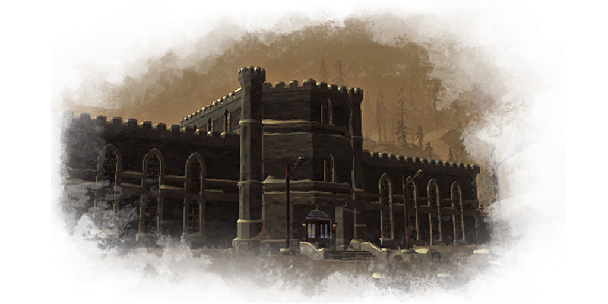

# Blackrock Blues/Transcript

**Contents**

- [Prison Opening Sequence](#prison-opening-sequence)
- [Find Medical Supplies for the Warden.](#find-medical-supplies-for-the-warden)
- [Track down the prison truck and medicine.](#track-down-the-prison-truck-and-medicine)
- [Return to Blackrock.](#return-to-blackrock)

**Blackrock Blues/Transcript**

| Property | Details |
| --- | --- |
|  |  / *Blackrock\_Blues.png* |
| Episode |  |
| **Missions** |  |
| Previous | [Prologue/Transcript](./Prologue%20%E2%80%94%20Transcript.md) |
| Current | Blackrock Blues/Transcript |
| Next | [The Power Plant/Transcript](./The%20Power%20Plant%20%E2%80%94%20Transcript.md) |
| Region | [Blackrock Region](./Blackrock.md) |
| Characters | [Will Mackenzie](./Will%20Mackenzie.md) / [Mathis](./Mathis.md) / [Franklin](./Franklin.md) / [Vachon](./Vachon.md) / [Heller](./Heller.md) / [Jace](./Jace.md) |

This is the transcript for Chapter 1 [Blackrock Blues](./Blackrock%20Blues.md) for [Episode 4: Fury, Then Silence](./Episode%204%20-%20Fury%2C%20Then%20Silence.md).

## Prison Opening Sequence

*Mackenzie awakes in a bed within a prison cell, his head aching from the blow Mathis gave it. A voice rings out from the nearby cell.*

???: "Psst...hey!! You awake yet? Hey...I can hear you moving around. Come to the window. We have to talk. Stand on the toilet and you can reach the window."

*Mackenzie gets up on a toilet and peers through the prison bars, eyeing a figure that sits in place and does not move.*

???: "There you are! Well...welcome to the shitshow."

*Dialogue options appear at this point*

**Blue Dialogue**

- WHO?

Mackenzie: "Ok, so who are you?"

???: "Unfortunately, I run this place."

Mackenzie: "That doesn't seem to be working out too well for you."

???: "Yes well, normally I'm on the other side of the bars. Name's Franklin. I'm Warden here at Blackrock."

[Franklin](./Franklin.md): "And you are?"

Mackenzie: "Mackenzie. Franklin. What's going on here?"

Franklin: "The situation is this: You and I are locked up in here. Mathis and his gang of thugs are trying to break someone out of solitary. We're still alive, for now, so they must need us for something. The power's been out for days. And nobody's coming to help."

Mackenzie: "Sounds about right."

- MATHIS

Mackenzie: "So, Mathis. You know him?"

Franklin: "Oh yeah. We go way back. He was in for murder on the Mainland about ten years ago. He did seven and then got off on parole. I was Warden at one of the federal pens there and...well let's just say Mathis isn't sending me any Christmas cards these days."

Mackenzie: "Any idea what he's doing here."

Franklin: "Unfortunately, yes. He's here for Donner."

Mackenzie: "Donner? Who's that?

Franklin: "His son."

Mackenzie: "Shit. So, some kind of twisted family reunion."

Franklin: "Mathis is bad, but he's...old school bad. Murder. Larceny. The occasional heist and grand theft auto. But Donner...he's a chip off the old block. And then some."

Mackenzie: "So, not a good person."

Franklin: "Well, he's locked up in Blackrock, isn't he? Listen, Mathis is bad, but Donner is something much worse. I've seen a lot of criminals in my years and Donner...He's one of those guys that keeps Wardens like me up at night. He's evil to the core. He's the kind of guy they make prisons like Blackrock for. There's no redemption for guys like Donner. They aren't here for rehabilitation. There's no way back to living in "regular society" again. They just want to destroy the world you and I live in. If Mathis is bad, Donner is...biblical bad."

- BLACKROCK

Mackenzie: "So...Blackrock?"

Franklin: "Yeah. Maximum security prison. Built a hundred years ago and updated a few times. It's basically a fortress."

Mackenzie: "Out here?"

Franklin: "You notice the walls on your way in?"

Mackenzie: "I was...No."

Franklin: "Ok, well they aren't that high or that impressive really. You know why?"

Mackenzie: "No idea."

Franklin: "Because whatever dumb sonofabitch tries to escape from this place has to get through about fifty clicks of brutal terrain...full of dangerous wildlife before they can even think about find a road that leads out of here."

Mackenzie: "Well, but we got here."

Franklin: "Yeah...but are you going to get out? About twenty years ago a pair of cons escaped. They came back three days later, half-dead, begging us to take them back. And that was in the middle of summer."

Mackenzie: "I get the picture."

- DONNER

Mackenzie: "So, Donner is a very bad guy. Mathis came here to spring him. Tell me again why we aren't dead yet?"

Franklin: "Well, that's a story. Power went out here a couple weeks ago now. The backups held for a while but eventually the cons were able to break out and overwhelm the guards. They grabbed the keys to solitary and went to get Donner, which...well that would have been the end. But they couldn't open the gates to solitary. Something has them locked down tight and it's driving Mathis crazy. It was...bad for us. I haven't seen any of the other guards since they locked me up in here and...well, I fear the worst. And now that Mathis is here..."

- LOCKED

Mackenzie: "But with the power down, what's keeping the gates locked?"

Franklin: "There are mechanical fail safes in the system. Keep in mind most of this jail is pretty old. But that's not the full answer to why Donner is still locked up."

Mackenzie: "What do you mean?"

Franklin: "Well...best I can tell, they should have been able to break him out by now. But something...or someone...has been getting in the way."

Mackenzie: "You mean...there's someone else still out there?"

Franklin: "That's exactly what I mean."

Mackenzie: "But who?"

Franklin: "I don't know. But sounds like Mathis is mad as a hornet because of them, and that brings me no small pleasure. Shit...they're coming. Get back to your bunk!"

*Mackenzie gets off the toilet and crawls back into his bunk, just as Mathis, Vachon, and Heller walk by. Mathis notices Mackenzie and stops and smile*

Mathis: "So, pilot. You're back in the land of the living. For now."

Mackenzie: "Yeah. But just seeing you gives me a headache."

Mathis: "Ha ha...seeing you makes me want to hit people."

*Mathis walks into Franklin's cell. Vachon and Heller follow*

Mathis: "So, Warden. Looks like we have a little problem. I still can't get into solitary. You have any idea why that might be?"

*Mackenzie climbs the toilet and peers through the barred window, seeing Mathis looking over Franklin*

Franklin: "I told you, Mathis. The whole jail is in some kind of weird lockdown. It all happened before you got here. Donner just..."

*Mathis savagely strikes Franklin. Franklin begins spitting and coughing*

Mathis: "Don't you ever say his name."

Franklin: "\[Warden spitting blood\] I...I don't know anything about it."

Mathis: "My guys say someone's been tampering with the system. They say...it's gotten worse. Every time they take a step closer to breaking into solitary something new gets in their way. Didn't you use to run this place?"

Franklin: "Yeah."

Mathis: "So, you telling me you have no idea how it works?"

Franklin: "That's just the thing. Nothing is working the way it's supposed to right now."

Mathis: "Bullshit. Stop wasting my time."

*Mathis strikes Franklin again, causing him to yell a muffled groan.*

Mathis: "And stop wasting your time. You don't have much left, unless we get that door open."

Franklin: "Mathis...I don't know anything."

*Mathis cracks his knuckles*

Mathis: "Let me jog your memory."

*Mathis uses 4 heavy punches on Franklin without stopping*

Vachon: "Hey...hey Mathis. Maybe not so hard."

*Franklin begins spitting blood*

Vachon: "Like...we might still need him..to get..."HIM"...out."

Heller: "Mathis. He doesn't look good. You're going to far."

*Mathis laughs, surprising Heller and Vachon as they crowd around Franklin*

Mathis: "Clean him up."

*Mackenzie quickly gets off the toilet and stands in his cell, Mathis walks by without noticing him*

Heller: "Oh shiiiit...he looks bad."

Vachon: "Yeah. Mathis...he's getting worse."

Heller: "This shit with Donner has him half-crazy."

Vachon: "Half crazy? Ever since the bus crash...he's been getting wild. Like a caged animal. How the hell did he expect this to turn out?"

Heller: "You remember Montreal, right?"

Vachon: "Oh yeah. I mean remember that place on Saint Catherine's with the girl who..."

Heller: "Not that, you fucking moron. Remember how Mathis broke out?"

Vachon: "Oh yeah...I wasn't there but I heard about it."

Heller: "Right. You clean up the warden and I'll tell you all about it. So there was this really tight plan, Mathis had months to set it up. Everyone had their part to play. It was like...out of a fucking movie. So we bust out, and all hell breaks loose. We get to the front gates, it's a mess, right? Place is in chaos. And the driver who's supposed to pick us up. He's late."

Vachon: "No shit."

Heller: "No shit. So the driver pulls up, like...two minutes late. Alarms are going off everywhere, it's like...the prison guards are coming after us. we're going to get grabbed at any second. We're yelling at Mathis, "Come on man let's go. Let's get outta here!" And Mathis just stands there. Looking at the fucking driver. Looking like...he wants to eat the guy. The driver's terrified. Mathis walks over to the van, slowly. We're all jumping in and yelling to get out, and we...and we can \*see\* the fucking guards coming. Like, we are done. We need to GET OUT. Mathis...he pulls the driver out of the van, looks back at us, and...with this totally wild look in his eyes...just says..."Go". Like totally calmly, but with this wild edge. And he just starts beating the living shit out of the driver."

Vachon: "Wow. I knew it went bad in Montreal but I didn't know that story."

Heller: "Yeah I mean we took off. And Mathis...it took five cops to pull him off that driver. He cared less about being caught than he did about the driver being late."

Vachon: "Crazy fucker."

Heller: "Mathis is not a patient man. He does not like it when a plan does not come together. He does not like to be let down. And right now, his plan for getting Donner out of here is totally fucked."

*Mackenzie gets off the bunk bed and stands on the toilet, peering through the window bars*

Heller: "And it's just a matter of time before he...\[snaps fingers\]...snaps, like he did in Montreal."

Vachon: "He looks bad, eh? What are we going to do?"

Heller: "If he dies, it'll be worse for us. Cause we'll take the heat. We need to get him patched up."

Vachon: "Well...we passed some kind of first aid building on the way in."

Heller: "Great! Go there and grab some supplies."

Vachon: "No fucking way. You hear all those wolves out there?"

Heller: "Don't be an asshole. Go do it."

Vachon: "You do it. Why do I have to be the one who..."

Heller: "Hey, who went back to look for Leclerc when he went missing? No way I'm going back out there."

Mackenzie: "I'll do it."

*Vachon and Heller look around confused*

Vachon: "Did you hear something?"

Mackenzie: "I said I'll do it."

*Vachon and Heller turn to face Mackenzie as he peers at them through the bars*

Mackenzie: "Let me out, and I'll get the supplies."

Heller: "Nobody's talking to you, pilot. Just keep quiet and hope that Mathis doesn't start paying attention to you."

Mackenzie: "He dies, and you guys take the rap. You want that?"

Heller: "The rap? Take the rap? Who talks like that? Listen, pilot. Why don't you shut the fuck up?"

Mackenzie: "What do you have to lose? I go out there, get attacked by wolves. No great loss, right?"

*Mackenzie gets off the toilet as the two convicts walk to the front of his cell*

Vachon: "Wait a second, man. This is a bad idea. Mathis has plans for this guy."

Heller: "Shut up. Alright. You're right. You've been...out in the bush all this time. I'm sure you've figured out how to deal with a few wolves by now. We let you out, you get the supplies. The Warden lives. And maybe...we keep Mathis distracted so he doesn't lose his shit on you next time."

Mackenzie: "Understood. You let me out. I get the supplies. The Warden lives."

Heller: "Ha...you see? He learns fast! Time to save the day, pilot. Don't fuck it up."

*Scene transition to the front step of the Prison, as Mackenzie turns from the parking lot back to Vachon peering through the front door*

Vachon: "Get going, pilot. The Warden doesn't have much time left. And in case you're thinking of running away. Remember...we still have your precious case."

*Vachon closes the door and locks it, with Mackenzie shivering and turning around*

Mackenzie: "Ah, brutal, deadly cold. How I've missed you."

## Find Medical Supplies for the Warden.

*Mackenzie makes his way to the infirmary, but finds the front doors locked*

Mackenzie: "Has to be another way around.

*Mackenzie tries the side door*

Mackenzie: "I need to find some way in."

*Mackenzie heads to a nearby vehicle shed and finds a gate leading to the outside perimeter of the Prison Yard. He steps past a Wolf feeding on a Deer Carcass, and walks into a section of the Yard housing the guard's barracks. He walks to the roof and over some catwalks, then finds a window to the infirmary that is propped open and steps inside.*

Mackenzie: "Now to find some meds for the Warden..."

*He heads to the back but only finds a [Memo](./Memo.md) with an attached key saying that a supply shipment is coming, with the med bay itself empty. Suddenly a [Receiver](./Receiver.md) begins ringing and he picks up the phone.*

Mackenzie: "He...hello? Hello?..."

[???](./Jace.md): "Who the hell are you?"

Mackenzie: "I could ask you the same question."

???: "Quit fucking around. Who are you?"

Mackenzie: "I'm...nobody important. Just a bush pilot. My name's uh..."

???: "You forgot your name?"

Mackenzie: "My name's Mackenzie."

???: "Right. Well, Mr. Mackenzie..."

Mackenzie: "Not mister Mackenzie...just Mackenzie."

???: "Well, Mr. Bush Pilot Mackenzie...welcome to the party. You working for those assholes in the prison?"

Mackenzie: "Which...ones? I mean, no. Not working for them."

???: "Then what you doing out here?"

Mackenzie: "Where are you calling me from?"

???: "Somewhere safe. Look Mister Mackenzie. Soon, you're going to have to figure out whose side you're on in this little stalemate we have going on."

Mackenzie: "I don't know anything about a stalemate. And I'm not on anyone's side. I'm on my own side."

???: "Well, at least you're honest. That's a start."

Mackenzie: "Where are you and what do you want?"

???: "Whooee...that question has a long damn answer. Right now, I'm safe from those prison assholes. But I cannot say the same for you."

Mackenzie: "Look...the prison Warden. He's injured. I'm just trying to keep him alive."

???: "So, they let you out of the prison? Then they're going to just let you back in?"

Mackenzie: "Right."

???: "But you aren't helping them."

Mackenzie: "No."

???: "Something about this situation...about you...doesn't fit."

Mackenzie: "Look, why don't you tell me where you are and maybe I can help you."

???: "Help me? Shit man, you can't even help yourself."

Mackenzie: "Are you the one that's messing up the convict's plans?"

???: "Maybe I am, maybe I'm not. Either way, I'm not telling you. How do I know you aren't really one of Donner's boys? Trying to trap me?"

Mackenzie: "Donner...so, you know about him?"

???: "Wake up man, this is all about Donner. Don't you get that? And I'm the only thing standing between that fucker rotting away in solitary...and an evil bastard being unleashed on the rest of this frozen hellhole."

Mackenzie: "Well...I mean I hear it's nice in the summer."

???: "Take care of yourself, Mister Mackenzie. Those wolves sound pretty hungry to me."

Mackenzie: "I'll do my best."

*Mackenzie hangs up the phone.*

Mackenzie: "Well. That was weird."

## Track down the prison truck and medicine.

*Mackenzie goes to the front gate and unlocks it with the key he found. Inside he finds a [Weapon Locker](./Weapon%20Locker.md) containing supplies, and [Noisemakers](./Noisemaker.md)*

Mackenzie: "Well well...what do we have here?"

*Once outside, Mackenzie leaves the area but spots a mass of bodies piled up in the left hand marsh. Getting a closer look, they all appear to be guards and civilians working at the prison, executed by the Convicts and left to lot in the snow.*

Mackenzie: "This is just...terrible. Can't tell if anyone made it.""

*Mackenzie begins is search, leaving the prison, passing a wooden bridge, going past [Cook's Farm](./Cook%27s%20Farm.md), then finding a bloody backpack in the snow near a prison truck.*

Mackenzie: "Looks like someone's been here recently."

*He follows the trail of blood in the snow, and finds a [Dead Prison Guard](./Dead%20Prison%20Guard.md) being eaten by a Wolf near a cave. Dispatching it, Mackenzie finds the [Blackrock Infirmary Medication](./Blackrock%20Infirmary%20Medication.md) in a nearby [First Aid Kit](./First%20Aid%20Kit.md) and returns to the Prison.*

## Return to Blackrock.

*If the player explores the region, Mackenzie will refuse to cross certain areas. The player tries to cross [Narrow Bridge](./Narrow%20Bridge.md) early, Mackenzie will refuse to cross and say*

Mackenzie: "That doesn't look safe."

*If the player tries to enter [Last Prospect](./Last%20Prospect.md) early, Mackenzie will say*

Mackenzie: "I don't think that's where I need to go."

*Mackenzie reaches the front doors of the Prison as Vachon opens them*

Vachon: "Well...shit. You made it."

Mackenzie: "I made it."

Vachon: "I guess you're tougher than you look.

Mackenzie: "I found stuff to help the Warden. Medical supplies."

Vachon: "Yeah, you'd better get in there to see him. He doesn't look too good. But first, you gotta let me frisk you. Mathis'd have my balls if I let you sneak a knife in here."

*Vachon checks Mackenzie as the screen fades to black*

The story continues in [The Power Plant/Transcript](./The%20Power%20Plant%20%E2%80%94%20Transcript.md).**Lua execution error in Module:Navbox function navbox**
