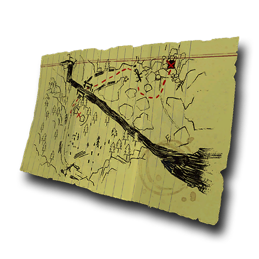
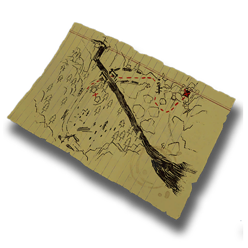

# Blackrock Foothills Map

<table class="infobox">
<caption>Blackrock Foothills Map</caption>
<colgroup>
<col style="width: 50%" />
<col style="width: 50%" />
</colgroup>
<tbody>
<tr>
<td colspan="2"><figure>

<figcaption>Blackrock_Foothills_Map_icon.png</figcaption>
</figure></td>
</tr>
<tr>
<td>
Release
</td>
<td>
<a href="./The%20Long%20Dark%20%E2%80%94%20Changelog.md#2.52" class="wikilink" title="31 March 2026">31 March 2026</a>
</td>
</tr>
<tr>
<td>
Wintermute
</td>
<td>
<a href="./Episode%205%20-%20The%20Light%20At%20The%20End%20Of%20All%20Things.md" class="wikilink" title="Episode 5: The Light At The End Of All Things">Episode 5: The Light At The End Of All Things</a>
</td>
</tr>
<tr>
<td colspan="2" class="section">
<strong>Properties</strong>
</td>
</tr>
<tr>
<td>
Item type
</td>
<td>
<a href="./Collectibles.md" class="wikilink" title="Collectibles">Collectibles</a>|-
</td>
</tr>
<tr>
<td>
Stackable
</td>
<td>
No
</td>
</tr>
<tr>
<td>
Examine
</td>
<td>
A hand drawn map of the Blackrock Foothills. The edges of the drawing fade away in anxiety or desperation, or both.
</td>
</tr>
<tr>
<td colspan="2" class="section">
<strong>Values</strong>
</td>
</tr>
<tr>
<td>
Weight
</td>
<td>
0.00 kg (0 lbs)
</td>
</tr>
<tr>
<td colspan="2" class="section">
<strong>Actions</strong>
</td>
</tr>
<tr>
<td>
Backpack
</td>
<td>
Examine
</td>
</tr>
<tr>
<td>
On ground
</td>
<td>
Take It, Read Text, Leave It
</td>
</tr>
</tbody>
</table>

**Blackrock Foothills Map** is a <a href="./Collectibles.md" class="wikilink" title="Collectibles">Collectibles</a> found in <a href="./Episode%205%20-%20The%20Light%20At%20The%20End%20Of%20All%20Things.md" class="wikilink" title="Episode 5">Episode 5</a> of the <a href="./Wintermute.md" class="wikilink" title="Wintermute">Wintermute</a> story. It is found during the main mission The Cold Broken Road, inside a trailer at the logging camp. <a href="./Jace.md" class="wikilink" title="Jace">Jace</a> is met shortly afterwards, and <a href="./Will%20Mackenzie.md" class="wikilink" title="Will Mackenzie">Will Mackenzie</a> formulates a plan to pass through the region.

Once acquired, the <a href="./Map.md" class="wikilink" title="Map">Map</a> for the <a href="./Blackrock%20Foothills.md" class="wikilink" title="Blackrock Foothills">Blackrock Foothills</a> region is unlocked.

<table class="gallery">
<colgroup>
<col style="width: 100%" />
</colgroup>
<tbody>
<tr>
<td><figure>

<figcaption>alt icon</figcaption>
</figure></td>
</tr>
</tbody>
</table>

## Update history

\* UPDATE **31 March 2026 (<a href="./The%20Long%20Dark%20%E2%80%94%20Changelog.md#2.52" class="wikilink" title="Update">Update</a>):**

- - Added to game.

**Lua execution error in Module:Navbox function navbox**

