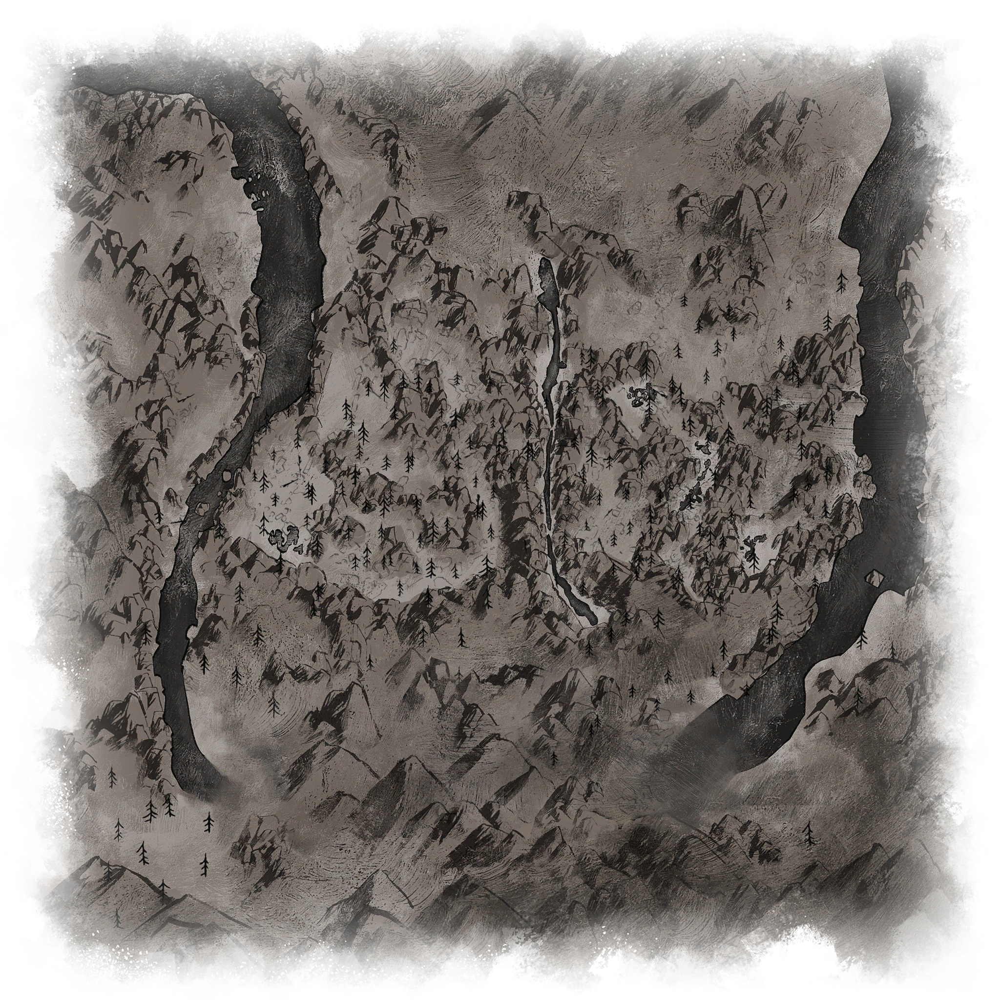

# Blackrock Foothills

**Contents**

- [Overview](#Overview)
- [Locations](#Locations)
- [Ruined Cabin](#Ruined_Cabin)
- [Bisecting Ravine](#Bisecting_Ravine)
- [Logging Camp](#Logging_Camp)
- [Cable Cars](#Cable_Cars)
- [Unstable Mine](#Unstable_Mine)
- [Trivia](#Trivia)

<table class="infobox">
<caption>Blackrock Foothills</caption>
<colgroup>
<col style="width: 50%" />
<col style="width: 50%" />
</colgroup>
<tbody>
<tr>
<td colspan="2"><figure>

<figcaption>No_picture.png</figcaption>
</figure></td>
</tr>
<tr>
<td colspan="2" class="section">
<strong>Location on <a href="./Great%20Bear%20Island.md" class="wikilink" title="Great Bear Island">Great Bear Island</a></strong>
</td>
</tr>
<tr>
<td colspan="2"><figure>

<figcaption>No_picture.png</figcaption>
</figure></td>
</tr>
<tr>
<td colspan="2"><figure>

<figcaption>Blackrock_Foothills_In-Game_Map.png</figcaption>
</figure></td>
</tr>
<tr>
<td colspan="2" class="section">
<strong>Details</strong>
</td>
</tr>
<tr>
<td>
Description
</td>
<td>
A mountainous region with a large mine bisecting it.
</td>
</tr>
<tr>
<td>
Connecting Regions
</td>
<td>
<a href="./Suzuki%20Environs.md" class="wikilink" title="Suzuki Environs">Suzuki Environs</a>
</td>
</tr>
<tr>
<td>
Characters
</td>
<td>
<a href="./Jace.md" class="wikilink" title="Jace">Jace</a> <a href="./Will%20Mackenzie.md" class="wikilink" title="Will Mackenzie">Will Mackenzie</a> 
Unnamed Convict 1 
Unnamed Convict 2
</td>
</tr>
<tr>
<td>
Locations
</td>
<td>
Ruined Cabin 
Bisecting Ravine 
Logging Camp 
Cable Cars 
Unstable Mine
</td>
</tr>
<tr>
<td>
Date Added
</td>
<td>
31 March 2026
</td>
</tr>
</tbody>
</table>

**Blackrock Foothills** are a <a href="./Wintermute.md" class="wikilink" title="Wintermute">Wintermute</a>-exclusive region, which consists of the wilderness near the region of <a href="./Blackrock.md" class="wikilink" title="Blackrock">Blackrock</a>. It eventually leads to the <a href="./Suzuki%20Environs.md" class="wikilink" title="Suzuki Environs">Suzuki Environs</a> and the <a href="./Suzuki%20Radio%20Telescope.md" class="wikilink" title="Suzuki Radio Telescope">Suzuki Radio Telescope</a>, accessed through an abandoned and unstable mineshaft.

## Overview

The Foothills are a small, barren region just downstream from the <a href="./Power%20Plant.md" class="wikilink" title="Power Plant">Power Plant</a> in <a href="./Blackrock.md" class="wikilink" title="Blackrock">Blackrock</a>. Given it's nature in <a href="./Episode%205%20-%20The%20Light%20At%20The%20End%20Of%20All%20Things.md" class="wikilink" title="Episode 5">Episode 5</a>'s plot, it is a rather linear region, with few locations within. Much of the region consists of rough, winding chasms and gullies, with some flatter basins here and there. Wolves can be found intermittently, though typically in the more open areas during the first portion of the map.

## Locations

#### **Ruined Cabin**

A burnt out cabin, situated on a small, reinforced overlook near a frozen pond. A prybar can be found near the front door, with a Cooking Pot and Firelogs behind it.

#### **Bisecting Ravine**

A huge, seemingly bottomless ravine with an inaccessible frozen river at the bottom. Given the many fallen trees, it is probably geologically unstabe. The player is forced to walk across a fallen tree to cross it.

#### **Logging Camp**

A pair of abandoned logging trailers, aswell as a small covered shed in a flat clearing. Both trailers are accessible by the player, with the trailer marked "Foreman's Office" containing the <a href="./Blackrock%20Foothills%20Map.md" class="wikilink" title="Blackrock Foothills Map">Blackrock Foothills Map</a>, a <a href="./Distress%20Pistol.md" class="wikilink" title="Distress Pistol">Distress Pistol</a>, and two <a href="./Flare%20Shell.md" class="wikilink" title="Flare Shells">Flare Shells</a>, among other loot. There is a fire barrel in the small area in front of the trailers, with two pieces of <a href="./Cedar%20Firewood.md" class="wikilink" title="Cedar Firewood">Cedar Firewood</a> inside of the nearby shed.

#### **Cable Cars**

A set of two industrial cable cars used to cross the region's rapids to access the Unstable Mine. The cars are manually crank-operated, with the movement of one being able to move the other. Mackenzie is forced to cross various fallen trees to reach a rocky island in the middle of the river, which is high enough to reach one of the cars, as they were left in the middle of the river. It is the only way to access the Abandoned Mine in the Blackrock Foothills. The system itself is poorly maintained; given that they sport large gaps in their floors, and because Mackenzie is able to easily destroy the Pulley Mechanism with a <a href="./Hatchet.md" class="wikilink" title="Hatchet">Hatchet</a>.

#### **Unstable Mine**

The Unstable Mine is, technically, a transition zone between the Foothills and the Suzuki Environs, with it featuring a number of <a href="./Tales%20from%20the%20Far%20Territory.md" class="wikilink" title="Far Territory">Far Territory</a> mechanics such as <a href="./Chemical%20Hazard.md" class="wikilink" title="Toxic Gas">Toxic Gas</a>, <a href="./Respirator.md" class="wikilink" title="Respirators">Respirators</a>, and <a href="./Canister.md" class="wikilink" title="Canisters">Canisters</a>. Two Episode 5-exclusives can be found here, in the form of the <a href="./Crank%20Light.md" class="wikilink" title="Crank Light">Crank Light</a> and Gas Lamps, alongside the Wintermute-exclusive <a href="./Bolt%20Cutters.md" class="wikilink" title="Bolt Cutters">Bolt Cutters</a>. The mine consists of five floors (technically, levels), with manual, crank-operated elevators connecting them, requring two people to function. Minecraft Tracks lead throughout each floor, usually helping to direct the player on where to go.

Almost every floor of the mine has at least one area full of posionous chemical gas, which the player is forced to remove by opening Clean Air Valves so Jace can follow them. The player is also forced to light the Gas Lamps on each level, as Jace is claustrophobic and deeply afraid of the dark. There are a number of puzzles within. The only area with no gas or puzzles comes is the Fifth Floor, which contains a large, sealed exit leading to the Suzuki Environs and the Radio Telescope itself. After exiting the mine, this exit point collapses rather violently.

## Trivia

- According to a line from Jace, a couple of hikers disappeared within the Unstable Mine the year prior, and although Search and Rescue were able to get inside, the search was called off due to the mine's instability. There is a high chance that the corpse Mackenzie aquires the Respirator from may have been one of these hikers, having died in a sudden collapse caused by the mine's unstable nature.
- Jace does the "Uhm, Actually" pose during a cutscene. I'm serious.[^1]
- There is a paved segment of road in the clearing where the Logging Camp is situated, and according to the <a href="./Blackrock%20Foothills%20Map.md" class="wikilink" title="Blackrock Foothills Map">Blackrock Foothills Map</a>, it seems the road leading to it most likely led out of the region. It is unknown when the road became inaccessible, though it may be implied this alternative path is the one that the Convicts take to find Jace and Mackenzie.
- While the Player doesn't physically walk to the Unstable Mine's entrance, it may have been planned for them to walk to it based on the out-of-bounds space in the region, among other things.[^2]

**Lua execution error in Module:Navbox function navbox**

## Notes

[^1]: <https://youtu.be/Mv1kQlPK7xE?t=2184>

[^2]: <https://youtu.be/K2iTYy7wHCc?t=48>
