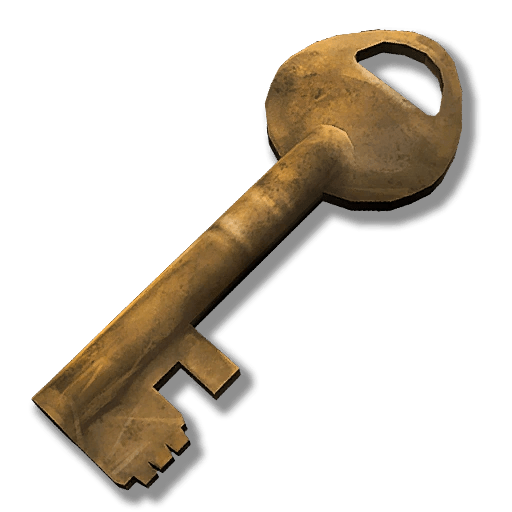

# Blackrock Gate Key

**Blackrock Gate Key**

| Property | Details |
| --- | --- |
|  |  / *Blackrock\_Gate\_Key\_icon.png* |
| Release | [6 October 2021](./The%20Long%20Dark%20%E2%80%94%20Changelog.md#1.95) |
| Wintermute | [Episode 4](./Episode%204%20-%20Fury%2C%20Then%20Silence.md) |
| **Properties** |  |
| Item type | [Collectibles](./Collectibles.md)\|- |
| Stackable | No |
| Examine | Blackrock Gate Key. |
| **Values** |  |
| Weight | 0.00 kg (0 lbs) |
| **Actions** |  |
| Backpack | Examine |
| On ground | Take It, Read Text, Leave It |

**Blackrock Gate Key** is a [Collectible](./Collectibles.md) note found in [Episode 4](./Episode%204%20-%20Fury%2C%20Then%20Silence.md) of the [Wintermute](./Wintermute.md) story. It is found in the infirmary attached to the [Memo](./Memo.md) note. It opens the door leading to the outside of the Prison.

## Update history

- UPDATE **6 October 2021 ([Update](./The%20Long%20Dark%20%E2%80%94%20Changelog.md#1.95)):**
  - Added to game.

**Lua execution error in Module:Navbox function navbox**
