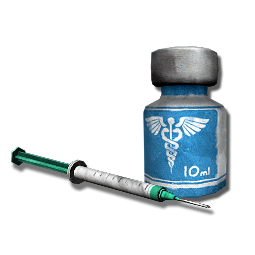

# Blackrock Infirmary Medication

<table class="infobox">
<caption>Blackrock Infirmary Medication</caption>
<colgroup>
<col style="width: 50%" />
<col style="width: 50%" />
</colgroup>
<tbody>
<tr>
<td colspan="2"><figure>

<figcaption>Blackrock_Infirmary_Medication_icon.png</figcaption>
</figure></td>
</tr>
<tr>
<td>
Release
</td>
<td>
<a href="./The%20Long%20Dark%20%E2%80%94%20Changelog.md#1.95" class="wikilink" title="6 October 2021">6 October 2021</a>
</td>
</tr>
<tr>
<td>
Wintermute
</td>
<td>
<a href="./Episode%204%20-%20Fury%2C%20Then%20Silence.md" class="wikilink" title="Episode 4">Episode 4</a> - <a href="./Blackrock%20Blues.md" class="wikilink" title="Blackrock Blues">Blackrock Blues</a>
</td>
</tr>
<tr>
<td colspan="2" class="section">
<strong>Properties</strong>
</td>
</tr>
<tr>
<td>
Item type
</td>
<td>
<a href="./First%20Aid.md" class="wikilink" title="First Aid">First Aid</a>|-
</td>
</tr>
<tr>
<td>
Stackable
</td>
<td>
No
</td>
</tr>
<tr>
<td>
Examine
</td>
<td>
Vials of morphine and injectable antibiotics.
</td>
</tr>
<tr>
<td colspan="2" class="section">
<strong>Values</strong>
</td>
</tr>
<tr>
<td>
Weight
</td>
<td>
0.00 kg (0 lbs)
</td>
</tr>
<tr>
<td colspan="2" class="section">
<strong>Actions</strong>
</td>
</tr>
<tr>
<td>
Backpack
</td>
<td>
Examine
</td>
</tr>
<tr>
<td>
On ground
</td>
<td>
Take It, Read Text, Leave It
</td>
</tr>
<tr>
<td colspan="2" class="section">
<strong>Advanced data</strong>
</td>
</tr>
<tr>
<td>
Item key
</td>
<td>
STORY_InfirmaryMeds
</td>
</tr>
</tbody>
</table>

**Blackrock Infirmary Medication** is a <a href="./First%20Aid.md" class="wikilink" title="First Aid">First Aid</a> item found in <a href="./Episode%204%20-%20Fury%2C%20Then%20Silence.md" class="wikilink" title="Episode 4">Episode 4</a> of the <a href="./Wintermute.md" class="wikilink" title="Wintermute">Wintermute</a> story mode during the mission <a href="./Blackrock%20Blues.md" class="wikilink" title="Blackrock Blues">Blackrock Blues</a>.

During the course of the mission, <a href="./Will%20Mackenzie.md" class="wikilink" title="Will Mackenzie">Will Mackenzie</a> journeys outside <a href="./Blackrock%20Prison.md" class="wikilink" title="Blackrock Federal Penitentiary">Blackrock Federal Penitentiary</a> towards <a href="./Cutty%27s%20Cave.md" class="wikilink" title="Cutty&#39;s Cave">Cutty's Cave</a>, and retrieves the medication off a <a href="./Dead%20Prison%20Guard.md" class="wikilink" title="Dead Prison Guard">Dead Prison Guard</a> for <a href="./Franklin.md" class="wikilink" title="Franklin">Franklin</a>.

## Transcript

The following text is transcribed from the label on **Blackrock Infirmary Medication**

High-quality, injectable medication. The label reads, “FOR EMERGENCIES ONLY”.

## Update history

- UPDATE **6 October 2021 (<a href="./The%20Long%20Dark%20%E2%80%94%20Changelog.md#1.95" class="wikilink" title="Update">Update</a>):**
  - Added to game.

**Lua execution error in Module:Navbox function navbox**

