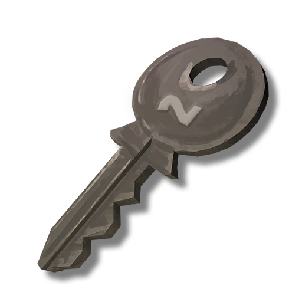

# Blackrock Locker Key 2

**Categories:** Collectibles, Pages with update history · **Source:** [Fandom](https://thelongdark.fandom.com/wiki/Blackrock_Locker_Key_2)

**Blackrock Locker Key #2**

| Property | Details |
| --- | --- |
|  |  / _Blackrock\_Locker\_Key\_2\_icon.png_ |
| Release | [6 October 2021](./The%20Long%20Dark%20%E2%80%94%20Changelog.md#1.95) |
| Wintermute | [Episode 4](./Episode%204%20-%20Fury%2C%20Then%20Silence.md) - [Blackrock Lockers](./Blackrock%20Lockers.md) |
| **Properties** |  |
| Item type | [Collectibles](./Collectibles.md)\|- |
| Stackable | No |
| Examine | A key to a locker in the Blackrock Officers Barracks. |
| **Values** |  |
| Weight | 0.00 kg (0 lbs) |
| **Actions** |  |
| Backpack | Examine |
| On ground | Take It, Read Text, Leave It |

**Blackrock Locker Key #2** is a [Collectible](./Collectibles.md) note found in [Episode 4](./Episode%204%20-%20Fury%2C%20Then%20Silence.md) of the [Wintermute](./Wintermute.md) story as part of the side mission [Blackrock Lockers](./Blackrock%20Lockers.md). It is found on a [Dead Prison Guard](./Dead%20Prison%20Guard.md) located in a small forest area north of Blackrock Prison. It opens Locker #2, containing 5 [Rifle Ammunition](./Rifle%20Ammunition.md), [Combat Pants](./Combat%20Pants.md) and a [Military Coat](./Military%20Coat.md).

## Update history

- UPDATE **6 October 2021 ([Update](./The%20Long%20Dark%20%E2%80%94%20Changelog.md#1.95)):**
  - Added to game.

[ru:Ключ от тюремного шкафчика №2](ru:%D0%9A%D0%BB%D1%8E%D1%87_%D0%BE%D1%82_%D1%82%D1%8E%D1%80%D0%B5%D0%BC%D0%BD%D0%BE%D0%B3%D0%BE_%D1%88%D0%BA%D0%B0%D1%84%D1%87%D0%B8%D0%BA%D0%B0_%E2%84%962)
