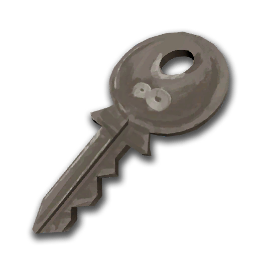

# Blackrock Locker Key 8

<table class="infobox">
<caption>Blackrock Locker Key #8</caption>
<colgroup>
<col style="width: 50%" />
<col style="width: 50%" />
</colgroup>
<tbody>
<tr>
<td colspan="2"><figure>

<figcaption>Blackrock_Locker_Key_8_icon.png</figcaption>
</figure></td>
</tr>
<tr>
<td>
Release
</td>
<td>
<a href="./The%20Long%20Dark%20%E2%80%94%20Changelog.md#1.95" class="wikilink" title="6 October 2021">6 October 2021</a>
</td>
</tr>
<tr>
<td>
Wintermute
</td>
<td>
<a href="./Episode%204%20-%20Fury%2C%20Then%20Silence.md" class="wikilink" title="Episode 4">Episode 4</a> - <a href="./Blackrock%20Lockers.md" class="wikilink" title="Blackrock Lockers">Blackrock Lockers</a>
</td>
</tr>
<tr>
<td colspan="2" class="section">
<strong>Properties</strong>
</td>
</tr>
<tr>
<td>
Item type
</td>
<td>
<a href="./Collectibles.md" class="wikilink" title="Collectibles">Collectibles</a>|-
</td>
</tr>
<tr>
<td>
Stackable
</td>
<td>
No
</td>
</tr>
<tr>
<td>
Examine
</td>
<td>
A key to a locker in the Blackrock Officers Barracks.
</td>
</tr>
<tr>
<td colspan="2" class="section">
<strong>Values</strong>
</td>
</tr>
<tr>
<td>
Weight
</td>
<td>
0.00 kg (0 lbs)
</td>
</tr>
<tr>
<td colspan="2" class="section">
<strong>Actions</strong>
</td>
</tr>
<tr>
<td>
Backpack
</td>
<td>
Examine
</td>
</tr>
<tr>
<td>
On ground
</td>
<td>
Take It, Read Text, Leave It
</td>
</tr>
</tbody>
</table>

**Blackrock Locker Key \#8** is a <a href="./Collectibles.md" class="wikilink" title="Collectible">Collectible</a> note found in <a href="./Episode%204%20-%20Fury%2C%20Then%20Silence.md" class="wikilink" title="Episode 4">Episode 4</a> of the <a href="./Wintermute.md" class="wikilink" title="Wintermute">Wintermute</a> story as part of the side mission <a href="./Blackrock%20Lockers.md" class="wikilink" title="Blackrock Lockers">Blackrock Lockers</a>. It is found in the <a href="./Steam%20Tunnels.md" class="wikilink" title="Steam Tunnels">Steam Tunnels</a> inside a <a href="./Metal%20Container.md" class="wikilink" title="Metal Container">Metal Container</a> at the final stairwell leading back into <a href="./Blackrock%20Prison.md" class="wikilink" title="Blackrock Prison">Blackrock Prison</a>. It is used to open Locker \#8 which contains 12 <a href="./Revolver%20Ammunition.md" class="wikilink" title="Revolver Ammunition">Revolver Ammunition</a>, a <a href="./Revolver.md" class="wikilink" title="Revolver">Revolver</a> and a <a href="./Flare%20Shell.md" class="wikilink" title="Flare Shell">Flare Shell</a>.

## Update history

- UPDATE **6 October 2021 (<a href="./The%20Long%20Dark%20%E2%80%94%20Changelog.md#1.95" class="wikilink" title="Update">Update</a>):**
  - Added to game.

**Lua execution error in Module:Navbox function navbox**

<a href="ru:%D0%9A%D0%BB%D1%8E%D1%87_%D0%BE%D1%82_%D1%82%D1%8E%D1%80%D0%B5%D0%BC%D0%BD%D0%BE%D0%B3%D0%BE_%D1%88%D0%BA%D0%B0%D1%84%D1%87%D0%B8%D0%BA%D0%B0_%E2%84%968" class="wikilink" title="ru:Ключ от тюремного шкафчика №8">ru:Ключ от тюремного шкафчика №8</a>

