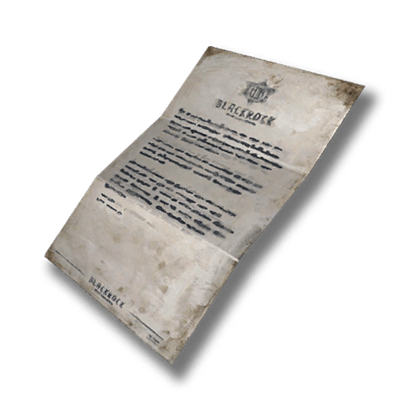

# Blackrock Memo \- Late Employee

<table class="infobox">
<caption>Blackrock Memo - Late Employee</caption>
<colgroup>
<col style="width: 50%" />
<col style="width: 50%" />
</colgroup>
<tbody>
<tr>
<td colspan="2"><figure>

<figcaption>Blackrock_Memo_-_Late_Employee_icon.png</figcaption>
</figure></td>
</tr>
<tr>
<td>
Release
</td>
<td>
<a href="./The%20Long%20Dark%20%E2%80%94%20Changelog.md#1.95" class="wikilink" title="6 October 2021">6 October 2021</a>
</td>
</tr>
<tr>
<td>
Wintermute
</td>
<td>
<a href="./Episode%204%20-%20Fury%2C%20Then%20Silence.md" class="wikilink" title="Episode 4">Episode 4</a> - <a href="./Blackrock%20Rumours.md" class="wikilink" title="Blackrock Rumours">Blackrock Rumours</a>
</td>
</tr>
<tr>
<td colspan="2" class="section">
<strong>Properties</strong>
</td>
</tr>
<tr>
<td>
Item type
</td>
<td>
<a href="./Collectibles.md" class="wikilink" title="Collectibles">Collectibles</a>|-
</td>
</tr>
<tr>
<td>
Stackable
</td>
<td>
No
</td>
</tr>
<tr>
<td>
Examine
</td>
<td>
A memo detailing a missing employee.
</td>
</tr>
<tr>
<td colspan="2" class="section">
<strong>Values</strong>
</td>
</tr>
<tr>
<td>
Weight
</td>
<td>
0.00 kg (0 lbs)
</td>
</tr>
<tr>
<td colspan="2" class="section">
<strong>Actions</strong>
</td>
</tr>
<tr>
<td>
Backpack
</td>
<td>
Examine
</td>
</tr>
<tr>
<td>
On ground
</td>
<td>
Take It, Read Text, Leave It
</td>
</tr>
</tbody>
</table>

**Blackrock Memo - Late Employee** is a <a href="./Collectibles.md" class="wikilink" title="Collectible">Collectible</a> note found in <a href="./Episode%204%20-%20Fury%2C%20Then%20Silence.md" class="wikilink" title="Episode 4">Episode 4</a> of the <a href="./Wintermute.md" class="wikilink" title="Wintermute">Wintermute</a> story. It is found in the phone room of the Blackrock Infirmary, just below the corkboard on the floor.

## Transcript

The following text is transcribed from **Blackrock Memo - Late Employee**

ATTN: Red Shift Supervisors

CC: Dr. Childs.

Once again we are left wondering what it is exactly that Murphy is up to when he arrives late for his shifts. Today marks six times this month. No one seems to know where he is. We know he is off the grounds and on foot instead of in his truck.

Given the current shift requirements the Warden is not ready to initiate an official disciplinary response, so we are copying the doctor on this memo as well. In case medical or psychiatric support is needed for Murphy.

but first we need to find him. He was seen previously heading down the low river near the Blocked Bridge, south of the Penitentiary.

We are all aware of what isolation can do out here, but we have a job to do just the same.

Blackrock Admin Team

## Update history

- UPDATE **6 October 2021 (<a href="./The%20Long%20Dark%20%E2%80%94%20Changelog.md#1.95" class="wikilink" title="Update">Update</a>):**
  - Added to game.

**Lua execution error in Module:Navbox function navbox**

