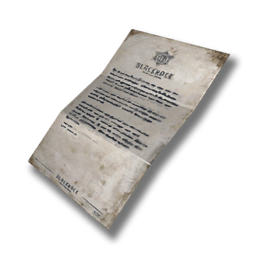

# Blackrock Memo

<table class="infobox">
<caption>Blackrock Memo</caption>
<colgroup>
<col style="width: 50%" />
<col style="width: 50%" />
</colgroup>
<tbody>
<tr>
<td colspan="2"><figure>

<figcaption>Blackrock_Memo_icon.png</figcaption>
</figure></td>
</tr>
<tr>
<td>
Release
</td>
<td>
<a href="./The%20Long%20Dark%20%E2%80%94%20Changelog.md#1.98" class="wikilink" title="7 December 2021">7 December 2021</a>
</td>
</tr>
<tr>
<td colspan="2" class="section">
<strong>Properties</strong>
</td>
</tr>
<tr>
<td>
Item type
</td>
<td>
<a href="./Collectibles.md" class="wikilink" title="Collectibles">Collectibles</a>|-
</td>
</tr>
<tr>
<td>
Stackable
</td>
<td>
No
</td>
</tr>
<tr>
<td>
Examine
</td>
<td>
Crude handwriting is scratched into the margins of an old, faded office memo.
</td>
</tr>
<tr>
<td colspan="2" class="section">
<strong>Values</strong>
</td>
</tr>
<tr>
<td>
Weight
</td>
<td>
0.00 kg (0 lbs)
</td>
</tr>
<tr>
<td colspan="2" class="section">
<strong>Actions</strong>
</td>
</tr>
<tr>
<td>
Backpack
</td>
<td>
Examine
</td>
</tr>
<tr>
<td>
On ground
</td>
<td>
Take It, Read Text, Leave It
</td>
</tr>
</tbody>
</table>

**Page** is a <a href="./Collectibles.md" class="wikilink" title="Collectibles">Collectibles</a> found in <a href="./Survival%20Mode.md" class="wikilink" title="Survival Mode">Survival Mode</a> at <a href="./Blackrock.md" class="wikilink" title="Blackrock">Blackrock</a>. It is inside <a href="./Blackrock%20Prison.md" class="wikilink" title="Blackrock Prison">Blackrock Prison</a> on the <a href="./Keypad.md" class="wikilink" title="Keypad">Keypad</a> leading to the <a href="./Ammunition%20Work%20Bench.md" class="wikilink" title="Ammunition Work Bench">Ammunition Work Bench</a> room.

## Transcript

The following text is transcribed from **Blackrock Memo**

Find me at the mine. East and up the hill, looking up at the mountain. I got a lead on this door.\
\
-- M (Who is M?)

## Update history

UPDATE **7 December 2021 (<a href="./The%20Long%20Dark%20%E2%80%94%20Changelog.md" class="wikilink" title="Update">Update</a>):**

- Added to game

**Lua execution error in Module:Navbox function navbox**

<a href="ru:%D0%97%D0%B0%D0%BF%D0%B8%D1%81%D0%BA%D0%B0_%D0%A7%D0%B5%D1%80%D0%BD%D0%BE%D0%B3%D0%BE_%D0%BA%D0%B0%D0%BC%D0%BD%D1%8F_(%D0%BC%D0%B0%D1%81%D1%82%D0%B5%D1%80%D1%81%D0%BA%D0%B0%D1%8F)" class="wikilink" title="ru:Записка Черного камня (мастерская)">ru:Записка Черного камня (мастерская)</a>

