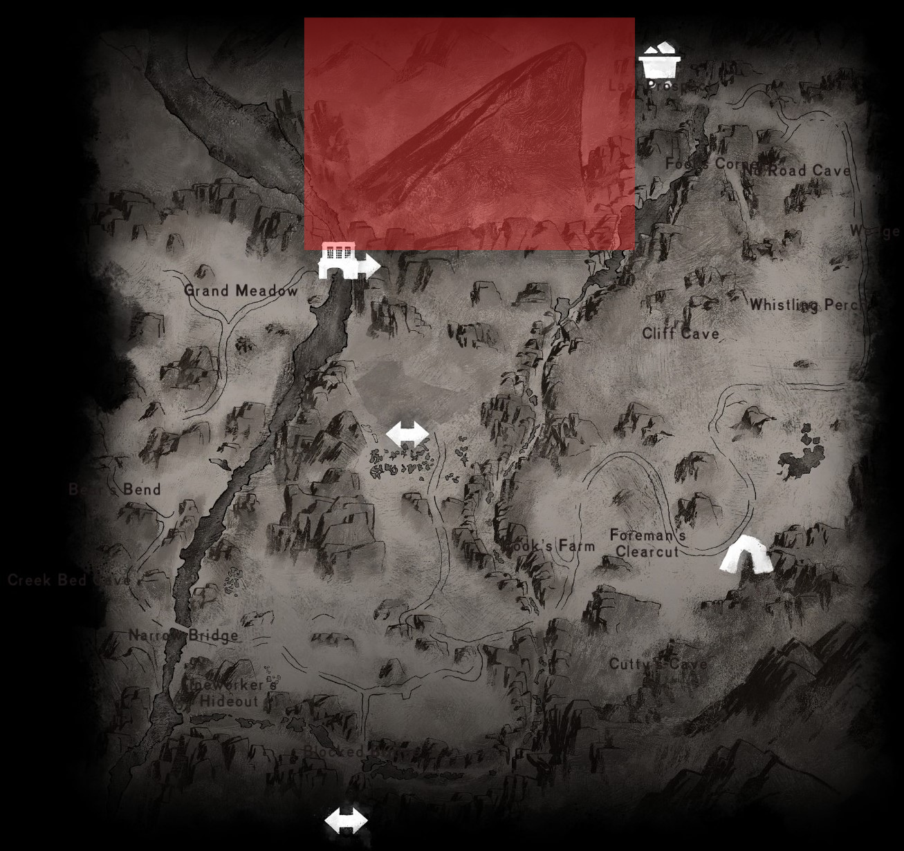
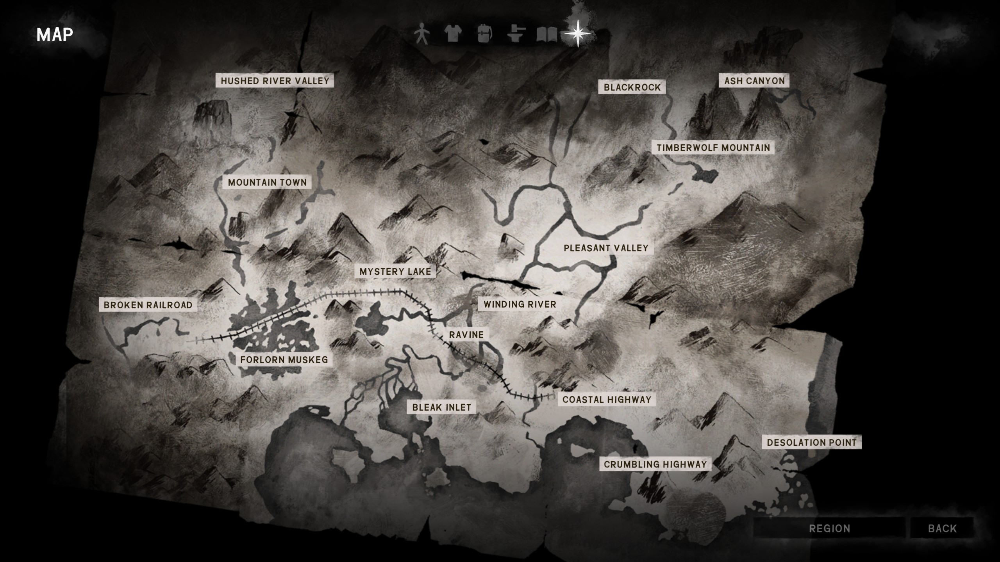
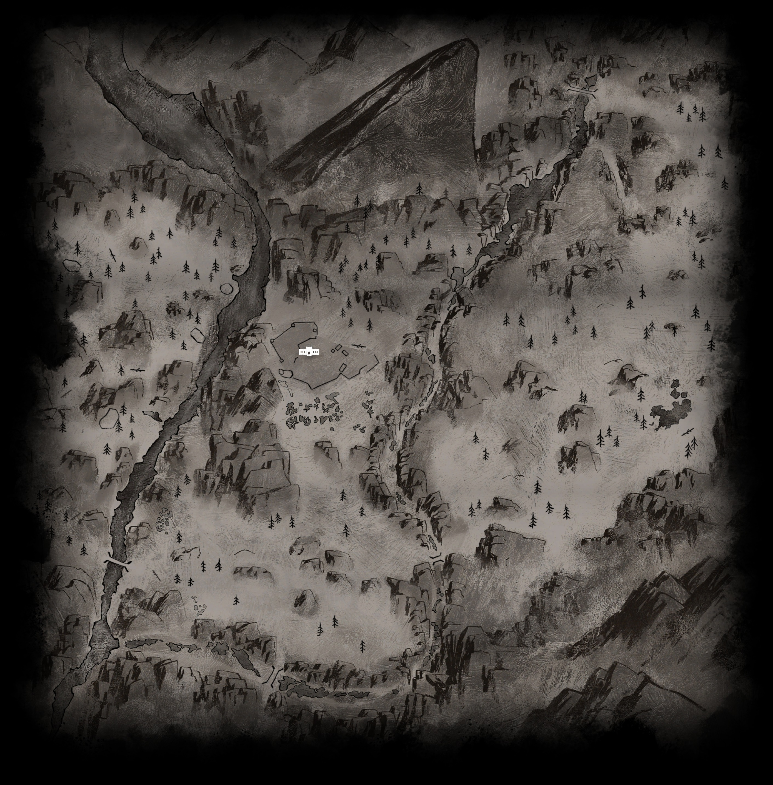
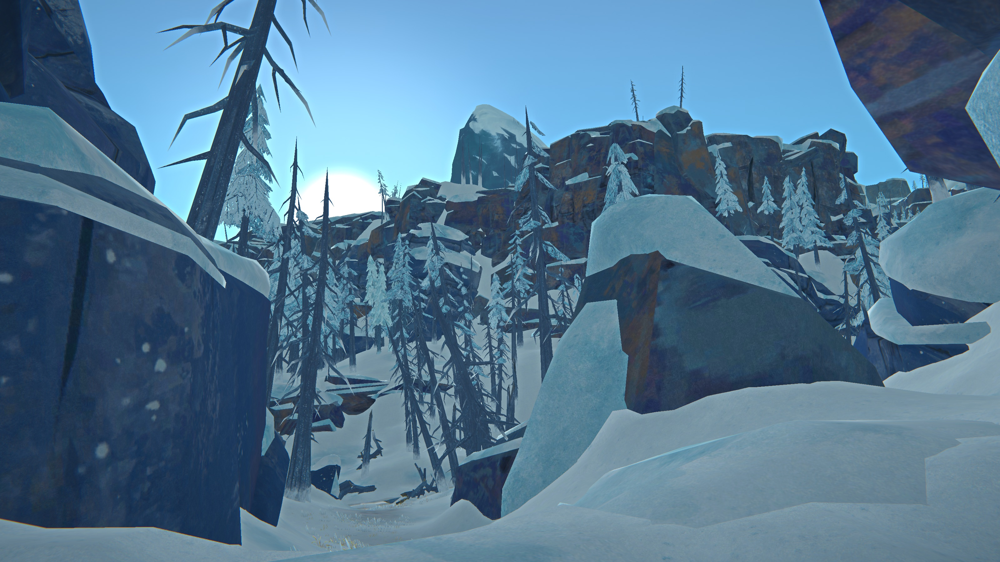

# Blackrock Mountain

**Categories:** Blackrock, Locations, Outdoor locations · **Source:** [Fandom](https://thelongdark.fandom.com/wiki/Blackrock_Mountain)

**Blackrock Mountain**

| Property | Details |
| --- | --- |
|  |  / _Blackrock\_Region.jpg_ |
| **Location** |  |
|  |  / _Blackrock\_Mountain\_Location.png_ |
| Region |  |
| Description | A large notable landmark looming over [Blackrock Prison](./Blackrock%20Prison.md) |
| **General** |  |

| “ | __The dramatic peak dominates the landscape around Blackrock Penitentiary and played a role in establishing the prison's fearsome reputation.__ / [Load Screen](./Load%20Screen.md) Description / ” |
|  / _The mountain as seen from [Foreman's Clearcut](./Foreman%27s%20Clearcut.md)_ |  / _The mountain as seen on the world map_ /  / _The mountain seen on the region map_ /  / _Concept art of [Blackrock Prison](./Blackrock%20Prison.md) with the mountain_ |
|  / _The mountain as seen from [Wedge Cave](./Wedge%20Cave.md)_ |  |
