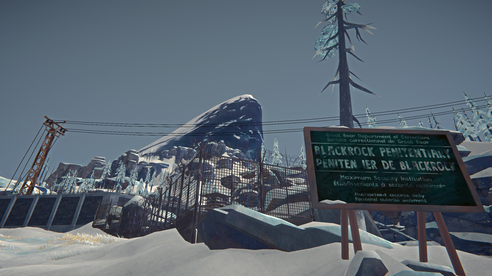

# Blackrock Mountain

**Categories:** Blackrock, Locations, Outdoor locations · **Source:** [Fandom](https://thelongdark.fandom.com/wiki/Blackrock_Mountain)

**Blackrock Mountain**

**Location**

Region

Description

A large notable landmark looming over [Blackrock Prison](./Blackrock%20Prison.md)

**General**

Has no shelter

> “**The dramatic peak dominates the landscape around Blackrock Penitentiary and played a role in establishing the prison's fearsome reputation.**”
>
> — [Load Screen](./Load%20Screen.md) Description

**Blackrock Mountain** is a landmark in [Blackrock](./Blackrock.md) that can be seen throughout most of the region, as well as the reason for the region's namesake. The base of the mountain can be passed when heading to and from the [Last Prospect](./Last%20Prospect.md) mine. The mountain is large enough that it can be seen throughout most of the region, as well as appearing as a landmark on the World [Map](./Map.md) of Lower Great Bear.

## Gallery

_The mountain as seen from [Foreman's Clearcut](./Foreman%27s%20Clearcut.md)_

_Concept art of [Blackrock Prison](./Blackrock%20Prison.md) with the mountain_

_The mountain as seen from [Wedge Cave](./Wedge%20Cave.md)_
