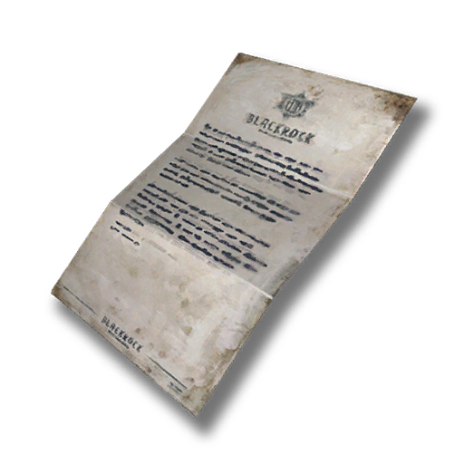

# Blackrock Penitentiary Memo

<table class="infobox">
<caption>Blackrock Penitentiary Memo</caption>
<colgroup>
<col style="width: 50%" />
<col style="width: 50%" />
</colgroup>
<tbody>
<tr>
<td colspan="2"><figure>

<figcaption>Blackrock_Penitentiary_Memo_icon.png</figcaption>
</figure></td>
</tr>
<tr>
<td>
Release
</td>
<td>
<a href="./The%20Long%20Dark%20%E2%80%94%20Changelog.md#1.60" class="wikilink" title="22 October 2019">22 October 2019</a>
</td>
</tr>
<tr>
<td>
Wintermute
</td>
<td>
<a href="./Episode%203%20-%20Crossroads%20Elegy.md" class="wikilink" title="Episode 3">Episode 3</a> - <a href="./Blackrock%20%28mission%29.md" class="wikilink" title="Blackrock (mission)">Blackrock (mission)</a>
</td>
</tr>
<tr>
<td colspan="2" class="section">
<strong>Properties</strong>
</td>
</tr>
<tr>
<td>
Item type
</td>
<td>
<a href="./Collectibles.md" class="wikilink" title="Collectibles">Collectibles</a>|-
</td>
</tr>
<tr>
<td>
Stackable
</td>
<td>
No
</td>
</tr>
<tr>
<td>
Examine
</td>
<td>
Official typewritten orders for Blackrock prison guards
</td>
</tr>
<tr>
<td colspan="2" class="section">
<strong>Values</strong>
</td>
</tr>
<tr>
<td>
Weight
</td>
<td>
0.00 kg (0 lbs)
</td>
</tr>
<tr>
<td colspan="2" class="section">
<strong>Actions</strong>
</td>
</tr>
<tr>
<td>
Backpack
</td>
<td>
Examine
</td>
</tr>
<tr>
<td>
On ground
</td>
<td>
Take It, Read Text, Leave It
</td>
</tr>
<tr>
<td colspan="2" class="section">
<strong>Advanced data</strong>
</td>
</tr>
<tr>
<td>
Item key
</td>
<td>
STORY_Collectible_BlackrockMemo
</td>
</tr>
</tbody>
</table>

**Blackrock Penitentiary Memo** is a <a href="./Collectibles.md" class="wikilink" title="Collectible">Collectible</a> item found in <a href="./Episode%203%20-%20Crossroads%20Elegy.md" class="wikilink" title="Episode 3">Episode 3</a> of the <a href="./Wintermute.md" class="wikilink" title="Wintermute">Wintermute</a> story mode as a part of the <a href="./Blackrock%20%28mission%29.md" class="wikilink" title="Blackrock (mission)">Blackrock (mission)</a> side mission.

During the course of the mission, Astrid finds the note *Blackrock Penitentiary Memo* on the body of a dead prison guard near <a href="./Heartbreak%20Bridge.md" class="wikilink" title="Heartbreak Bridge">Heartbreak Bridge</a>.

## Transcript

The following text is transcribed from **Blackrock Penitentiary Memo**

TO: Officer Gray

FROM: Regional Deputy Commissioner Stevens

RE: Blackrock Transfer

Have we arranged additional officers for the upcoming inmate transfer? Roads and conditions are never good on Great Bear, and this year I am hearing they are even worse than usual.

Let’s make sure we have enough help, where and when we need it.

As you know, this bunch won't make it easy on us.

Regards,

R. Stevens

Deputy Commissioner

## Update history

- UPDATE **22 October 2019 (<a href="./The%20Long%20Dark%20%E2%80%94%20Changelog.md#1.60" class="wikilink" title="Update">Update</a>):**
  - Added to game.

**Lua execution error in Module:Navbox function navbox**

