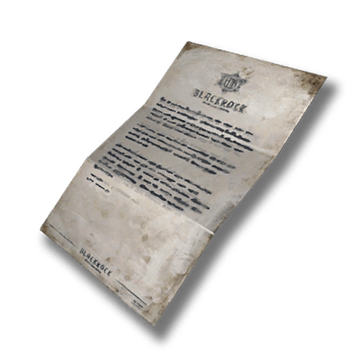

# Blackrock Prisoner Release Record

**Categories:** Collectibles, Pages with update history · **Source:** [Fandom](https://thelongdark.fandom.com/wiki/Blackrock_Prisoner_Release_Record)

**Blackrock Prisoner Release Record**

| Property | Details |
| --- | --- |
|  |  / _Blackrock\_Prisoner\_Release\_Record\_icon.png_ |
| Release | [6 October 2021](./The%20Long%20Dark%20%E2%80%94%20Changelog.md#1.95) |
| Wintermute | [Episode 4](./Episode%204%20-%20Fury%2C%20Then%20Silence.md) - [Blackrock Rumours](./Blackrock%20Rumours.md) |
| **Properties** |  |
| Item type | [Collectibles](./Collectibles.md)\|- |
| Stackable | No |
| Examine | An official document with details on a prisoner release. |
| **Values** |  |
| Weight | 0.00 kg (0 lbs) |
| **Actions** |  |
| Backpack | Examine |
| On ground | Take It, Read Text, Leave It |

**Blackrock Prisoner Release Record** is a [Collectible](./Collectibles.md) note found in [Episode 4](./Episode%204%20-%20Fury%2C%20Then%20Silence.md) of the [Wintermute](./Wintermute.md) story. It is found inside the prepper cache during the Suspicious Person portion of the [Blackrock Rumours](./Blackrock%20Rumours.md) side mission. It is not required to be collected to finish the objective, unlike the [Conspiracy Theories](./Conspiracy%20Theories.md) note.

## Transcript

_The following text is transcribed from **Blackrock Prisoner Release Record**_

**Medical Evaluation -- Inmate #5627

Board Summary:

Extensive evidence of both pre- and post-incarceration trauma.

(\*)Spiral fractures of the humerus on both arms  
 (\*)Cervical ligament damage  
 (\*)Radiology studies suggest multiples (sic) shoulder dislocations  
 (\*)Patient reports post-concussion syndrome

(\*\*)Recommend evaluation under compassionate release criteria (see attached inmate history for background). Psychological survey suggests very low risk of recidivism.

Regards,

Blackrock Penitentiary Medical Committee**

## Update history

- UPDATE **6 October 2021 ([Update](./The%20Long%20Dark%20%E2%80%94%20Changelog.md#1.95)):**
  - Added to game.
