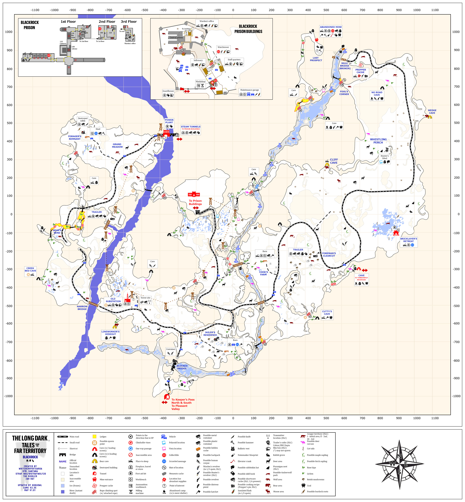
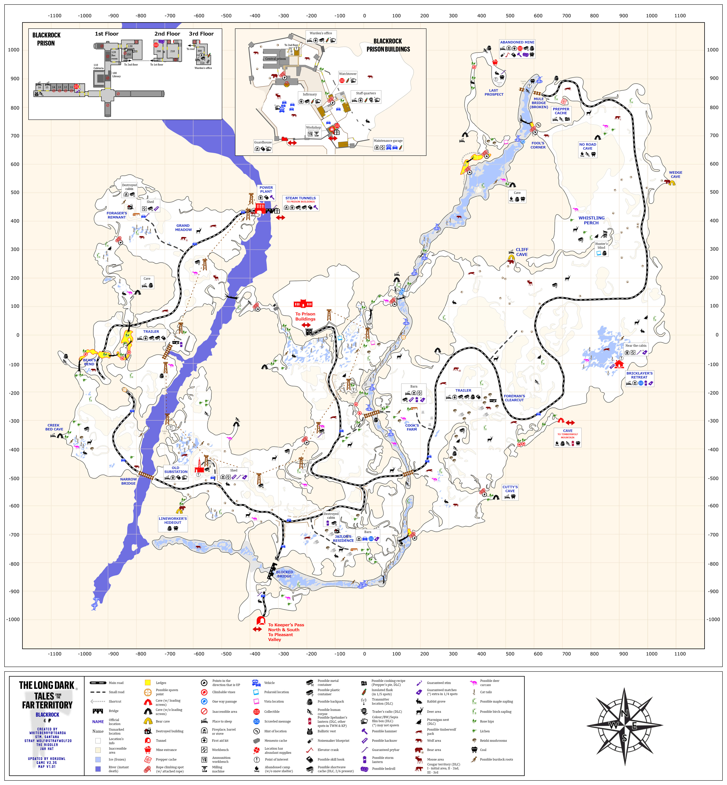
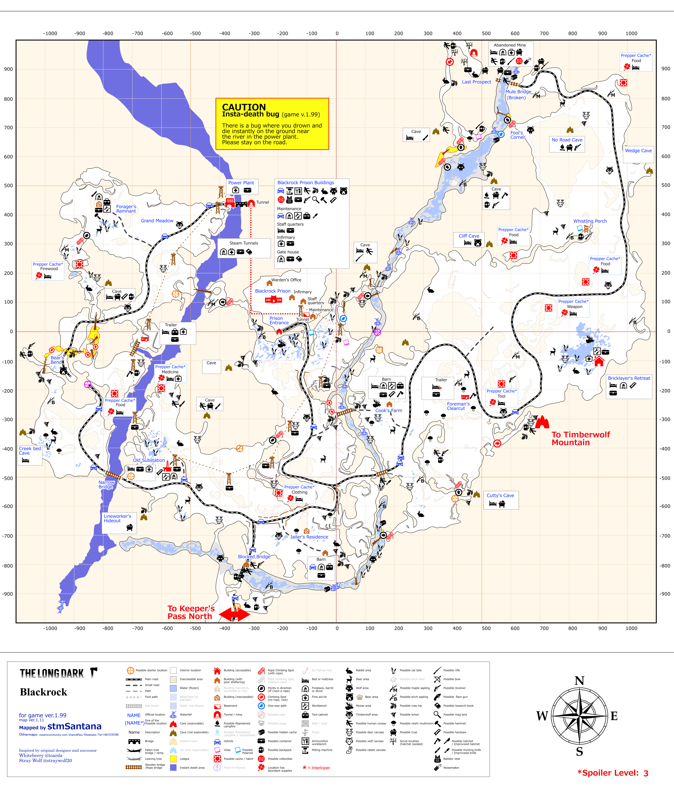

# Blackrock

**Categories:** Blackrock, Regions · **Source:** [Fandom](https://thelongdark.fandom.com/wiki/Blackrock)

**Contents**

- [Exclusive gear](#exclusive-gear)
- [Survivability](#survivability)
- [Wildlife Availability](#wildlife-availability)
- [Safehouses](#safehouses)
- [Locations](#locations)
- [Notes](#notes)
- [Gallery](#gallery)
- [Maps](#maps)

**Blackrock**

[Blackrock Region](../assets/Blackrock_Region.jpg)

**Location on [Great Bear Island](./Great%20Bear%20Island.md)**

[Blackrock Location](../assets/Blackrock_Location.png)

[Map EP4 L0](../assets/Map-EP4-L0.jpg)

**Details**

**Description:** An old prison complex built under the shadow of Blackrock Mountain.

**Connecting Regions:** [Pleasant Valley](./Pleasant%20Valley.md) (via [Keeper's Pass North](./Keeper%27s%20Pass%20North.md) and [Keeper's Pass South](./Keeper%27s%20Pass%20South.md)) [Timberwolf Mountain](./Timberwolf%20Mountain.md)

**Characters:** [Will Mackenzie](./Will%20Mackenzie.md), [Mathis](./Mathis.md), [Donner](./Donner.md), [Jace](./Jace.md), [Franklin](./Franklin.md), [Heller](./Heller.md), [Vachon](./Vachon.md)

**Interloper Region Spawn:** Yes

**Locations:** 25

**Date Added:** October 6th 2021

> “__For intermediate players. Home to Blackrock Penitentiary, this Region’s icy rivers, deep ravines, and challenging weather act as a natural extension of the notorious prison. Its many caves and winding roads offer additional security if a storm moves in.  
 Connects to Pleasant Valley and Timberwolf Mountain.__”
>
> — - In game description

**Blackrock** is the 12th [Region](./Region.md) to be added to [Survival Mode](./Survival%20Mode.md) (with the [Perilous Constraint](./The%20Long%20Dark%20%E2%80%94%20Changelog.md) update in December 2021), and is the setting for [Episode 4: Fury, Then Silence](./Episode%204%20-%20Fury%2C%20Then%20Silence.md). It is centered around the [titular mountain](./Blackrock%20Mountain.md) and federal penitentiary.

In Survival Mode, Blackrock connects to [Pleasant Valley](./Pleasant%20Valley.md) near the [Long Curve](./Long%20Curve.md) through a pair of transition zones: [Keeper's Pass North](./Keeper%27s%20Pass%20North.md) and [Keeper's Pass South](./Keeper%27s%20Pass%20South.md), with an ice cave connecting them. It also connects to [Timberwolf Mountain](./Timberwolf%20Mountain.md) through a transition cave.

## Exclusive gear

This region is the first to contain [Noisemakers](./Noisemaker.md) and the [Ballistic Vest](./Ballistic%20Vest.md), which were added to Survival Mode in the [Perilous Constraint](./The%20Long%20Dark%20%E2%80%94%20Changelog.md) update.

- Noisemakers are a crafted at an ammunition workbench, but must first be found before they can be crafted (only found in Blackrock and a Bleak Inlet memento cache). Similar to flares, they excel at scaring wildlife particularly breaking Timberwolf pack morale.
- The Ballistic Vest is an accessory which provides massive protection from wildlife attacks (50%) at the cost of reduced mobility and carry capacity.

## Survivability

Blackrock is listed as a medium difficulty region, but surviving there can be challenging even for the well prepared. Natural resources are abundant in the countryside, and the region has an abundance of structures and vehicles for loot and shelter. Blizzards are frequent in Blackrock and make navigation difficult.

The greatest hazard in Blackrock is its high predator density; timberwolves, wolves, and numerous bears.

The local [Ammunition Work Bench](./Ammunition%20Work%20Bench.md) at the prison allows crafting [Noisemakers](./Noisemaker.md) and creating new ammunition, along with a [Milling Machine](./Milling%20Machine.md) for repairing gear.

## Wildlife Availability

Blackrock features the highest density of Predator Wildlife of any region. Timberwolves will frequently pursue a survivor indoors or along the base of cliffs for hours: exacerbating the dangers of [starvation, dehydration, freezing](./Needs.md), or [Cabin Fever](./Cabin%20Fever.md).

- [Deer](./Deer.md), [Rabbit](./Rabbit.md), and [Ptarmigan](./Ptarmigan.md) are commonly found throughout the region. [Deer Carcasses](./Deer%20Carcass.md) can also be found sporadically.
- [Moose](./Moose.md) can occasionally spawn in this region.
- [Wolves](./Wolf.md), though quite rare, appear in this set areas in this region away from Timberwolves.
  - Wolves always spawn in the [Blackrock Prison](./Blackrock%20Prison.md) and at the bottom of the river near [Fool's Corner](./Fool%27s%20Corner.md).
  - They can very rarely spawn near the entrance to [Keeper's Pass North](./Keeper%27s%20Pass%20North.md), behind the [Blocked Bridge](./Blocked%20Bridge.md).
- [Timberwolves](./Timberwolf.md) are the main hazard of this region, found throughout most if not all major roads, fields, and pathways.
- There are 3 potential [Bear](./Bear.md) spawns in the region ([Lineworker's Hideout](./Lineworker%27s%20Hideout.md), [Bear's Bend](./Bear%27s%20Bend.md), [Cliff Cave](./Cliff%20Cave.md)).
- [Cougar](./Cougar.md) appear if enabled, and are found in the mountains to the northeast.

## Safehouses

- [Blackrock Prison](./Blackrock%20Prison.md) is surrounded and infested with predators, but offers vast storage space, a crafting bench and ammunition workbench, and hunting outside the yard. An indoor connection to the western Blackrock is close by via the [Steam Tunnels](./Steam%20Tunnels.md), useful in poor weather.
- The [Old Substation](./Old%20Substation.md) with its workbench and outdoor fire barrel.
- The trailer at [Foreman's Clearcut](./Foreman%27s%20Clearcut.md).

## Locations

As with most regions, Blackrock Mountain features a number of discoverable locations:

| Column 1 | Column 2 |
| --- | --- |
| - [Bear's Bend](./Bear%27s%20Bend.md) - [Blackrock Prison](./Blackrock%20Prison.md) - [Blocked Bridge](./Blocked%20Bridge.md) - [Bricklayer's Retreat](./Bricklayer%27s%20Retreat.md) - [Cliff Cave](./Cliff%20Cave.md) - [Cook's Farm](./Cook%27s%20Farm.md) - [Creek Bed Cave](./Creek%20Bed%20Cave.md) - [Cutty's Cave](./Cutty%27s%20Cave.md) - [Fool's Corner](./Fool%27s%20Corner.md) - [Forager's Remnant](./Forager%27s%20Remnant.md) - [Foreman's Clearcut](./Foreman%27s%20Clearcut.md) - [Grand Meadow](./Grand%20Meadow.md) - [Jailer's Residence](./Jailer%27s%20Residence.md) | - [Last Prospect](./Last%20Prospect.md) - [Lineworker's Hideout](./Lineworker%27s%20Hideout.md) - [Mule Bridge](./Mule%20Bridge.md) - [Narrow Bridge](./Narrow%20Bridge.md) - [No Road Cave](./No%20Road%20Cave.md) - [Old Substation](./Old%20Substation.md) - [Power Plant](./Power%20Plant.md) - [Steam Tunnels](./Steam%20Tunnels.md) - [Wedge Cave](./Wedge%20Cave.md) - [Whistling Perch](./Whistling%20Perch.md) - To Cave System (Region Transition to [Timberwolf Mountain](./Timberwolf%20Mountain.md)) - To Keeper's Pass North (Region Transition to [Keeper's Pass North](./Keeper%27s%20Pass%20North.md)) |

There is also 1 [Prepper Cache](./Prepper%20Cache.md) that is found near Mule Bridge and a [Trailer (Blackrock Region)](./Trailer%20%28Blackrock%20Region%29.md). [Blackrock Mountain](./Blackrock%20Mountain.md) is also a major landmark seen throughout most of the region.

## Notes

- Blackrock Mountain was first revealed as an in-game location in [Episode 1: Do Not Go Gentle](./Episode%201%20-%20Do%20Not%20Go%20Gentle.md).
- In Episode 1 of Wintermute, [Hobbs](./Hobbs.md) describes Blackrock Penitentiary as housing "the worst of the worst". Given Great Bear's remote island geography, and the expense to staff and maintain such a prison, Blackrock is likely a "super-maximum security" (SUPERMAX) penal colony facility.
- Shortly before [The First Flare](./First%20Flare.md), a bus from Blackrock Penitentiary crashed in [Mountain Town](./Mountain%20Town.md), allowing the prisoners aboard it to escape.
- The Blackrock Mountain region contains three possible [moose](./Moose.md) spawns: the first is directly outside the prison roaming the small bog, the second is near [Cook's Farm](./Cook%27s%20Farm.md), and the third is outside of [Bricklayer's Retreat](./Bricklayer%27s%20Retreat.md) on the frozen pond.

## Gallery

## Maps

