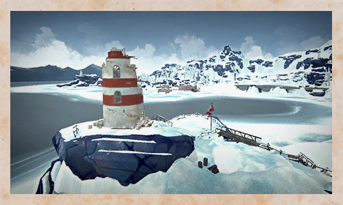

# Bleak Inlet

**Contents**

- [Overview](#Overview)
- [The Cannery](#The_Cannery)
- [Safehouses](#Safehouses)
- [Locations](#Locations)
- [Tips](#Tips)
- [Gallery](#Gallery)
- [Maps](#Maps)

<table class="infobox">
<caption>Bleak Inlet</caption>
<colgroup>
<col style="width: 50%" />
<col style="width: 50%" />
</colgroup>
<tbody>
<tr>
<td colspan="2"><figure>

<figcaption>Bleakinlet.png</figcaption>
</figure></td>
</tr>
<tr>
<td colspan="2" class="section">
<strong>Location on <a href="./Great%20Bear%20Island.md" class="wikilink" title="Great Bear Island">Great Bear Island</a></strong>
</td>
</tr>
<tr>
<td colspan="2"><figure>
[Missing image: Bleak_Inlet_Location.png]
<figcaption>Bleak_Inlet_Location.png</figcaption>
</figure></td>
</tr>
<tr>
<td colspan="2"><figure>

<figcaption>Bleak_Inlet_Region_Map.png</figcaption>
</figure></td>
</tr>
<tr>
<td colspan="2" class="section">
<strong>Details</strong>
</td>
</tr>
<tr>
<td>
Description
</td>
<td>
Industrial wasteland ravaged by strong winds and timberwolves
</td>
</tr>
<tr>
<td>
Connecting Regions
</td>
<td>
<a href="./Forlorn%20Muskeg.md" class="wikilink" title="Forlorn Muskeg">Forlorn Muskeg</a>, <a href="./The%20Ravine.md" class="wikilink" title="The Ravine">The Ravine</a>
</td>
</tr>
<tr>
<td>
Characters
</td>
<td>
None
</td>
</tr>
<tr>
<td>
Difficulty
</td>
<td>
Advanced
</td>
</tr>
<tr>
<td>
Interloper Region Spawn
</td>
<td>
Yes
</td>
</tr>
<tr>
<td>
Locations
</td>
<td>
21
</td>
</tr>
<tr>
<td>
Date Added
</td>
<td>
Dec 10, 2019
</td>
</tr>
</tbody>
</table>

<table>
<colgroup>
<col style="width: 33%" />
<col style="width: 33%" />
<col style="width: 33%" />
</colgroup>
<tbody>
<tr>
<td style="vertical-align: top; font-size: 3em; color: #5d5980; padding-right: 10px">
“
</td>
<td>
Once home to a thriving industrial Cannery, seismic instability has cut Bleak Inlet off from the rest of the Great Bear mainland. Inaccessible and in the heart of Timberwolf territory, exploring Bleak Inlet is not for the faint of heart. The Cannery industrial complex holds a useful treasure for those hardy enough to access it.

&#10;

- In game description

</td>
<td style="vertical-align: bottom; font-size: 3em; color: #5d5980; padding-left: 10px">
”
</td>
</tr>
</tbody>
</table>

**Bleak Inlet** is the 10th <a href="./Region.md" class="wikilink" title="Region">Region</a> to be added to <a href="./The%20Long%20Dark.md" class="wikilink" title="The Long Dark"><em>The Long Dark</em></a>. It was released in the Errant Pilgrim update in December 2019. The region connects to <a href="./Forlorn%20Muskeg.md" class="wikilink" title="Forlorn Muskeg">Forlorn Muskeg</a> and <a href="./The%20Ravine.md" class="wikilink" title="The Ravine">The Ravine</a>.

## Overview

Bleak Inlet is a cold and windy region of ruined coastal industry, and a ring of wilderness around its namesake inlet of <a href="./Weak%20Ice.md" class="wikilink" title="Weak Ice">Weak Ice</a>. Entry to Bleak Inlet can be gained through a cave system from <a href="./Forlorn%20Muskeg.md" class="wikilink" title="Forlorn Muskeg">Forlorn Muskeg</a> or via a ledge by climbing into <a href="./The%20Ravine.md" class="wikilink" title="The Ravine&#39;s">The Ravine's</a> basin.

It is the first region to feature packs of <a href="./Timberwolf.md" class="wikilink" title="Timberwolves">Timberwolves</a> in <a href="./Survival%20Mode.md" class="wikilink" title="Survival mode">Survival mode</a>, and two unique workstations: the <a href="./Milling%20Machine.md" class="wikilink" title="Milling Machine">Milling Machine</a> and <a href="./Ammunition%20Work%20Bench.md" class="wikilink" title="Ammunition Workbench">Ammunition Workbench</a>. An abundance of wildlife is present throughout the region, including many <a href="./Deer.md" class="wikilink" title="Deer">Deer</a>, <a href="./Rabbit.md" class="wikilink" title="Rabbits">Rabbits</a>, multiple <a href="./Moose.md" class="wikilink" title="Moose">Moose</a> and a roaming <a href="./Bear.md" class="wikilink" title="Bear">Bear</a>. The inlet has two ice fishing huts, offering another renewable source of food.

The region also provides a third spawn location for the <a href="./Distress%20Pistol.md" class="wikilink" title="Distress Pistol">Distress Pistol</a> (atop the <a href="./Fallen%20Lighthouse.md" class="wikilink" title="Fallen Lighthouse">Fallen Lighthouse</a>).

Initially, the high elevation areas around <a href="./Echo%20One%20Radio%20Tower.md" class="wikilink" title="Echo One Radio Tower">Echo One Radio Tower</a> can only be accessed via <a href="./The%20Ravine.md" class="wikilink" title="The Ravine">The Ravine</a>. Once on this plateau, the player may deploy a <a href="./Mountaineering%20Rope.md" class="wikilink" title="Mountaineering Rope">Mountaineering Rope</a> at a climbing point to allow bi-directional access between higher and lower elevations.

An electrically powered keypad-activated door seals the <a href="./Last%20Resort%20Cannery.md" class="wikilink" title="Last Resort Cannery">Last Resort Cannery</a> (similar to those in <a href="./Wintermute.md" class="wikilink" title="Wintermute">Wintermute</a>).

## The Cannery

Bleak Inlet was formerly an industrial region which supported the now ruined <a href="./Last%20Resort%20Cannery.md" class="wikilink" title="Last Resort Cannery">Last Resort Cannery</a> (maker of the <a href="./Tin%20of%20Sardines.md" class="wikilink" title="Tin of Sardines">Tin of Sardines</a> brand food). The cannery complex consists of ruined warehouses, docks, piers, sheds, semi-trailers, a sealed trawler and a trailer. All of these structures are extremely cold, with only the trailer providing proper shelter.

The Cannery plant off the pier is a <a href="./Workshop.md" class="wikilink" title="Workshop">Workshop</a> that houses specialized equipment: the <a href="./Milling%20Machine.md" class="wikilink" title="Milling Machine">Milling Machine</a> which allows repair of damaged or ruined tools and weapons, and the <a href="./Ammunition%20Work%20Bench.md" class="wikilink" title="Ammunition Work Bench">Ammunition Work Bench</a> which allows crafting new <a href="./Hunting%20Rifle.md" class="wikilink" title="Hunting Rifle">Hunting Rifle</a> or <a href="./Revolver.md" class="wikilink" title="Revolver">Revolver</a> ammunition with the <a href="./Gunsmithing.md" class="wikilink" title="Gunsmithing">Gunsmithing</a> Skill.

- There are three entrances to the complex: the front gate, side entrance, or coast. Entering the complex from all directions risks encountering a <a href="./Timberwolf.md" class="wikilink" title="Timberwolf">Timberwolf</a> pack in the courtyard. Once inside the complex, a Rope can be climbed and parkour route taken along the roofs of structures leading to The Cannery's main door.
- Access inside the Cannery is initially barred by an unpowered and electronically locked door. The passcode to this door can be found on a note inside the <a href="./Echo%20One%20Radio%20Tower.md" class="wikilink" title="Echo One Radio Tower">Echo One Radio Tower</a>. Once this note is read or picked up, the door's keypad can be accessed at night during an active <a href="./Aurora.md" class="wikilink" title="Aurora">Aurora</a> to open it.
- Notable loot include an abundance of <a href="./Tin%20of%20Sardines.md" class="wikilink" title="Tins of Sardines">Tins of Sardines</a>, <a href="./Marine%20Flare.md" class="wikilink" title="Marine Flares">Marine Flares</a>, <a href="./Reclaimed%20Wood.md" class="wikilink" title="Reclaimed Wood">Reclaimed Wood</a>, and <a href="./Charcoal.md" class="wikilink" title="Charcoal">Charcoal</a>. A <a href="./Safe.md" class="wikilink" title="Safe">Safe</a> with high quality items is at ground level in a ruined building, and a <a href="./Heavy%20Hammer.md" class="wikilink" title="Heavy Hammer">Heavy Hammer</a> may spawn on the pier.
- A breakroom with a door off the docks contains a <a href="./Fire%20Barrel.md" class="wikilink" title="Fire Barrel">Fire Barrel</a> and <a href="./Bed.md" class="wikilink" title="Bed">Bed</a>; however, like all the ruined buildings in the cannery complex, this room is only partially sheltered. To avoid freezing, it may be necessary to sleep in the cannery trailer.
- The breakroom and the room with the locked door have the same behavior as <a href="./Warm%20Cave.md" class="wikilink" title="warm caves">warm caves</a>: they have an air temperature bonus, do not contribute to cabin fever risk, and campfires can be lit on the floor, including with a <a href="./Magnifying%20Lens.md" class="wikilink" title="Magnifying Lens">Magnifying Lens</a> if the player stands in the doorway, which acts like a shallow cave. These can make ideal locations for cooking because they are wind-sheltered and the full campfire duration bonus can be achieved by standing in the doorway.

## Safehouses

Bleak Inlet is a little short of houses, let alone *safe*houses. There are two enterable structures that could serve this purpose: the first being the <a href="./Cannery%20Worker%20Residences.md" class="wikilink" title="Cannery Worker Residences">Cannery Worker Residences</a>. One of the four of these buildings has a <a href="./Bed.md" class="wikilink" title="bed">bed</a>, <a href="./Fireplace.md" class="wikilink" title="Fireplace">Fireplace</a>, and some storage. Some wildlife might spawn nearby, including a Bear, as well as a notable Rabbit and Deer spawn near the <a href="./Fallen%20Lighthouse.md" class="wikilink" title="Fallen Lighthouse">Fallen Lighthouse</a>.

Another possible safehouse is a small cabin located in a secluded corner of the map. It contains a <a href="./Rim%20Grill.md" class="wikilink" title="Rim Grill">Rim Grill</a>, bed, and decent storage. Deer and Rabbits will spawn nearby, as well as Rose Hips and occasionally <a href="./Timberwolf.md" class="wikilink" title="Timberwolf">Timberwolf</a>.

## Locations

Bleak Inlet is a moderately large map with a cold, windy climate and few indoor locations, making it challenging for even skilled survivors.{\| class="" style="background-color:transparent; color:inherit; width:100%;" \|- \|

- <a href="./Bunker%20Alpha.md" class="wikilink" title="Bunker Alpha">Bunker Alpha</a>
- <a href="./Cannery%20Pier.md" class="wikilink" title="Cannery Pier">Cannery Pier</a>
- <a href="./Cannery%20Worker%20Residences.md" class="wikilink" title="Cannery Worker Residences">Cannery Worker Residences</a>
- <a href="./Coastal%20Highway%20Terminus.md" class="wikilink" title="Coastal Highway Terminus">Coastal Highway Terminus</a>
- <a href="./Coast%20Mountain%20Road.md" class="wikilink" title="Coast Mountain Road">Coast Mountain Road</a>
- <a href="./Echo%20One%20Radio%20Tower.md" class="wikilink" title="Echo One Radio Tower">Echo One Radio Tower</a>
- <a href="./Fallen%20Lighthouse.md" class="wikilink" title="Fallen Lighthouse">Fallen Lighthouse</a>
- <a href="./Frozen%20Delta.md" class="wikilink" title="Frozen Delta">Frozen Delta</a>
- <a href="./Landslide%20%28Bleak%20Inlet%29.md" class="wikilink" title="Landslide">Landslide</a>
- <a href="./Last%20Resort%20Cannery.md" class="wikilink" title="Last Resort Cannery">Last Resort Cannery</a>
- <a href="./Long%20Bridge.md" class="wikilink" title="Long Bridge">Long Bridge</a>

\| valign="top" style="width:50%;" \|

- <a href="./Lower%20Raven%20Falls.md" class="wikilink" title="Lower Raven Falls">Lower Raven Falls</a>
- <a href="./Pensive%20Lookout.md" class="wikilink" title="Pensive Lookout">Pensive Lookout</a>
- <a href="./Raven%20Crossing.md" class="wikilink" title="Raven Crossing">Raven Crossing</a>
- <a href="./Ravine%27s%20End%20Waterfall.md" class="wikilink" title="Ravine&#39;s End Waterfall">Ravine's End Waterfall</a>
- <a href="./Secret%20Mountain%20Path.md" class="wikilink" title="Secret Mountain Path">Secret Mountain Path</a>
- <a href="./Summit%20at%20Ravine%27s%20End.md" class="wikilink" title="Summit at Ravine&#39;s End">Summit at Ravine's End</a>
- To Cave System (Region Transition to <a href="./Forlorn%20Muskeg.md" class="wikilink" title="Forlorn Muskeg">Forlorn Muskeg</a>)
- To Ravine (Region Transition to <a href="./The%20Ravine.md" class="wikilink" title="The Ravine">The Ravine</a>)
- <a href="./Washed%20Out%20Trailers.md" class="wikilink" title="Washed Out Trailers">Washed Out Trailers</a>
- <a href="./Workshop.md" class="wikilink" title="Workshop">Workshop</a>

\|}

Additionally, 1 <a href="./Prepper%20Cache.md" class="wikilink" title="Prepper Cache">Prepper Cache</a> spawns in the hills between Summit at Ravine's End and Pensive Lookout. There are also a number of small, unnamed caves scattered throughout the region. A single <a href="./Cabin.md" class="wikilink" title="Cabin">Cabin</a> is found to the northeastern most portion of the map and several <a href="./Trailers%20west%20of%20the%20Cannery.md" class="wikilink" title="Trailers west of the Cannery">Trailers west of the Cannery</a> can be found.

## Tips

- <a href="./Bleak%20Inlet.md" class="wikilink" title="Bleak Inlet">Bleak Inlet</a> is home to multiple packs of <a href="./Timberwolf.md" class="wikilink" title="Timberwolves">Timberwolves</a> and several <a href="./Moose.md" class="wikilink" title="Moose">Moose</a> and <a href="./Bear.md" class="wikilink" title="Bear">Bear</a>.
- The weather of Bleak Inlet is very cold and windy with few shelters, natural or artificial, and has an above-average number of Auroras at night. On average its weather is less severe weather than <a href="./Pleasant%20Valley.md" class="wikilink" title="Pleasant Valley">Pleasant Valley</a>, but comparably cold to that of <a href="./Timberwolf%20Mountain.md" class="wikilink" title="Timberwolf Mountain">Timberwolf Mountain</a>.
- Accessing Bleak Inlet can be difficult: requiring either traversing <a href="./Forlorn%20Muskeg.md" class="wikilink" title="Forlorn Muskeg">Forlorn Muskeg</a> and a cave, or two <a href="./Mountaineering%20Rope.md" class="wikilink" title="rope climbs">rope climbs</a> from <a href="./The%20Ravine.md" class="wikilink" title="The Ravine">The Ravine</a>.

## Gallery

<table class="gallery">
<colgroup>
<col style="width: 25%" />
<col style="width: 25%" />
<col style="width: 25%" />
<col style="width: 25%" />
</colgroup>
<tbody>
<tr>
<td><figure>
[Missing image: SS-BI-Inlet01.jpg]
<figcaption>Bleak Inlet (view from the fallen lighthouse)</figcaption>
</figure></td>
<td><figure>
[Missing image: SS-BI-Inlet02.jpg]
<figcaption>Worker Residences - Long bridge - Cannery</figcaption>
</figure></td>
<td><figure>
[Missing image: SS-BI-Inlet03.jpg]
<figcaption>Long bridge - Cannery - Washed out - Frozen delta</figcaption>
</figure></td>
<td><figure>
[Missing image: SS-BI-CanneryWorkerResidences03.jpg]
<figcaption>Worker Residences - Light house</figcaption>
</figure></td>
</tr>
<tr>
<td><figure>
[Missing image: SS-BI-CanneryWorkerResidences02.jpg]
<figcaption>Cannery - Long bridge - Worker Residences</figcaption>
</figure></td>
<td><figure>
[Missing image: SS-BI-FrozenDelta01.jpg]
<figcaption>Frozen delta and Inlet</figcaption>
</figure></td>
<td><figure>
[Missing image: SS-BI-FrozenDelta02.jpg]
<figcaption>Frozen delta behind the Inlet</figcaption>
</figure></td>
<td><figure>
[Missing image: SS-BI-inlet04.jpg]
<figcaption>The radio tower behind the Inlet</figcaption>
</figure></td>
</tr>
<tr>
<td><figure>
[Missing image: SS-BI-SummitAtRavien'sEnd.jpg]
<figcaption>Summit at Ravine's End</figcaption>
</figure></td>
<td><figure>
[Missing image: SS-BI-Trailer01.jpg]
<figcaption>Trailers west of the Cannery</figcaption>
</figure></td>
<td><figure>
[Missing image: SS-BI-RavenCrossing01.jpg]
<figcaption>Raven Crossing</figcaption>
</figure></td>
<td><figure>
[Missing image: SS-BI-Ravine'sEndWaterfall.jpg]
<figcaption>Ravine's End Waterfall</figcaption>
</figure></td>
</tr>
<tr>
<td><figure>
[Missing image: SS-BI-LowerRavenFall.jpg]
<figcaption>Lower raven falls and Broken furniture</figcaption>
</figure></td>
<td><figure>
[Missing image: SS-BI-LongBridge01.jpg]
<figcaption>Long bridge</figcaption>
</figure></td>
<td><figure>
[Missing image: SS-BI-Southwest-Island01.jpg]
<figcaption>Southwest island and cave</figcaption>
</figure></td>
<td><figure>
[Missing image: SS-BI-FallenLighthouse02.jpg]
<figcaption>Southeast island and Fallen lighthouse</figcaption>
</figure></td>
</tr>
<tr>
<td><figure>
[Missing image: SS-BI-CoastMountainRoad03.jpg]
<figcaption>Coast Mountain Road (Lower)</figcaption>
</figure></td>
<td><figure>
[Missing image: SS-BI-CoastMountainRoad02.jpg]
<figcaption>Coast Mountain Road (Upper)</figcaption>
</figure></td>
<td><figure>
[Missing image: SS-BI-CoastMountainRoad01.jpg]
<figcaption>Coast Mountain Road</figcaption>
</figure></td>
<td><figure>
[Missing image: SS-BI-Landslide01.jpg]
<figcaption>Landslide</figcaption>
</figure></td>
</tr>
<tr>
<td><figure>
[Missing image: SS-BI-Terminus01.jpg]
<figcaption>Coastal highway terminus</figcaption>
</figure></td>
<td><figure>

<figcaption>Last Resort Cannery from Cannery Worker Residences</figcaption>
</figure></td>
<td><figure>
[Missing image: SS-BI-Cannery01.jpg]
<figcaption>Last resort cannery</figcaption>
</figure></td>
<td><figure>
[Missing image: SS-BI-LowerCabin01.jpg]
<figcaption>Cabin near Lower raven fall</figcaption>
</figure></td>
</tr>
<tr>
<td><figure>
[Missing image: SS-BI-WashedOut01.jpg]
<figcaption>Washed out trailer</figcaption>
</figure></td>
<td><figure>
[Missing image: SS-BI-Rope01.jpg]
<figcaption>Lookout and Rope climbing spot (Upper)</figcaption>
</figure></td>
<td><figure>
[Missing image: SS-BI-Rope02.jpg]
<figcaption>Lookout and Rope climbing spot (Lower)</figcaption>
</figure></td>
<td><figure>
[Missing image: 20210118150830_1.jpg]
<figcaption>Secret Mountain path</figcaption>
</figure></td>
</tr>
<tr>
<td><figure>
[Missing image: 20210111173319_1.jpg]
<figcaption>Lighthouse view</figcaption>
</figure></td>
<td><figure>
[Missing image: 20210111173118_1.jpg]
<figcaption>20210111173118_1.jpg</figcaption>
</figure></td>
<td><figure>
[Missing image: 20210111173056_1.jpg]
<figcaption>20210111173056_1.jpg</figcaption>
</figure></td>
<td><figure>
[Missing image: 20210111173156_1.jpg]
<figcaption>20210111173156_1.jpg</figcaption>
</figure></td>
</tr>
</tbody>
</table>

## Maps

<table class="gallery">
<colgroup>
<col style="width: 33%" />
<col style="width: 33%" />
<col style="width: 33%" />
</colgroup>
<tbody>
<tr>
<td><figure>
[Missing image: BI_map_default.png.png]
<figcaption>A detailed map of Bleak Inlet v2.35</figcaption>
</figure></td>
<td><figure>
[Missing image: BI_Map_Interloper.png]
<figcaption>A map of Bleak Inlet v2.35 (Interloper/Misery edition, contains spoilers)</figcaption>
</figure></td>
<td><figure>

<figcaption>Bleak_Inlet_map.png</figcaption>
</figure></td>
</tr>
</tbody>
</table>

**Lua execution error in Module:Navbox function navbox** **Lua execution error in Module:Navbox function navbox** <a href="es:Ensenada_l%C3%B3brega" class="wikilink" title="es:Ensenada lóbrega">es:Ensenada lóbrega</a> <a href="fr:Crique_Lugubre" class="wikilink" title="fr:Crique Lugubre">fr:Crique Lugubre</a> <a href="ru:%D0%91%D0%BB%D0%B5%D0%B4%D0%BD%D0%B0%D1%8F_%D0%B1%D1%83%D1%85%D1%82%D0%B0" class="wikilink" title="ru:Бледная_бухта">ru:Бледная_бухта</a>

