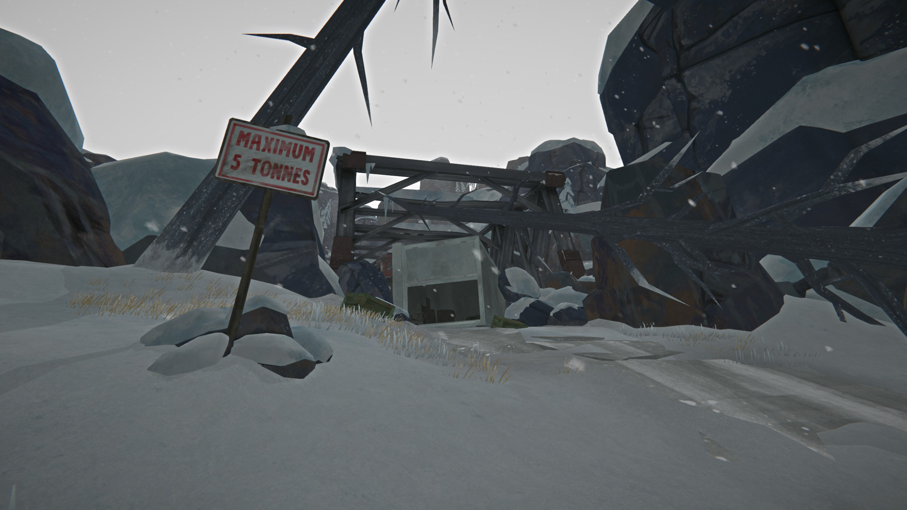

# Blocked Bridge

**Blocked Bridge**

| Property | Details |
| --- | --- |
|  |  / *Blockedbridge.jpg* |
| **Location** |  |
|  |  / *Blocked\_Bridge\_Location.png* |
| Region |  |
| **General** |  |
| Type | Landmark\|- |
