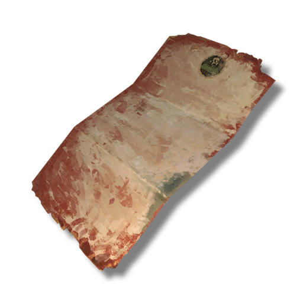

# Blood Soaked Forest Talker Documents

**Categories:** Collectibles, Pages with update history · **Source:** [Fandom](https://thelongdark.fandom.com/wiki/Blood_Soaked_Forest_Talker_Documents)

**Blood Soaked Forest Talker Documents**

_Blood\_Soaked\_Forest\_Talker\_Documents\_icon.png_

**Release:** [1 August 2017](./The%20Long%20Dark%20%E2%80%94%20Early%20Access%20Changelog.md#1.00)

**Wintermute:** [Episode 2](./Episode%202%20-%20Luminance%20Fugue.md) - [Lake Gunshots](./Lake%20Gunshots.md)

**Properties**

**Item type:** [Collectibles](./Collectibles.md)

**Stackable:** No

**Examine:** Official looking documents, soaked in blood.

**Values**

**Weight:** 0.00 kg (0 lbs)

**Actions**

**Backpack:** Examine

**On ground:** Take It, Leave It

**Blood Soaked Forest Talker Documents** is a [Collectible](./Collectibles.md) item found in [Episode 2](./Episode%202%20-%20Luminance%20Fugue.md) of the [Wintermute](./Wintermute.md) story mode. It is found on the corpse of the [Forest Talker](./Forest%20Talkers.md) at the end of the [Lake Gunshots](./Lake%20Gunshots.md) if Mackenzie chooses to take the ammo from the [Forest Talker Supplies](./Forest%20Talker%20Supplies.md).

## Transcript

_The following text is transcribed from **Blood Soaked Forest Talker Documents**_

**A variety of documents, some with barely visible Breyerhouse logos on them. Soaked in blood to the point of being ruined. Whatever useful info they contained is now lost.**

## Update history

- UPDATE **1 August 2017 ([Update](./The%20Long%20Dark%20%E2%80%94%20Changelog.md#1.00)):**
  - Added to game.
