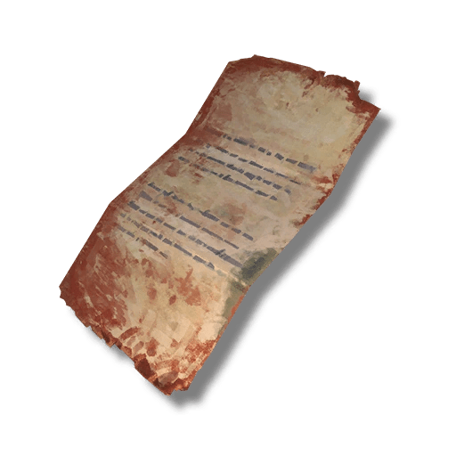

# Blood Soaked Note

**Categories:** Collectibles, Pages with update history · **Source:** [Fandom](https://thelongdark.fandom.com/wiki/Blood_Soaked_Note)

**Blood Soaked Note**

_Blood\_Soaked\_Note\_icon.png_

**Release:** [1 August 2017](./The%20Long%20Dark%20%E2%80%94%20Early%20Access%20Changelog.md#1.00)

**Wintermute:** [Episode 2](./Episode%202%20-%20Luminance%20Fugue.md) - [Mystery Lake Supply Caches](./Mystery%20Lake%20Supply%20Caches.md)

**Properties**

**Item type:** [Collectibles](./Collectibles.md)

**Stackable:** No

**Examine:** An expletive filled note pointing to a cache of supplies.

**Values**

**Weight:** 0.00 kg (0 lbs)

**Actions**

**Backpack:** Examine

**On ground:** Take It, Leave It

**Blood Soaked Note** is a [Collectible](./Collectibles.md) item found in [Episode 2](./Episode%202%20-%20Luminance%20Fugue.md) of the [Wintermute](./Wintermute.md) story mode. It is found near the derailed logging cares in the [Forlorn Muskeg](./Forlorn%20Muskeg.md) region. Collecting it unlocks a cache in the [Broken Railroad](./Broken%20Railroad.md) region for the [Mystery Lake Supply Caches](./Mystery%20Lake%20Supply%20Caches.md) side mission.

## Transcript

_The following text is transcribed from **Blood Soaked Note**_

**Judging by the amount of blood frozen on this page, the author wasn't doing too well when they wrote it.

"First it was the EXPLETIVE rancid meat. Then the sprained ankle. Then the EXPLETIVE convict out of nowhere. Gave him the slip by falling down into a damn ravine. Of course, that's when the EXPLETIVE wolves cam. Dropped my stuff and ran. As much as I could with a sprained ankle. If you're reading this - this is as far as I got.

Should've never tried to leave Milton."**

## Update history

- UPDATE **1 August 2017 ([Update](./The%20Long%20Dark%20%E2%80%94%20Changelog.md#1.00)):**
  - Added to game.
