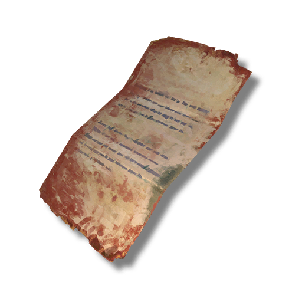

# Blood Stained\-Convict Note

**Blood Stained-Convict Note**

| Property | Details |
| --- | --- |
|  |  / *Blood\_Stained-Convict\_Note\_icon.png* |
| Release | [22 October 2019](./The%20Long%20Dark%20%E2%80%94%20Changelog.md#1.60) |
| Wintermute | [Episode 3](./Episode%203%20-%20Crossroads%20Elegy.md) - [Blackrock (mission)](./Blackrock%20%28mission%29.md) |
| **Properties** |  |
| Item type | [Collectibles](./Collectibles.md)\|- |
| Stackable | No |
| Examine | A bloodstained, handwritten note... |
| **Values** |  |
| Weight | 0.00 kg (0 lbs) |
| **Actions** |  |
| Backpack | Examine |
| On ground | Take It, Read Text, Leave It |
| **Advanced data** |  |
| Item key | STORY\_Collectible\_ConvictNote1 |

**Blood Stained-Convict Note** is a [Collectible](./Collectibles.md) item found in [Episode 3](./Episode%203%20-%20Crossroads%20Elegy.md) of the [Wintermute](./Wintermute.md) story mode as a part of the [Blackrock (mission)](./Blackrock%20%28mission%29.md) side mission.

During the course of the mission, the Astrid finds the note *Blood Stained-Convict Note* on the body of a dead prisoner in one of the outbuildings off of [Heartbreak Bridge](./Heartbreak%20Bridge.md).

## Transcript

*The following text is transcribed from **Blood Stained-Convict Note***

**I'm soakin right through this paper. All that's left of me those cowards. Like somethin jump up and bit me. Was wrong to follow [Mathis](./Mathis.md). No leader. Don't trust him. Won't lead you home.**

## Update history

- UPDATE **22 October 2019 ([Update](./The%20Long%20Dark%20%E2%80%94%20Changelog.md#1.60)):**
  - Added to game.

**Lua execution error in Module:Navbox function navbox**
