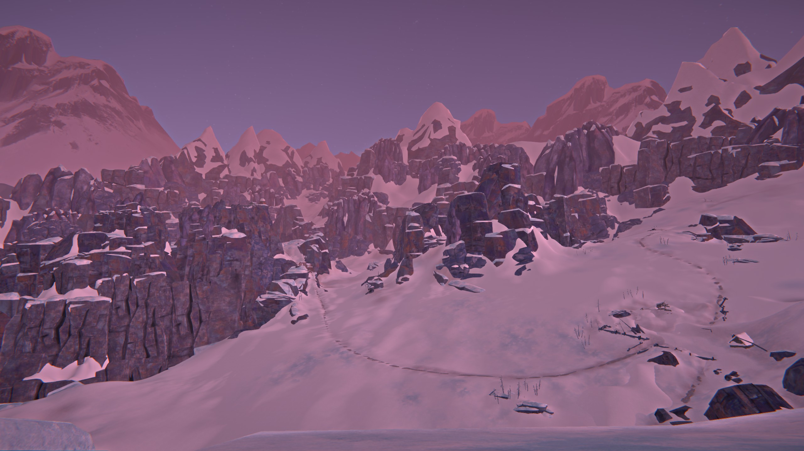

# Bolt Chopper's Haven

**Categories:** Caves, Locations, Locations in Sundered Pass, Sheltered locations · **Source:** [Fandom](https://thelongdark.fandom.com/wiki/Bolt_Chopper's_Haven)

**Bolt Chopper's Haven**

| Property | Details |
| --- | --- |
| | [Bolt Choppers Haven](../assets/Bolt_Choppers_Haven.jpg) |
| **Location** | |
| | [Bolt Chopper's Haven Location](../assets/Bolt_Chopper%27s_Haven_Location.png) |
| Region | [Sundered Pass](./Sundered%20Pass.md) |
| Location | A cave located down the slope across the tree bridge from Reluctant Shortcut |
| Description | A cave in the mountain |
| **General** | |
| Type | Cave |
| | Provides some shelter |

**Bolt Chopper's Haven** is a small unmarked cave located in [Sundered Pass](./Sundered%20Pass.md). It is located west of [Final Refuge](./Final%20Refuge.md) on the rock plateau, or north of the Red Broken Bridge leading to the [Weather Station](./Weather%20Station.md). Heading north across the nearby tree bridge leads to [Reluctant Shortcut](./Reluctant%20Shortcut.md) and the [Abandoned Mine](./Abandoned%20Mine.md).

## Overview

The cave doesn't have a bed, but may spawn a frozen corpse alongside a campfire with minor food items scattered about.

The cave is a source of [Coal](./Coal.md).

_The slope that leads to the cave as seen from [Prayerful Window](./Prayerful%20Window.md) (the slope is in the middle mountain)_

## Trivia

- A Bolt-Chopper is a climber term referring to someone who deliberately removes the bolts from rock faces on rock climbing routes; this is either done to preserve traditional climbing routes which specifically do not employ the use of pre-placed bolts to climb, or it may even be done in ecological protest to preserve the natural beauty of rock faces, though this practice is largely frowned upon due to the inherent dangers of scaling non-bolted rock faces for the average sport climber.
