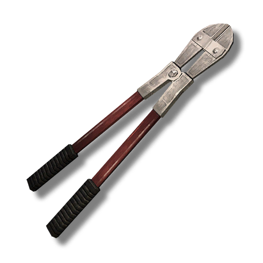
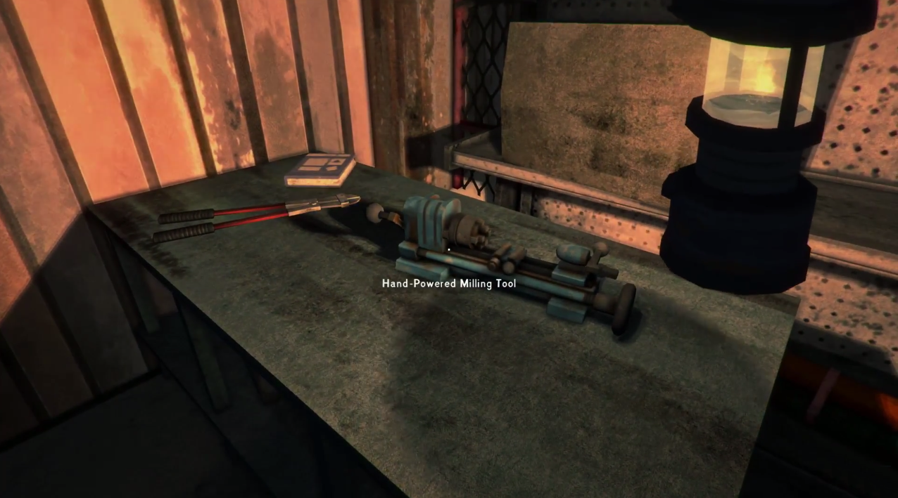

# Bolt Cutters

**Categories:** Pages with update history, Tools · **Source:** [Fandom](https://thelongdark.fandom.com/wiki/Bolt_Cutters)

**Contents**

- [Wintermute](#wintermute)
- [Episode 3: Crossroads Elegy](#episode-3-crossroads-elegy)
- [Episode 4: Fury, Then Silence](#episode-4-fury-then-silence)
- [Episode 5: The Light At The End Of All Things](#episode-5-the-light-at-the-end-of-all-things)
- [Survival Mode](#survival-mode)
- [Trivia](#trivia)
- [Update history](#update-history)

**Bolt Cutters**

| Property | Details |
| --- | --- |
|  | [Bolt Cutters icon](../assets/Bolt_Cutters_icon.png) |
| Release | [1 August 2017](./The%20Long%20Dark%20%E2%80%94%20Changelog%20%E2%80%94%20Archive%201.md#1-00-wintermute-1-0-launch-update-predux-release) |
| **Properties** |  |
| Item type | [Tools](./Tools.md) |
| Equipable | No |
| Stackable | No |
| Examine | A heavy tool designed to cut through metal bolts and chains. |
| **Values** |  |
| Weight | 1.50 kg (3.3 lbs) |
| **Actions** |  |
| Backpack | Pick Up, Examine, Drop |
| **Advanced data** |  |
| Item key | GAMEPLAY\_BoltCutters |

**Bolt Cutters** are a [Tool](./Tools.md) used briefly in [Wintermute](./Wintermute.md) to open locked gates at specific points in the story. Bolt Cutter can then be carried or dropped after this point and serve no other function for the remainder of the Episode.

## Wintermute

### [Episode 3: Crossroads Elegy](./Episode%203%20-%20Crossroads%20Elegy.md)

In the mission [Aftermath](./Aftermath.md), they are found in the [Cinder Hills Coal Mine](./Cinder%20Hills%20Coal%20Mine.md) middle level after [Astrid Greenwood](./Astrid%20Greenwood.md) falls deeper inside the mine due to an earthquake. They are used to open a single locked gate in order to access more of the mine level, but serve no other purpose afterwards for the rest of the Episode.

### [Episode 4: Fury, Then Silence](./Episode%204%20-%20Fury%2C%20Then%20Silence.md)

In the mission [The Detonators](./The%20Detonators.md), they are once again used to open a single gate after finding the [Detonators](./Detonators.md), but serve no other purpose afterwards for the rest of the Episode.

### [Episode 5: The Light At The End Of All Things](./Episode%205%20-%20The%20Light%20At%20The%20End%20Of%20All%20Things.md)

In the mission [The Cold, Broken Road](./The%20Cold%2C%20Broken%20Road.md), a pair of Bolt Cutters is seen in an unreachable area with several supplies before the floor collapses. A wieldable pair is found later in the mine, and are used to open a single locked gate.

## Survival Mode

Bolt Cutters appear in [Survival Mode](./Survival%20Mode.md) as part of the [Buried Echoes](./Buried%20Echoes.md) questline in the [Zone of Contamination](./Zone%20of%20Contamination.md). It is now classified as a Collectible instead of a Tool, and is stored in the Mementos section once obtained.

Location: head to the [Headframe Building](./Headframe%20Building.md) to open a locked door (with the [Foreman's Key](./Foreman%27s%20Key.md)) in order to obtain [Foreman's Site Report Day 45](./Foreman%27s%20Site%20Report%20Day%2045.md) and some [Bolt Cutters](./Bolt%20Cutters.md). Going to the bottom level of the [Langston Mine](./Langston%20Mine.md), the Bolt Cutters and are used to open a single gate in order to obtain the [Mine Gate Key](./Mine%20Gate%20Key.md).

## Trivia

This Tool was first introduced in [Episode 2: Luminance Fugue](./Episode%202%20-%20Luminance%20Fugue.md) to cut open the gate to the [Hunting Lodge](./Hunting%20Lodge.md) in [Broken Railroad](./Broken%20Railroad.md) in the mission [You Fix My Rifle?](./You%20Fix%20My%20Rifle%3F.md), but have been removed since the Redux version was released.

## Update history

- UPDATE **1 August 2017 ([Update](./The%20Long%20Dark%20%E2%80%94%20Changelog%20%E2%80%94%20Archive%201.md#1-00-wintermute-1-0-launch-update-predux-release)):**
  - Added to game.
- UPDATE **17 December 2018 ([Update](./The%20Long%20Dark%20%E2%80%94%20Changelog%20%E2%80%94%20Archive%201.md#1-41-wintermute-redux-update)):**
  - Removed from the game with the Redux release of Episode 2.
- UPDATE **22 October 2019 ([Update](./The%20Long%20Dark%20%E2%80%94%20Changelog%20%E2%80%94%20Archive%202.md#1-60-crossroads-elegy-update)):**
  - Returned to the game and added to Episode 3.
- UPDATE **6 October 2021 ([Update](./The%20Long%20Dark%20%E2%80%94%20Changelog%20%E2%80%94%20Archive%202.md#1-95-fury-then-silence-update)):**
  - Added to Episode 4 with a lock cutting animation.
- UPDATE **5 December 2023 ([Update](./The%20Long%20Dark%20%E2%80%94%20Changelog.md#2-25-steam-tftft-part-four-buried-echoes-update)):**
  - Added to Survival Mode as part of Buried Echoes.
- UPDATE **31 March 2026 ([Update](./The%20Long%20Dark%20%E2%80%94%20Changelog.md#version-2-52)):**
  - Added to Episode 5.
