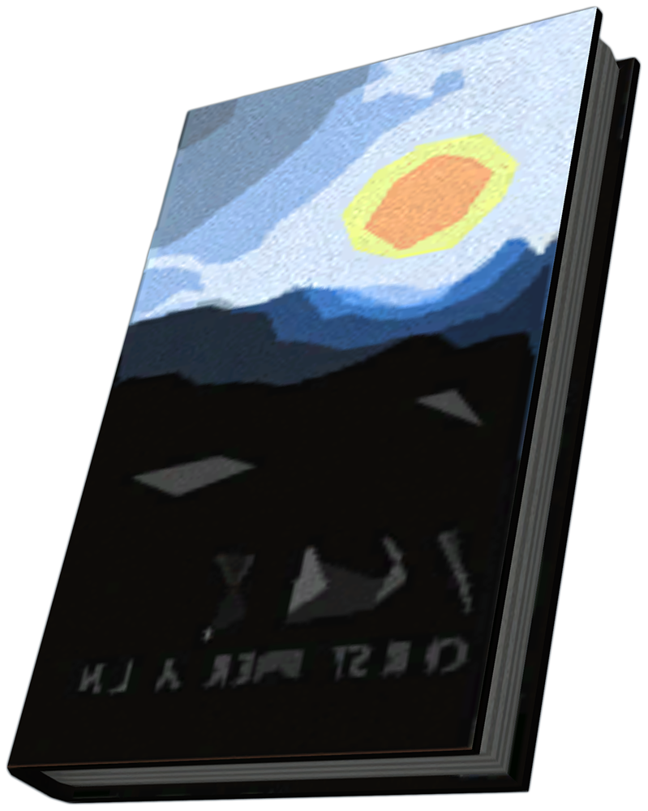
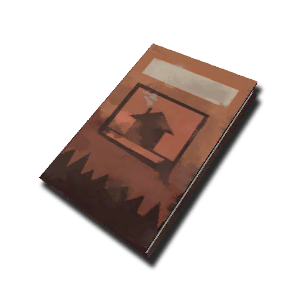
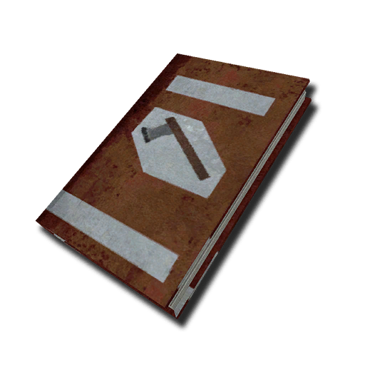

# Book

**Contents**

- [Fire Starting info](#Fire_Starting_info)
- [Trivia](#Trivia)
- [Gallery](#Gallery)
- [Update history](#Update_history)

<table class="infobox">
<caption>Book</caption>
<colgroup>
<col style="width: 50%" />
<col style="width: 50%" />
</colgroup>
<tbody>
<tr>
<td colspan="2"><figure>

<figcaption>Book_icon.png</figcaption>
</figure></td>
</tr>
<tr>
<td>
Release
</td>
<td>
<a href="./The%20Long%20Dark%20%E2%80%94%20Changelog.md#0.212" class="wikilink" title="1 April 2015">1 April 2015</a>
</td>
</tr>
<tr>
<td>
Wintermute
</td>
<td>
No
</td>
</tr>
<tr>
<td colspan="2" class="section">
<strong>Properties</strong>
</td>
</tr>
<tr>
<td>
Item type
</td>
<td>
<a href="./Fire%20Starting.md" class="wikilink" title="Fire Starting">Fire Starting</a>|-
</td>
</tr>
<tr>
<td>
Stackable
</td>
<td>
yes
</td>
</tr>
<tr>
<td>
Examine
</td>
<td>
Eventually, a source of knowledge. For now, something to burn when you are freezing.
</td>
</tr>
<tr>
<td colspan="2" class="section">
<strong>Values</strong>
</td>
</tr>
<tr>
<td>
Weight
</td>
<td>
0.50 kg (1.1 lbs)
</td>
</tr>
</tbody>
</table>

A **Book** is a material item in *<a href="./The%20Long%20Dark.md" class="wikilink" title="The Long Dark">The Long Dark</a>*.

Books are a fuel source for fires. Using a book when starting a fire increases the probability of success by 35%, but books do not provide much heat or burn time. Books are commonly inside houses, especially larger homes and cabins.

Books have a fire duration of 18 minutes.

Although books are the worst fuel in terms of burn time to weight, they have the highest bonus chance to start a new fire. This makes books useful for the purpose of starting fires, especially earlier in the game. This helps to preserve <a href="./Matches%20%28disambiguation%29.md" class="wikilink" title="Matches">Matches</a> until the <a href="./Fire%20Starting.md" class="wikilink" title="Fire Starting">Fire Starting</a> skill has improved.

## Fire Starting info

<table class="infobox">
<caption>Book</caption>
<thead>
<tr>
<th>
Type
</th>
<th>
Fuel
</th>
</tr>
</thead>
<tbody>
<tr>
<th colspan="2" class="section">
<strong>Statistics</strong>
</th>
</tr>
&#10;<tr>
<th>
Duration
</th>
<td>
 18 minutes
</td>
</tr>
<tr>
<th>
Start Chance
</th>
<td>
 35%
</td>
</tr>
<tr>
<th>
Heat
</th>
<td>
 +2°C (+3.6°F)
</td>
</tr>
<tr>
<th>
Burn Density
</th>
<td>
0.6 hr/kg (0.27 hr/lb)
</td>
</tr>
</tbody>
</table>

## Trivia

- Non-Research Books cannot be read.
- The player is implied to start with and carry a book at all times (their Journal).
- Books are unique among all items in *The Long Dark* for having multiple models. There are 12 in total with unique cover art, with 3 open variants.
- Different types of (non-Research Books) will stack together in the player's inventory or if placed in containers;. This irreversibly changes their model into that of the generic book when removed (featured above).

## Gallery

<table class="gallery">
<colgroup>
<col style="width: 25%" />
<col style="width: 25%" />
<col style="width: 25%" />
<col style="width: 25%" />
</colgroup>
<tbody>
<tr>
<td><figure>

<figcaption>Old model.</figcaption>
</figure></td>
<td><figure>
[Missing image: Book_Old.jpg]
<figcaption>Ditto, orange variant</figcaption>
</figure></td>
<td><figure>
[Missing image: Book_Variants.jpg]
<figcaption>All Book variants. The open versions are the same as the ones below them.</figcaption>
</figure></td>
<td><figure>

<figcaption>Backpack icon</figcaption>
</figure></td>
</tr>
<tr>
<td><figure>

<figcaption>Unused Backpack icon</figcaption>
</figure></td>
<td><figure>

<figcaption>Ditto</figcaption>
</figure></td>
<td><figure>

<figcaption>Ditto</figcaption>
</figure></td>
<td><figure>

<figcaption>Ditto</figcaption>
</figure></td>
</tr>
<tr>
<td><figure>

<figcaption>Ditto</figcaption>
</figure></td>
<td><figure>

<figcaption>Ditto</figcaption>
</figure></td>
<td><figure>

<figcaption>Ditto</figcaption>
</figure></td>
<td></td>
</tr>
</tbody>
</table>

## Update history

- UPDATE **1 April 2015 (<a href="./The%20Long%20Dark%20%E2%80%94%20Changelog.md#.212" class="wikilink" title="Update">Update</a>):**
  - Added to game.

**Lua execution error in Module:Navbox function navbox** <a href="ru:%D0%9A%D0%BD%D0%B8%D0%B3%D0%B0" class="wikilink" title="ru:Книга">ru:Книга</a>

