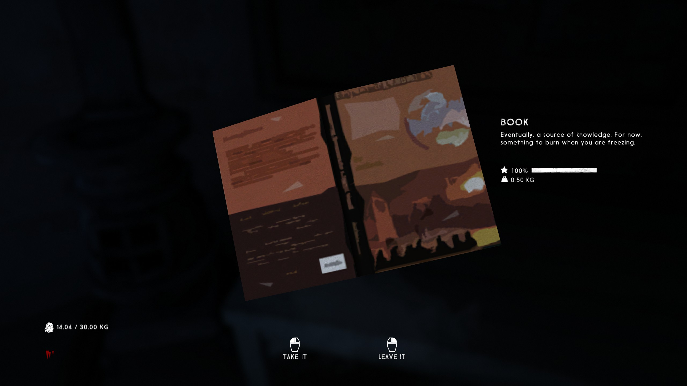
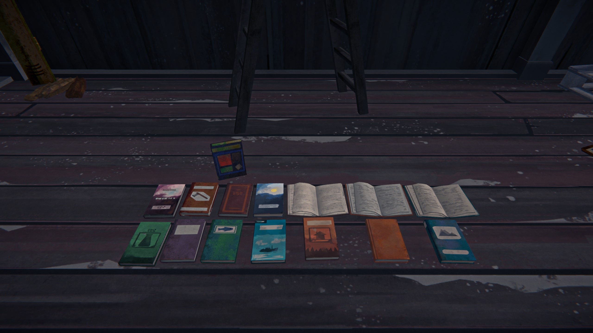
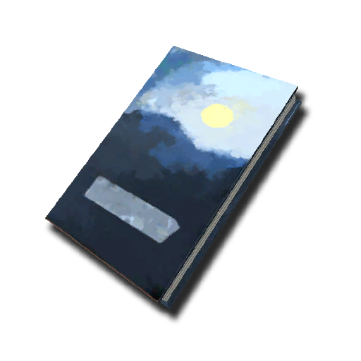
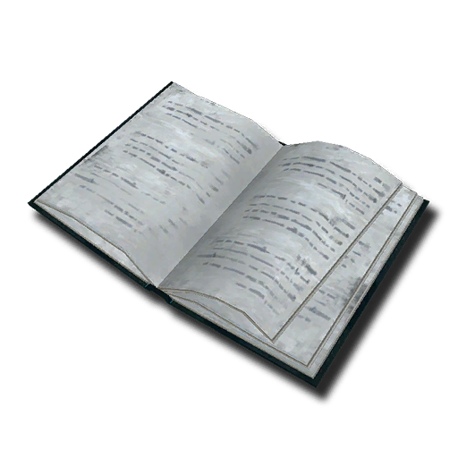
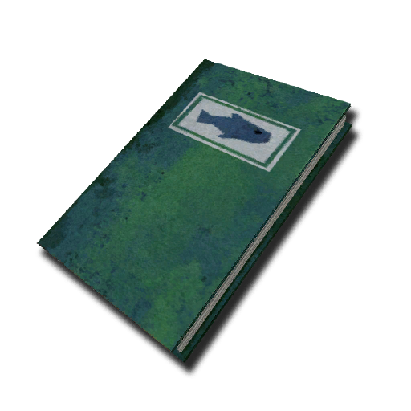
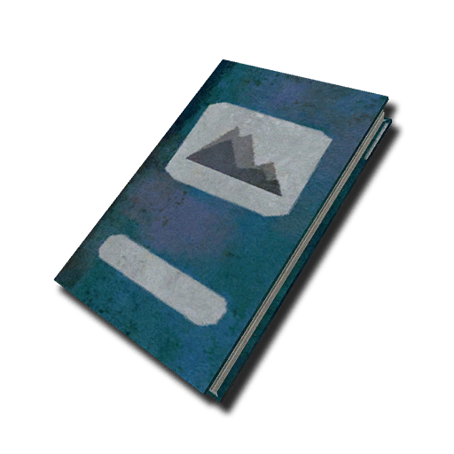

# Book

**Contents**

- [Fire Starting info](#fire-starting-info)
- [Trivia](#trivia)
- [Gallery](#gallery)
- [Update history](#update-history)

**Book**

| Property | Details |
| --- | --- |
|  |  / *Book\_icon.png* |
| Release | [1 April 2015](./The%20Long%20Dark%20%E2%80%94%20Changelog.md#0.212) |
| Wintermute | No |
| **Properties** |  |
| Item type | [Fire Starting](./Fire%20Starting.md)\|- |
| Stackable | yes |
| Examine | Eventually, a source of knowledge. For now, something to burn when you are freezing. |
| **Values** |  |
| Weight | 0.50 kg (1.1 lbs) |

A **Book** is a material item in *[The Long Dark](./The%20Long%20Dark.md)*.

Books are a fuel source for fires. Using a book when starting a fire increases the probability of success by 35%, but books do not provide much heat or burn time. Books are commonly inside houses, especially larger homes and cabins.

Books have a fire duration of 18 minutes.

Although books are the worst fuel in terms of burn time to weight, they have the highest bonus chance to start a new fire. This makes books useful for the purpose of starting fires, especially earlier in the game. This helps to preserve [Matches](./Matches%20%28disambiguation%29.md) until the [Fire Starting](./Fire%20Starting.md) skill has improved.

## Fire Starting info

**Book**

| Property | Details |
| --- | --- |
| Type | Fuel |
| **Statistics** |  |
| Duration |  18 minutes |
| Start Chance |  35% |
| Heat |  +2°C (+3.6°F) |
| Burn Density | 0.6 hr/kg (0.27 hr/lb) |

## Trivia

- Non-Research Books cannot be read.
- The player is implied to start with and carry a book at all times (their Journal).
- Books are unique among all items in *The Long Dark* for having multiple models. There are 12 in total with unique cover art, with 3 open variants.
- Different types of (non-Research Books) will stack together in the player's inventory or if placed in containers;. This irreversibly changes their model into that of the generic book when removed (featured above).

## Gallery

| Column 1 | Column 2 | Column 3 | Column 4 |
| --- | --- | --- | --- |
|  / *Old model.* |  / *Ditto, orange variant* |  / *All Book variants. The open versions are the same as the ones below them.* |  / *Backpack icon* |
|  / *Unused Backpack icon* |  / *Ditto* |  / *Ditto* |  / *Ditto* |
|  / *Ditto* |  / *Ditto* |  / *Ditto* |  |

## Update history

- UPDATE **1 April 2015 ([Update](./The%20Long%20Dark%20%E2%80%94%20Changelog.md#.212)):**
  - Added to game.

**Lua execution error in Module:Navbox function navbox** [ru:Книга](ru:%D0%9A%D0%BD%D0%B8%D0%B3%D0%B0)
