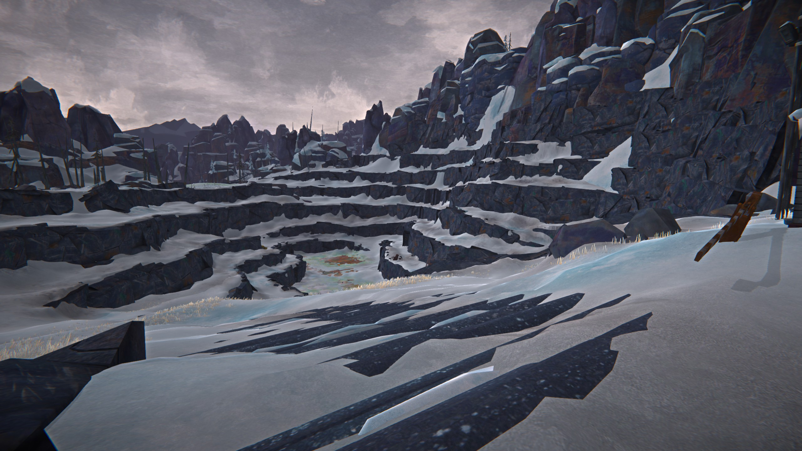

# Bountiful Overlook

**Bountiful Overlook**

| Property | Details |
| --- | --- |
|  |  / *Bountiful\_Overlook.jpg* |
| **Location** |  |
|  |  / *Bountiful\_Overlook\_Location.png* |
| Region | [Zone of Contamination](./Zone%20of%20Contamination.md)\|- |
| **General** |  |
|  | Has no shelter\|} **Bountiful Overlook** is a location found near the [Concentrator](./Concentrator.md) and is the highest point overlooking the open pit portion of the [Langston Mine](./Langston%20Mine.md). A nearby [Earth Mover](./Haul%20Truck.md) and toll booth marks the beginning of the overlook. Walking down the road leads to the [Pump House](./Pump%20House.md) and [Overladen Pond](./Overladen%20Pond.md). The quarry itself holds an entrance to the Langston Mine, as well as 2 more Earth Movers. / **Lua execution error in Module:Navbox function navbox** [ru:Вид на красоту](ru:%D0%92%D0%B8%D0%B4_%D0%BD%D0%B0_%D0%BA%D1%80%D0%B0%D1%81%D0%BE%D1%82%D1%83) |
