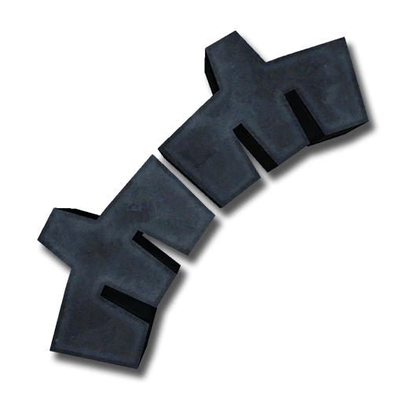

# Brake Shoe

<table class="infobox">
<caption>Brake Shoe</caption>
<colgroup>
<col style="width: 50%" />
<col style="width: 50%" />
</colgroup>
<tbody>
<tr>
<td colspan="2"><figure>

<figcaption>Brake_Shoe_icon.png</figcaption>
</figure></td>
</tr>
<tr>
<td colspan="2" class="section">
<strong>General</strong>
</td>
</tr>
<tr>
<td>
Item Type
</td>
<td>
Material|-
</td>
</tr>
<tr>
<td colspan="2" class="section">
<strong>Statistics</strong>
</td>
</tr>
<tr>
<td>
Weight
</td>
<td>
0.50 kg(1.1 lbs)
</td>
</tr>
</tbody>
</table>

<table style="width:100%;">
<colgroup>
<col style="width: 16%" />
<col style="width: 16%" />
<col style="width: 16%" />
<col style="width: 16%" />
<col style="width: 16%" />
<col style="width: 16%" />
</colgroup>
<tbody>
<tr>
<td width="40px"><figure>

<figcaption>Seal_icon.png</figcaption>
</figure></td>
<td>
<strong>DLC-Exclusive content.</strong> 

This content requires the <a href="./Iron%20Road.md" class="wikilink" title="Iron Road">Iron Road</a> addon to be installed before it can be seen or used in regular gameplay.

</td>
<td>
|}{| style="margin:auto"
</td>
<td style="vertical-align: top; font-size: 3em; color: #5d5980; padding-right: 10px">
“
</td>
<td>
A spare Brake Shoe used to repair a Train's braking mechanism. Old, but fit for purpose.

&#10;

In-game description

</td>
<td style="vertical-align: bottom; font-size: 3em; color: #5d5980; padding-left: 10px">
”
</td>
</tr>
</tbody>
</table>

A **Brake Shoe** is a <a href="./Materials.md" class="wikilink" title="Material">Material</a> in *<a href="./The%20Long%20Dark.md" class="wikilink" title="The Long Dark">The Long Dark</a>*.

## General Information

The only usage of this item is to repair the Brake Shoes of the <a href="./Prototype%20Train.md" class="wikilink" title="Prototype Train">Prototype Train</a> (repairs always restore 100% Condition of the Brake Shoes of the train). They are often found in the various buildings around <a href="./Cauldron%20Island.md" class="wikilink" title="Cauldron Island">Cauldron Island</a>, mostly being located inside of Train <a href="./Repair%20Depot.md" class="wikilink" title="Repair Depots">Repair Depots</a>.

## Game History

**Template:update historyLua execution error in Module:Navbox function navbox**

<a href="ru:%D0%A2%D0%BE%D1%80%D0%BC%D0%BE%D0%B7%D0%BD%D0%B0%D1%8F_%D0%BA%D0%BE%D0%BB%D0%BE%D0%B4%D0%BA%D0%B0" class="wikilink" title="ru:Тормозная колодка">ru:Тормозная колодка</a>

