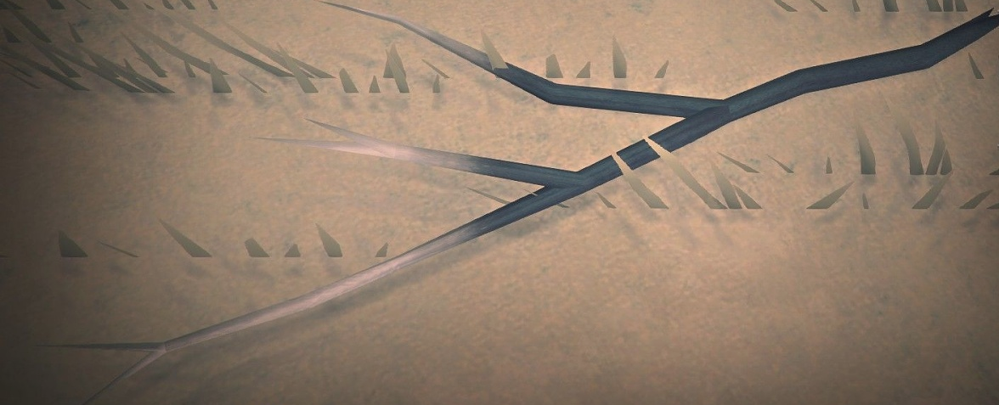

# Branch

## Overview

<table class="infobox">
<caption>Branch</caption>
<colgroup>
<col style="width: 50%" />
<col style="width: 50%" />
</colgroup>
<tbody>
<tr>
<td colspan="2"><figure>

<figcaption>Branch.png</figcaption>
</figure></td>
</tr>
<tr>
<td colspan="2" class="section">
<strong>General</strong>
</td>
</tr>
<tr>
<td>
Item Type
</td>
<td></td>
</tr>
<tr>
<td>
Wintermute
</td>
<td>
Yes|-
</td>
</tr>
<tr>
<td>
Weight
</td>
<td>
0.45 kg(0.99 lbs)
</td>
</tr>
</tbody>
</table>

Branches are usually found outside in the forest close to trees. High winds will cause them and tree limbs to fall, making them renewable.

They take 10 minutes to break down by hand or 5 minutes to be break down with a hatchet.

They yield 3 <a href="./Stick.md" class="wikilink" title="Sticks">Sticks</a> giving you 24 minutes of fire.

| Stick | Time       | Calories | Condition of Tool      |
|-------|------------|----------|------------------------|
| 3     | 10 minutes | 31       | -0% by Hand            |
| 3     | 5 minutes  | 15       | -2% Hatchet            |
| 3     | 7 minutes  | 20       | -3% Improvised Hatchet |

**Lua execution error in Module:Navbox function navbox** <a href="ru:%D0%92%D0%B5%D1%82%D0%BA%D0%B0" class="wikilink" title="ru:Ветка">ru:Ветка</a>

