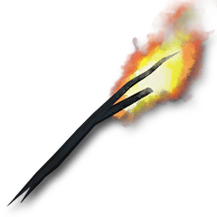
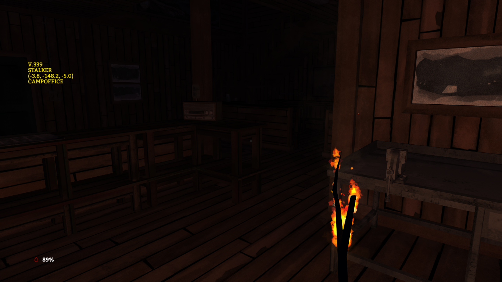
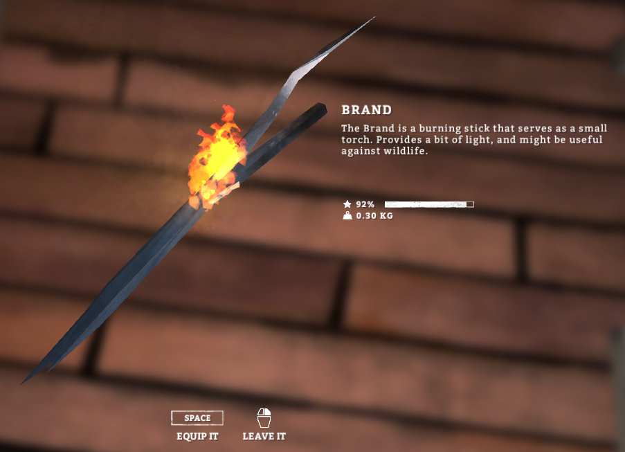

# Brand

**Contents**

- [Overview](#Overview)
- [Creation](#Creation)
- [Brandishing](#Brandishing)
- [Burn Time](#Burn_Time)
- [Animation](#Animation)
- [Heat](#Heat)
- [Special Handling](#Special_Handling)
- [Update history](#Update_history)

<table class="infobox">
<caption>Brand</caption>
<colgroup>
<col style="width: 50%" />
<col style="width: 50%" />
</colgroup>
<tbody>
<tr>
<td colspan="2"><figure>

<figcaption>Brand_icon.png</figcaption>
</figure></td>
</tr>
<tr>
<td>
Release
</td>
<td>
<a href="./The%20Long%20Dark%20%E2%80%94%20Changelog.md#0.321" class="wikilink" title="21 April 2016">21 April 2016</a>
</td>
</tr>
<tr>
<td>
Wintermute
</td>
<td>
No
</td>
</tr>
<tr>
<td colspan="2" class="section">
<strong>Properties</strong>
</td>
</tr>
<tr>
<td>
Item type
</td>
<td>
<a href="./Tools.md" class="wikilink" title="Tools">Tools</a>|-
</td>
</tr>
<tr>
<td>
Stackable
</td>
<td>
No
</td>
</tr>
<tr>
<td>
Examine
</td>
<td>
The Brand is a burning stick that serves as a small torch. Provides a bit of light, and might be useful against wildlife.
</td>
</tr>
<tr>
<td colspan="2" class="section">
<strong>Values</strong>
</td>
</tr>
<tr>
<td>
Weight
</td>
<td>
0.30 kg (0.66 lbs)
</td>
</tr>
</tbody>
</table>

A **Brand** was a <a href="./Tools.md" class="wikilink" title="Tool">Tool</a> introduced in the <a href="./The%20Long%20Dark%20%E2%80%94%20Early%20Access%20Changelog.md#0.321_%28Tireless_Menace_Update%29" class="wikilink" title="Tireless Menace">Tireless Menace</a> update in <a href="./Survival%20Mode.md" class="wikilink" title="Survival Mode">Survival Mode</a> during the Alpha builds of *<a href="./The%20Long%20Dark.md" class="wikilink" title="The Long Dark">The Long Dark</a>* and was eventually cut in the Faithful Cartographer update. It is currently considered <a href="./Cut%20%E2%80%94%20Discontinued%20Content.md" class="wikilink" title="Cut/Discontinued Content">Cut/Discontinued Content</a>, but can still be experienced by using the <a href="./Time%20Capsule.md" class="wikilink" title="Time Capsule">Time Capsule</a>.

The mechanic of taking <a href="./Torch.md" class="wikilink" title="Torches">Torches</a> from active fireboxes was used before the introduction of Brands, but due to the similarities between the Brand and the Torch, the Brand was cut and its role in the game was entirely replaced by the Torch.

## Overview

Brands are hand held fire and light source despite being just a <a href="./Stick.md" class="wikilink" title="Stick">Stick</a> on fire, behaving similarly to an improvised active <a href="./Torch.md" class="wikilink" title="Torch">Torch</a> (often being dubbed "Mini Torches") by dimly lighting up your surroundings and providing a small bit of Warmth. Unlike Torches however, they cannot be manually extinguished, and behave similarly to an active <a href="./Flare.md" class="wikilink" title="Flare">Flare</a>, and can only be dropped and picked back up. Brands cannot be thrown, but instead can be <a href="./Cut%20%E2%80%94%20Discontinued%20Content.md#Brandishing" class="wikilink" title="Brandished">Brandished</a> (swung sideways) to scare away <a href="./Wolf.md" class="wikilink" title="Wolves">Wolves</a>. Brandishing a Brand will use up 5% of the <a href="./Stamina.md" class="wikilink" title="Stamina">Stamina</a> and around 10 minutes of its fire duration per swing.

Brands are the only Tool in the game that cannot be added to the Backpack, and will disappear from the game world after they burn out and are picked up.

Wolves have a chance to be scared away when detecting the character if a Brand is carried and lit.

## Creation

Brands are taken from any active <a href="./Fire.md" class="wikilink" title="Fire">Fire</a> via a special button "Remove Brand," so long as the Fire has a lifespan greater than 10 minutes. Removing a Brand diminishes a Fire by 10 minutes and 1°C.

- Taking a Brand while holding a Torch, Flare or another Brand will cause the held item to be dropped.

## Brandishing

With the Brand in hand, you can Brandish the item with RMB. This gives an additional chance to scare off Wolves that are actively stalking you, but is only effective when the Wolf is near but not yet charging.

- Brandishing does not seem to work against already charging Wolves.
- Brandishing has no effect of <a href="./Bear.md" class="wikilink" title="Bears">Bears</a>.

## Burn Time

The lit Brand burns for 30 game minutes and cannot be extinguished, except when blown out by overly windy <a href="./Weather.md" class="wikilink" title="weather">weather</a> or by mishandling. Once they burn out, they are mostly useless as they cannot be re-lit or harvested for the stick. They cannot be added as fuel for Fires.

- Brands lose Condition as they burn or being brandished with. When they burn fully, they reach 0% Condition and become ruined. However, if they are extinguished through other means, they fail to become ruined but cannot be re-lit at all.

### Animation

 The Brand displays flickering orange flames when it is first created that gradually diminish as condition is lost. Area lighting also diminishes as the flame dies.

- If a Brand is already burning in the game when another one is pulled from a fire, the new brand animation will echo the previous brand, causing it to seemingly burn out early. The animation can be reset to mirror the actual brand by dropping it.

## Heat

A fire held in the hand is much warmer to the character than fire burning nearby. Holding a burning brand raises the <a href="./Feels%20Like.md" class="wikilink" title="Feels Like">Feels Like</a> temperature by 5°C. So, taking a Brand from a fire actually grants a bonus of 4°C for its duration.

- A dropped Brand in proximity also raises the “feels like” temperature 5°C. To get proximity, crouch over a brand on the ground or relocate it to on a shelf or table or such.
- **EXPLOIT:** Light a 1 hour fire. Take out 6 Brands and crouch over them. Feels like temperature will be increased +30°C for 30 minutes vs. original fire’s +7°C for an hour. **Warm up faster and in colder weather with less fuel!**
- Note: Lit Brand can be used to start fire. With use of this, it is possible to start fire indoors even if you haven't any <a href="./Firestriker.md" class="wikilink" title="firestrikers">firestrikers</a>/matches (start fire outdoors with a Magnifying Lens and then take a Brand and use it to start fire indoors. You can start fire indoors with use of only renewable materials).

## Special Handling

The brand has been specifically targeted by the developers to be very hard to keep in the character's inventory. For this reason, many of the normal object-handling functions are disabled and using the brand in some ways will actually result in buggy behavior.

- If a Brand on the ground is selected, the LMB function to pick it up is purposely disabled. If the brand is still lit, spacebar can be used to place the Brand in one’s hand. However if it is not lit, the spacebar option remains highlighted but will not work.
- When a held Brand is not lit, it is automatically dropped whenever another object is selected or inventory is opened.
- Note that the held Brand is still in the inventory despite all efforts to influence it otherwise. Viewing inventory will show it there as a burning stick whether it is actually still burning or not. It can from there be dropped. If its condition is still higher than 0%, it can also be equipped.
- Opening a container while carrying a Brand will allow the Brand to be placed in the container. Placing a burning Brand in a container will extinguish it. Note: Any ruined item placed inside a container should now disappear.
- LMB will immediately drop a Brand that is carried in-hand.
- It is impossible to get rid of an extinguished Brand once it has been dropped on the ground. It can only be relocated in the world using RMB.

<table class="gallery">
<colgroup>
<col style="width: 100%" />
</colgroup>
<tbody>
<tr>
<td><figure>

<figcaption>Item when picked up</figcaption>
</figure></td>
</tr>
</tbody>
</table>

## Update history

- UPDATE **8 June 2017 (<a href="./The%20Long%20Dark%20%E2%80%94%20Changelog.md#0.423" class="wikilink" title="Update">Update</a>):**
  - Removed from the game and replaced entirely by the <a href="./Torch.md" class="wikilink" title="Torch">Torch</a>.
- UPDATE **21 April 2016 (<a href="./The%20Long%20Dark%20%E2%80%94%20Changelog.md#0.321" class="wikilink" title="Update">Update</a>):**
  - Added to game.

**Lua execution error in Module:Navbox function navbox**

