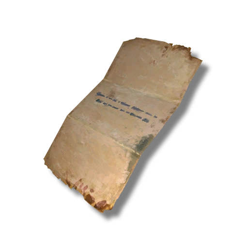

# Breyerhouse Crew Winter Warning

**Categories:** Collectibles, Pages with update history · **Source:** [Fandom](https://thelongdark.fandom.com/wiki/Breyerhouse_Crew_Winter_Warning)

**Breyerhouse Crew Winter Warning**

| Property | Details |
| --- | --- |
|  |  / _Breyerhouse\_Crew\_Winter\_Warning\_icon.png_ |
| Release | [1 August 2017](./The%20Long%20Dark%20%E2%80%94%20Early%20Access%20Changelog.md#1.00) |
| Wintermute | [Episode 2](./Episode%202%20-%20Luminance%20Fugue.md) |
| **Properties** |  |
| Item type | [Collectibles](./Collectibles.md)\|- |
| Stackable | No |
| Examine | A note found in the Trailers outside Carter Dam. |
| **Values** |  |
| Weight | 0.00 kg (0 lbs) |
| **Actions** |  |
| Backpack | Examine |
| On ground | Take It, Leave It |

**Breyerhouse Crew Winter Warning** is a [Collectible](./Collectibles.md) item found in [Episode 2](./Episode%202%20-%20Luminance%20Fugue.md) of the [Wintermute](./Wintermute.md) story mode. It is found on a desk in the Trailers near [Carter Hydro Dam](./Carter%20Hydro%20Dam.md), next to the [Carter Hydro Staging Area Gate Key](./Carter%20Hydro%20Staging%20Area%20Gate%20Key.md).

## Transcript

_The following text is transcribed from **Breyerhouse Crew Winter Warning**_

**To; Breyerhouse Winter Teams

Re: Carter Dam Reminder

We know some of you like to hang out in the Dam during your breaks and off-hours, but the whole facility is still a no-go. The place is falling apart and unsafe to enter, especially the Lower Dam.

If you need another reason, our insurance won't kick in if you hurt yourself in there. You'll be on your own.

- Crew 17 Foreman**

## Update history

\* UPDATE **17 December 2018 ([Update](./The%20Long%20Dark%20%E2%80%94%20Changelog.md#1.41)):**

- 
  - Added to game.

[ru:Предупреждение команде по обслуживанию в зимний период](ru:%D0%9F%D1%80%D0%B5%D0%B4%D1%83%D0%BF%D1%80%D0%B5%D0%B6%D0%B4%D0%B5%D0%BD%D0%B8%D0%B5_%D0%BA%D0%BE%D0%BC%D0%B0%D0%BD%D0%B4%D0%B5_%D0%BF%D0%BE_%D0%BE%D0%B1%D1%81%D0%BB%D1%83%D0%B6%D0%B8%D0%B2%D0%B0%D0%BD%D0%B8%D1%8E_%D0%B2_%D0%B7%D0%B8%D0%BC%D0%BD%D0%B8%D0%B9_%D0%BF%D0%B5%D1%80%D0%B8%D0%BE%D0%B4)
