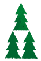

# Breyerhouse

<table class="infobox">
<caption>Breyerhouse</caption>
<colgroup>
<col style="width: 50%" />
<col style="width: 50%" />
</colgroup>
<tbody>
<tr>
<td colspan="2"><figure>

<figcaption>breyerhouse_logo.png</figcaption>
</figure></td>
</tr>
<tr>
<td>
Industry
</td>
<td>
Forest products 
Hydroelectric power
</td>
</tr>
</tbody>
</table>

\[Missing image: maintenance_yard.jpg\] Breyerhouse trucks in the Maintenance Yard. **Breyerhouse** was a logging company which was active in multiple regions of <a href="./Great%20Bear%20Island.md" class="wikilink" title="Great Bear Island">Great Bear Island</a> the prior to <a href="./First%20Flare.md" class="wikilink" title="The First Flare">The First Flare</a>.

The company performed logging in <a href="./Mystery%20Lake%20%28region%29.md" class="wikilink" title="Mystery Lake">Mystery Lake</a>, which The <a href="./Forest%20Talkers.md" class="wikilink" title="Forest Talkers">Forest Talkers</a> allege was illegally harvesting of <a href="Wikipedia:Old-growth_forest" class="wikilink" title="old growth">old growth</a>. This timber was exported via railcar along the <a href="./Trans-Island%20Railway%20Line.md" class="wikilink" title="Trans-Island Railway Line">Trans-Island Railway Line</a> to the <a href="./Log%20Sort.md" class="wikilink" title="Log Sort">Log Sort</a> in <a href="./Coastal%20Highway.md" class="wikilink" title="Coastal Highway">Coastal Highway</a>, with <a href="./Broken%20Railroad.md" class="wikilink" title="Broken Railroad">Broken Railroad</a> being the maintenance center for the line. Multiple <a href="./Truck.md" class="wikilink" title="trucks">trucks</a> and ruined railcars of this industry can be found in these regions, some of which bear the Breyerhouse logo.

It is unclear if Breyerhouse constructed the Trans-Island Railway Line, or merely acquired it after <a href="./Cinder%20Hills%20Coal%20Mine.md" class="wikilink" title="coal mining">coal mining</a> or the <a href="./Carter%20Hydro%20Dam.md" class="wikilink" title="Carter Hydro Dam">Carter Hydro Dam</a> ceased operations.

## Trivia

- The name Breyerhouse is possibly inspired by <a href="wikipedia:Weyerhaeuser" class="wikilink" title="Weyerhaeuser">Weyerhaeuser</a>, a timberland real-estate trust and wood product company headquartered in Seattle, Washington.
- The Hinterland Studio Inc. offices in Downtown Vancouver are located in the [building](https://www.historicplaces.ca/en/rep-reg/place-lieu.aspx?id=8781) which formerly served as the headquarters of <a href="wikipedia:MacMillan_Bloedel" class="wikilink" title="MacMillan Bloedel">MacMillan Bloedel</a>, a Canadian Forestry company which was bought out by Weyerhaeuser in 1999.

