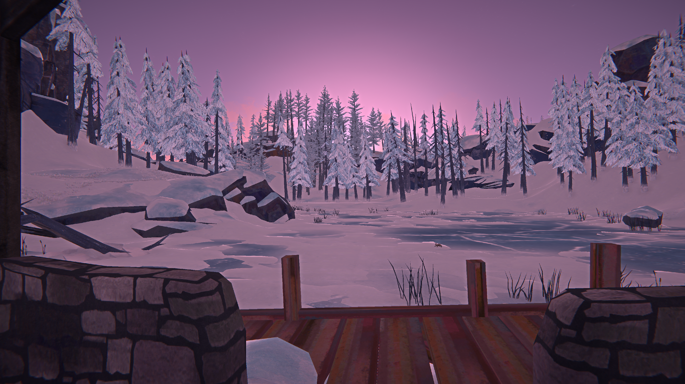

# Bricklayer's Retreat

<table class="infobox">
<caption>Bricklayer's Retreat</caption>
<colgroup>
<col style="width: 50%" />
<col style="width: 50%" />
</colgroup>
<tbody>
<tr>
<td colspan="2"><figure>
[Missing image: Bricklayer's_Retreat.jpg]
<figcaption>Bricklayer's_Retreat.jpg</figcaption>
</figure></td>
</tr>
<tr>
<td colspan="2" class="section">
<strong>Location</strong>
</td>
</tr>
<tr>
<td colspan="2"><figure>
[Missing image: Bricklayer's_Retreat_Location.png]
<figcaption>Bricklayer's_Retreat_Location.png</figcaption>
</figure></td>
</tr>
<tr>
<td>
Region
</td>
<td></td>
</tr>
<tr>
<td>
Location
</td>
<td>
Easternmost of the Blackrock Region, near a frozen lake.
</td>
</tr>
<tr>
<td colspan="2" class="section">
<strong>General</strong>
</td>
</tr>
<tr>
<td>
Firebox
</td>
<td></td>
</tr>
<tr>
<td><figure>

<figcaption>bed_icon.png</figcaption>
</figure></td>
<td>
Has a bed
</td>
</tr>
<tr>
<td><figure>

<figcaption>workbench_icon_green.png</figcaption>
</figure></td>
<td>
Has a workbench|-
</td>
</tr>
<tr>
<td>
Missions
</td>
<td>
<a href="./Blackrock%20Rumours.md" class="wikilink" title="Blackrock Rumours">Blackrock Rumours</a>
</td>
</tr>
</tbody>
</table>

**Bricklayer's Retreat** is a cabin located to the east of a pond, near the southeastern limit of <a href="./Blackrock.md" class="wikilink" title="Blackrock">Blackrock</a>.

## Overview

Quite similar to the <a href="./Mountaineer%27s%20Hut.md" class="wikilink" title="Mountaineer&#39;s Hut">Mountaineer's Hut</a> in <a href="./Timberwolf%20Mountain.md" class="wikilink" title="Timberwolf Mountain">Timberwolf Mountain</a>, this cabin provides basic weather and cold protection, along with a fireplace. However, this cabin does not have a closable door. A <a href="./Work%20Bench.md" class="wikilink" title="Work Bench">Work Bench</a> can be found just outside the hut; it will receive the fireplace's warmth, but you will not have any wind protection.Its roof can be repaired using woodworking tools to increase the temperature bonus it grants by +3 C. In Story Mode, a <a href="./Survival%20Bow.md" class="wikilink" title="Survival Bow">Survival Bow</a> and some <a href="./Simple%20Arrow.md" class="wikilink" title="Simple Arrows">Simple Arrows</a> can be found inside, along with one of the few <a href="./Bedroll.md" class="wikilink" title="Bedrolls">Bedrolls</a> in <a href="./Episode%204%20-%20Fury%2C%20Then%20Silence.md" class="wikilink" title="Episode 4: Fury, then Silence">Episode 4: Fury, then Silence</a>.

A <a href="./Moose.md" class="wikilink" title="Moose">Moose</a> wanders around the small frozen pond in front of the cabin, usually to the northern side.

## Gallery

<table class="gallery">
<colgroup>
<col style="width: 100%" />
</colgroup>
<tbody>
<tr>
<td><figure>

<figcaption>Screen_29dab73f-c28d-4d00-97a1-5541cbcfe3db_hi.png</figcaption>
</figure></td>
</tr>
</tbody>
</table>

**Lua execution error in Module:Navbox function navbox** <a href="ru:%D0%A3%D0%B1%D0%B5%D0%B6%D0%B8%D1%89%D0%B5_%D0%BA%D0%B0%D0%BC%D0%B5%D0%BD%D1%89%D0%B8%D0%BA%D0%B0" class="wikilink" title="ru:Убежище каменщика">ru:Убежище каменщика</a>

