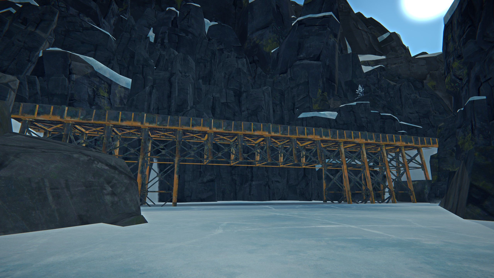

# Bridge

**Categories:** DLC Content, Locations, Locations in Anna Island -- Track Section 1, Outdoor locations · **Source:** [Fandom](https://thelongdark.fandom.com/wiki/Bridge)

**DLC-Exclusive content.** This content requires the [Iron Road](./Iron%20Road.md) addon to be installed before it can be seen or used in regular gameplay.

 **Bridge**   250px\]\] **Location**  Region [Anna Island -- Track Section 1](./Anna%20Island%20--%20Track%20Section%201.md)\\|- Location **Description:** A small trestle bridge. **General** Has no shelter\ **Bridge** is a location in [Anna Island -- Track Section 1](./Anna%20Island%20--%20Track%20Section%201.md).

## Overview

A small train bridge in the region, the area has nothing of note other being a simple pass over location.

A small path can be found on either side of the bridge that leads to a cliffside overlooking the bridge, but no loot spawns there if the player travels on foot up there.
