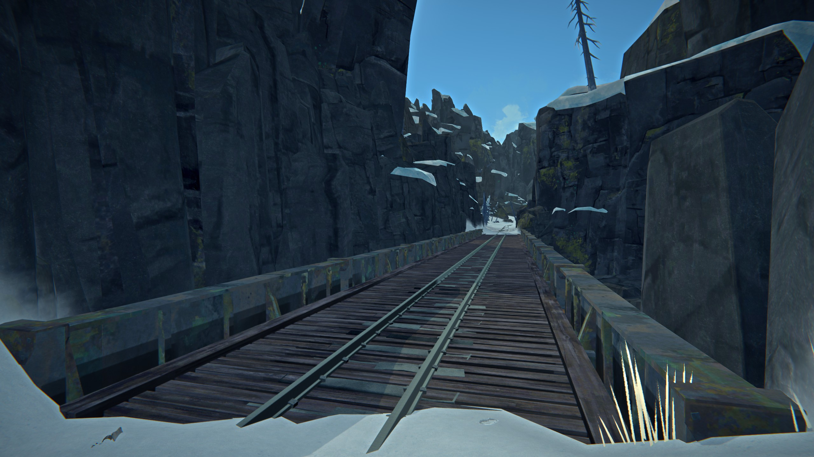

# Bridge

**Categories:** DLC Content, Locations, Locations in Anna Island -- Track Section 1, Outdoor locations · **Source:** [Fandom](https://thelongdark.fandom.com/wiki/Bridge)

_Seal\_icon.png_

**DLC-Exclusive content.** / This content requires the [Iron Road](./Iron%20Road.md) addon to be installed before it can be seen or used in regular gameplay.

\[\[File: /  / _The Bridge_ /  / _As seen from the ocean_

250px\]\]

_The Bridge_

_As seen from the ocean_

**Location**

_Bridge\_Track\_Section\_1\_Location.png_

Region

[Anna Island -- Track Section 1](./Anna%20Island%20--%20Track%20Section%201.md)\|-

Location

**Description:** A small trestle bridge.

**General**
