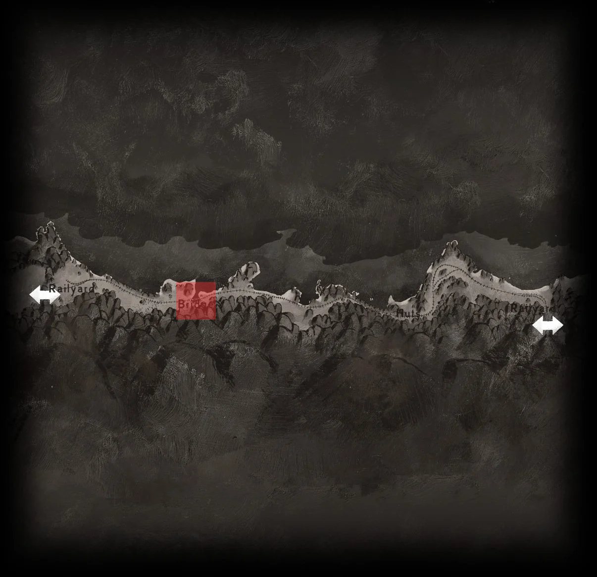

# Bridge

| Column 1 | Column 2 | Column 3 |
| --- | --- | --- |
|  / *Seal\_icon.png* | **DLC-Exclusive content.** / This content requires the [Iron Road](./Iron%20Road.md) addon to be installed before it can be seen or used in regular gameplay. | \|} / **Bridge** / \| Property \| Details \| / \| --- \| --- \| / \| \[\[File: / \\|  / *The Bridge* \\|  / *As seen from the ocean* \\| / \\| --- \\| --- \\| \| 250px\]\] \| / \|  / *The Bridge* \|  / *As seen from the ocean* \| / \| **Location** \|  \| / \|  / *Bridge\_Track\_Section\_1\_Location.png* \|  \| / \| Region \| [Anna Island -- Track Section 1](./Anna%20Island%20--%20Track%20Section%201.md)\\|- / Location \| / \| Description \| A small trestle bridge. \| / \| **General** \|  \| / \|  \| Has no shelter\\|} **Bridge** is a location in [Anna Island -- Track Section 1](./Anna%20Island%20--%20Track%20Section%201.md). / ## Overview / A small train bridge in the region, the area has nothing of note other being a simple pass over location. / A small path can be found on either side of the bridge that leads to a cliffside overlooking the bridge, but no loot spawns there if the player travels on foot up there. / The bridge is rusty orange, similar to the one in [Anna Island -- Track Section 6](./Anna%20Island%20--%20Track%20Section%206.md).**Lua execution error in Module:Navbox function navbox** \| |
| \[\[File: / \|  / *The Bridge* \|  / *As seen from the ocean* \| / \| --- \| --- \| | 250px\]\] |  |
|  / *The Bridge* |  / *As seen from the ocean* |  |
| **Location** |  |  |
|  / *Bridge\_Track\_Section\_1\_Location.png* |  |  |
| Region | [Anna Island -- Track Section 1](./Anna%20Island%20--%20Track%20Section%201.md)\|- | Location |
| Description | A small trestle bridge. |  |
| **General** |  |  |
|  | Has no shelter\|} **Bridge** is a location in [Anna Island -- Track Section 1](./Anna%20Island%20--%20Track%20Section%201.md). / ## Overview / A small train bridge in the region, the area has nothing of note other being a simple pass over location. / A small path can be found on either side of the bridge that leads to a cliffside overlooking the bridge, but no loot spawns there if the player travels on foot up there. / The bridge is rusty orange, similar to the one in [Anna Island -- Track Section 6](./Anna%20Island%20--%20Track%20Section%206.md).**Lua execution error in Module:Navbox function navbox** |  |
