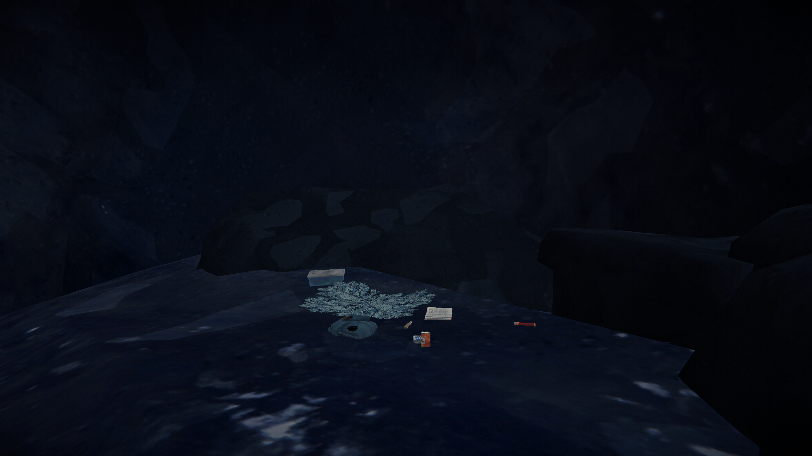

# Brittle Cave

**Categories:** Caves, Locations, Locations in Forsaken Airfield, Sheltered locations · **Source:** [Fandom](https://thelongdark.fandom.com/wiki/Brittle_Cave)

**Brittle Cave**

| Property | Details |
| --- | --- |
|  | [Brittle Cave Outside](../assets/Brittle_Cave_Outside.png) |
| **Location** |  |
|  | [Brittle Cave Location](../assets/Brittle_Cave_Location.png) |
| Region | [Forsaken Airfield](./Forsaken%20Airfield.md) |
| Location | East of Drift island next to the waterfall |
| Description | A cave |
| **General** |  |
| Type | Cave |
| [Bed icon](../assets/Bed_icon.png) | Has a bed |
|  | Provides some shelter |

**Brittle Cave** is a cave found in [Forsaken Airfield](./Forsaken%20Airfield.md) in the north eastern most section of the map.

## Overview

It is a small cave located a short walk east of [Drift Island](./Drift%20Island.md) next to an unnamed waterfall. It has a tuffet [Bed](./Bed.md) and spawns decent loot, such as a [Mackinaw Jacket](./Mackinaw%20Jacket.md), [Expedition Parka](./Expedition%20Parka.md), a [Prybar](./Prybar.md), [flares](./Flare.md) and food. The cave is also a source of [Coal](./Coal.md).

A wolf patrols the area outside the cave. _The inside of Brittle Cave_
