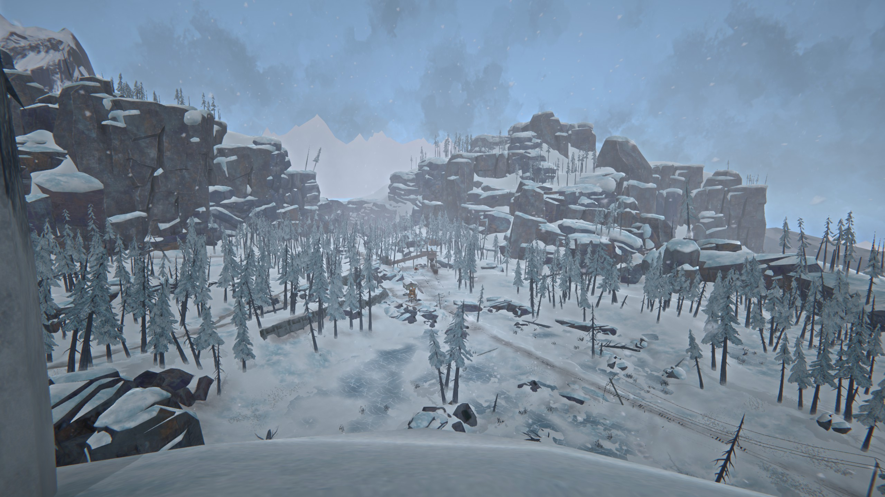

# Broad Aerie

**Broad Aerie**

| Property | Details |
| --- | --- |
|  |  / *Broad\_Aerie.jpg* |
| **Location** |  |
|  |  / *Broad\_Aerie\_Location.png* |
| Region | [Transfer Pass](./Transfer%20Pass.md)\|- |
| **General** |  |
|  | Has no shelter\|} / **Broad Aerie** is an unmarked location overlooking the [Loitering Marsh](./Loitering%20Marsh.md) in [Transfer Pass](./Transfer%20Pass.md). It can be reached by walking towards the connection to [Forsaken Airfield](./Forsaken%20Airfield.md), then taking a left near the blue [Truck](./Truck.md) up a path overlooking a cliffside. There is no shelter nearby aside from the Truck. A rabbit grove is nearby, as well as a few [Rose Hip](./Rose%20Hip.md) bushes and some [Old Man's Beard Lichen](./Old%20Man%27s%20Beard%20Lichen.md). / **Lua execution error in Module:Navbox function navbox** [ru:Большое гнездо](ru:%D0%91%D0%BE%D0%BB%D1%8C%D1%88%D0%BE%D0%B5_%D0%B3%D0%BD%D0%B5%D0%B7%D0%B4%D0%BE) |
